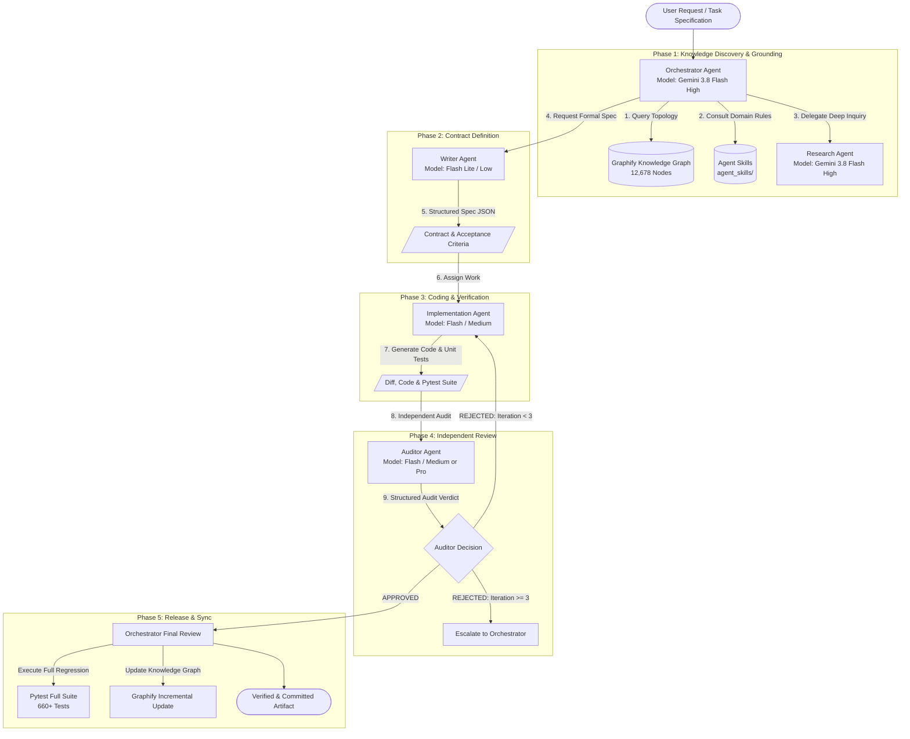
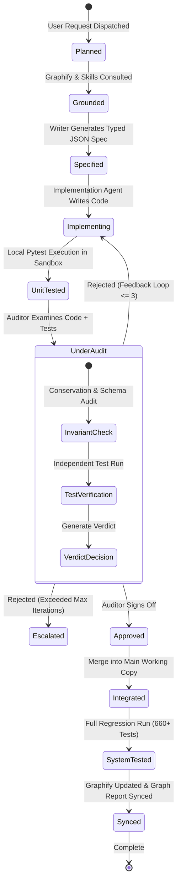

# SALTBOR MULTI-AGENT DEVELOPMENT ORCHESTRATION ARCHITECTURE

## System Overview & Design Principles

This document establishes the architecture for hierarchical, cost-aware, multi-agent development orchestration within the **SALTBOR** project, utilizing the native orchestration runtime of **Antigravity**.

The architecture addresses three critical engineering objectives:
1. **Dynamic Model Routing by Task Complexity**: Preventing token waste by reserving high-reasoning models exclusively for strategic and critical decisions while routine coding, testing, documentation, and data formatting are handled by cost-effective tiers.
2. **Deterministic, Closed-Loop Quality Assurance**: Eliminating self-audit bias by segregating implementation from auditing, enforcing strict structured contracts, and running iterative review-and-fix loops with hard termination bounds.
3. **Seamless Integration with the SALTBOR Ecosystem**: Integrating with local Graphify knowledge graphs, domain-specific Agent Skills, SQLite WAL persistence, deterministic Pytest suites, and absolute conservation laws.

---

## 1. Native vs. Custom Orchestration Capabilities

Antigravity provides powerful built-in orchestration primitives. To maintain architectural continuity and avoid redundant code, the system directly utilizes native features while structuring custom logic around SALTBOR-specific policies:

| Layer / Capability | Native Antigravity Feature | Custom Implementation in SALTBOR |
| :--- | :--- | :--- |
| **Workflow Engine** | Dynamic Workflows (`run_workflow` tool, Python runtime, `agent()`, `parallel()`, `pipeline()`) | Domain-specific workflow templates (`orchestration/workflows/`), task decoders, and structured result handlers. |
| **Model Selection** | Multi-tier model routing: `"flash_lite"`, `"flash"`, `"inherit"` (Gemini 3.8 Flash High); in Swarm: `gemini-3.8-flash-low`, `medium`, `high`. *(Note: `pro` is strictly excluded).* | Complexity classification matrix, automatic escalation policies, and token-cost tracking decorators. |
| **Resource & Timeout Governance** | `with_budget(awaitable, max_tokens, max_agents, max_seconds)`, `tokens_used()`. | Per-task budget quotas, iteration counters (`max_iterations = 3`), and quota failure fallbacks. |
| **Workspace Isolation** | Workspace modes: `"inherit"` (shared context), `"branch"` (isolated clone), `"share"` (worktree). | Branch lifecycle management, git merge validation, and concurrent edit conflict prevention. |
| **Structured Output Enforcing** | JSON Schema validation via agent `finish` tool. | Pydantic v2 schemas for all inter-agent messages (`schemas.py`), audit reports, and implementation diffs. |
| **Knowledge & Context Graph** | Native tool calls and conversational trajectory mining (`trajectory()`). | Bidirectional integration with `graphify` (`graph.json`, 12,400+ nodes) and `agent_skills/` routing tables. |

---

## 2. Multi-Agent Hierarchy & Topology

The multi-agent system is organized as a hierarchical state machine orchestrated by a central coordinator, with specialized functional agents operating under strict least-privilege principles.



---

## 3. Logical Agent Roles

Detailed specifications for each role are maintained in [AGENT_ROLE_REGISTRY.md](file:///c:/GIT%20HUB/sv%20people/AGENT_ROLE_REGISTRY.md).

> [!NOTE]
> **Directiva de Exclusión de `pro`**: El tier `pro` ha sido excluido de la arquitectura debido a que su capacidad de razonamiento y latencia es marcadamente inferior a **Gemini 3.8 Flash (High)**. El razonamiento profundo se ejecuta con `inherit` o `gemini-3.8-flash-high`.

1. **Orchestrator Agent**:
   - **Model**: `inherit` (Gemini 3.8 Flash High) / `gemini-3.8-flash-high` (Swarm).
   - **Scope**: Task decomposition, agent instantiation, acceptance criteria synthesis, conflict arbitration, regression gatekeeping, workflow termination.
2. **Writer Agent**:
   - **Model**: `flash_lite` (Dynamic Workflow) / `gemini-3.8-flash-low` (Swarm).
   - **Scope**: Technical specifications, Markdown documentation, docstrings, schema normalization, changelogs.
   - **Boundary**: Strict read/write sandboxing. Zero permission to modify engine logic or accounting equations.
3. **Implementation Agent**:
   - **Model**: `flash` (Dynamic Workflow) / `gemini-3.8-flash-medium` (Swarm).
   - **Scope**: Routine programming, refactoring, unit test authoring, bug fixes, module wiring.
   - **Boundary**: Operates in dedicated workspace (`"branch"` or `"share"`) when executing parallel tasks.
4. **Research Agent**:
   - **Model**: `inherit` (Gemini 3.8 Flash High) / `gemini-3.8-flash-high` (Swarm).
   - **Scope**: Literature synthesis, algorithm comparative analysis, complex state-flow reasoning, external repository evaluation.
5. **Auditor Agent**:
   - **Model**: `flash` (standard) / `inherit` (Gemini 3.8 Flash High for conservation laws or database schema migrations).
   - **Scope**: Independent code audit, edge-case detection, conservation invariant checking, test execution verification.
   - **Boundary**: Read-only access to codebase; execution access to pytest. Prohibited from editing production code directly to maintain audit purity.

---

## 4. Architectural State Flow

The execution cycle enforces that **Implementation**, **Integration**, and **Testing** are mathematically and procedurally distinct states:



---

## 5. SALTBOR Ecosystem Integration

### 5.1 Graphify Knowledge Graph Integration
- **Pre-Execution**: Before initiating code modifications, the Orchestrator or Implementer queries the graph:
  ```powershell
  python -m graphify query "<subsystem or feature name>"
  ```
  This surfaces the cluster community, imported types, dependent modules, and direct callers across the 12,424-node graph.
- **Post-Execution**: Once changes pass audit and regression, Graphify is updated:
  ```powershell
  python -m graphify update .
  ```
  Ensuring the `.graphify_root`, `graph.json`, and `GRAPH_REPORT.md` remain in exact synchronization with the codebase.

### 5.2 Agent Skills Routing
Agents route their technical queries through the skills catalog defined in `agent_skills/` and summarized in `AGENTS.md`. The newly installed [agent_skills/orchestration/SKILL.md](file:///c:/GIT%20HUB/sv%20people/agent_skills/orchestration/SKILL.md) governs the orchestration mechanics.

### 5.3 Accounting & Conservation Invariant Enforcement
All financial transactions in SALTBOR must satisfy:
$$\sum_{i} \Delta \text{Balance}_i + \Delta \text{Treasury} = 0$$
The Auditor specifically inspects that no newly implemented engine creates currency or material assets without an explicit offsetting debit.

---

## 6. Security Boundaries & Failure Isolation

1. **No Destructive Overwrites**: File editing is mediated through validated diffs or atomic replacements.
2. **Deterministic Seeds**: All simulation tests executed by agents must specify fixed random seeds (`random_seed=42`).
3. **Execution Sandboxing**: Agents running automated tests operate on temporary in-memory databases (`:memory:`) or transient scratch files that are cleaned up upon task completion.
4. **Offline Isolation**: No agent may introduce external network calls, remote API endpoints, or unvetted third-party packages into the SALTBOR simulation runtime.
