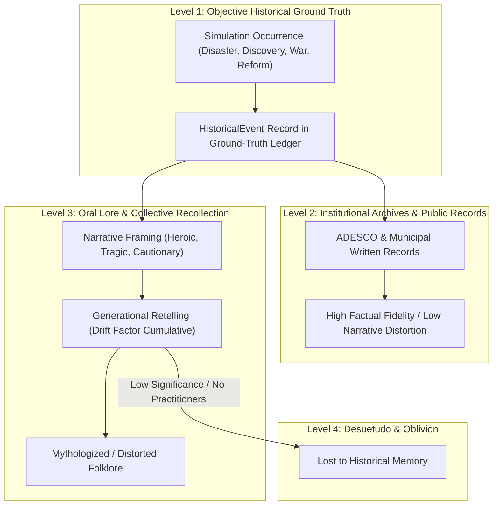

# CIVILIZATIONAL MEMORY MODEL (PHASE 1.11)
## Historical Continuity, Ground-Truth Event Logging, Consequence-Derived Significance, Narrative Drift, and Causal Reconstruction

**System**: SALTBOR Synthetic-Human Society Simulation Platform  
**Subsystem**: Historical Memory Core (`saltbor.civilization.history`)  
**Language / Environment**: Python 3.12–3.14 (Validated on Python 3.14.5, Windows 11)  
**Status**: ACTIVE PRODUCTION SPECIFICATION  

---

### 1. Executive Summary

History in SALTBOR is not a global database that every agent accesses with omniscient precision. The `HistoricalMemoryEngine` [history.py](file:///c:/GIT%20HUB/sv%20people/saltbor/civilization/history.py) fundamentally separates **what actually occurred** (objective ground-truth events) from **what was remembered, distorted, or forgotten** by successive generations of human inhabitants.

Events that leave negligible lasting consequences fade into obscurity. Conversely, events that trigger cascading socio-economic, environmental, or political crises acquire profound historical significance and are transmitted across generations via oral tradition, community narratives, and institutional archives.

---

### 2. Multi-Tier Historical Architecture



---

### 3. Historical Event Taxonomy and Data Schema

Events are categorized into 12 standard civilizational domains:

```python
class HistoricalCategory(str, Enum):
    NATURAL_DISASTER = "natural_disaster"          # Earthquakes, floods, volcanic eruptions, droughts
    WAR_CONFLICT = "war_conflict"                  # Inter-community or civil disputes
    EPIDEMIC = "epidemic"                          # Communicable disease outbreaks
    ECONOMIC_CRISIS = "economic_crisis"            # Commercial collapse, hyper-indebtedness
    TECHNOLOGICAL_DISCOVERY = "technological"      # Innovation breakthrough
    MIGRATION = "migration"                        # Mass exodus or settlement founding
    POLITICAL_TRANSFORMATION = "political"         # Municipal or leadership change
    INSTITUTIONAL = "institutional"                # ADESCO rule amendment or formalization
    CULTURAL_CHANGE = "cultural"                   # Adoption of new religious or folk tradition
    INFRASTRUCTURE_PROJECT = "infrastructure"      # Major road, bridge, or water system
    ENVIRONMENTAL_DEGRADATION = "environmental"    # Water depletion, severe erosion
    ORGANIZATION_CHANGE = "organization"           # Cooperative founding, business union
```

#### Historical Event Data Schema

```python
@dataclass
class HistoricalEvent:
    event_id: str
    category: HistoricalCategory
    tick: Tick
    year: float
    location: str
    actors: List[str]
    title: str
    description: str
    significance: float = 0.5                      # 0.0 to 1.0 (dynamically updated)
    causes: List[str] = field(default_factory=list)
    consequences: List[str] = field(default_factory=list)
    related_event_ids: List[str] = field(default_factory=list)
    evidence_level: float = 1.0                    # Ground truth = 1.0
```

---

### 4. Consequence-Derived Historical Significance

Historical significance is **never arbitrarily assigned** at the moment an event occurs. An event is retroactively assigned significance based on the scale and longevity of its observable consequences:

$$\mathcal{S} = \min\left(1.0, 0.20 + 0.15 \cdot N_{\text{consequences}} + 0.25 \cdot \text{CasualtiesRatio} + 0.20 \cdot \Delta \text{GDP}_{\text{impact}}\right)$$

If an event produces cascading consequences across multiple subsequent years (e.g. drought leading to crop failure $\rightarrow$ enterprise bankruptcy $\rightarrow$ mass migration), its significance approaches $1.0$. If an event produces zero downstream consequences, its significance remains below $0.25$ and it is rapidly omitted from collective memory.

---

### 5. Narrative Framing, Retelling, and Narrative Drift

When human communities form collective recollections, events are framed into narrative genres:
- `HEROIC`: Celebrates human leadership, community perseverance, and institutional triumph.
- `TRAGIC`: Focuses on grief, loss of life, and unmitigated devastation.
- `CAUTIONARY`: Moralistic lore warning against violating social norms or over-extracting natural resources.
- `MATTER_OF_FACT`: Plain chronological description without affective embellishment.

#### The Generational Drift Function

Every time an oral narrative is transmitted across generations, factual fidelity decays:

$$\Delta \text{Drift} = \delta_{\text{loss}} \cdot (1.0 - \text{Drift})$$

$$\text{Factual Accuracy} = 1.0 - \text{Drift}$$

After three or four generational retellings without written records, specific factual details (exact monetary costs, dates, and actor names) are blurred or exaggerated, while the central emotional framing persists as folklore.

---

### 6. Bidirectional Historical Causal Reconstruction

SALTBOR preserves an explicit directed acyclic graph (DAG) of causal links connecting historical events:

$$\mathcal{G}_{\text{history}} = (\mathcal{V}_{\text{events}}, \mathcal{E}_{\text{causal}})$$

Where each directed edge $(u \rightarrow v) \in \mathcal{E}$ represents a causal link with an explanatory tag (e.g., `reduccion_riego`, `desempleo_agricola`, `demanda_social`).

#### 6.1 Forward Causal Cascades (`reconstruct_causal_sequence`)
Starting from any root trigger event $e_0$ (e.g., a catastrophic volcanic eruption or river drought), the engine traverses forward BFS edges to reconstruct the entire downstream cascade of consequences:

$$e_0 \xrightarrow{\text{sequia}} e_1 \xrightarrow{\text{perdida}} e_2 \xrightarrow{\text{exodo}} e_3 \xrightarrow{\text{reforma}} e_4$$

#### 6.2 Backward Antecedent Tracing (`trace_antecedents`)
Starting from any terminal event $e_n$ (e.g., a sudden municipal tax reform or institutional revolt), the engine traverses backward edges to identify the historical root cause that set the sequence in motion.

This causal traceability allows scientific observers and researchers to prove that historical trajectories are structurally grounded rather than random noise.
