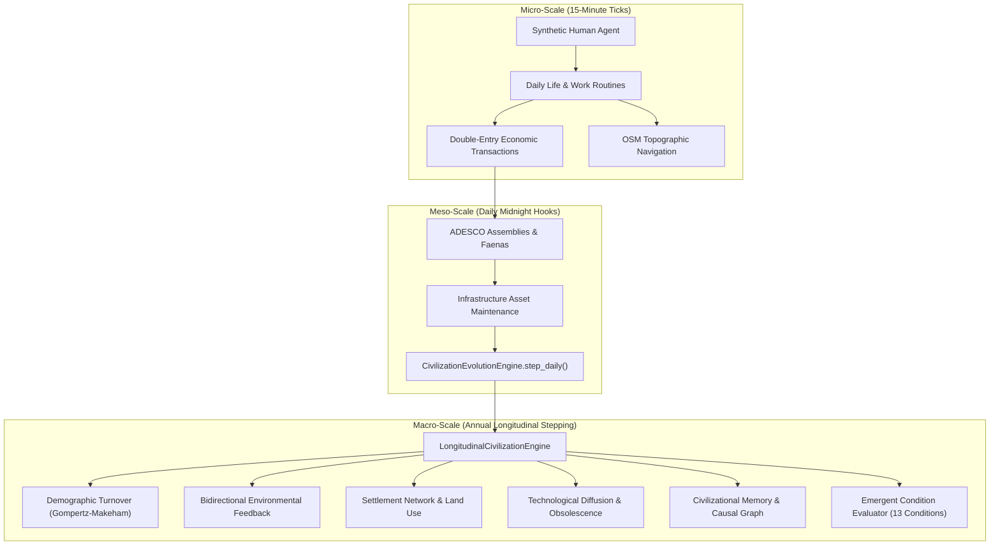

# CIVILIZATION EVOLUTION ARCHITECTURE (PHASE 1.11)
## Multi-Scale, Longitudinal Simulation and Emergent Macro-Dynamics

**System**: SALTBOR Synthetic-Human Society Simulation Platform  
**Subsystem**: Civilization Evolution Core (`saltbor.civilization`)  
**Language / Environment**: Python 3.12–3.14 (Validated on Python 3.14.5, Windows 11)  
**Status**: ACTIVE PRODUCTION SPECIFICATION  

---

### 1. Executive Summary and Architectural Mission

SALTBOR Phase 1.11 elevates the simulation platform from an integrated daily synthetic-human simulator into a scientifically observable, long-running civilization simulator spanning 10 to 200 simulated solar years. The foundational mandate of this architecture is **anti-teleological emergence**: historical trajectories must never follow predefined stages, scripted milestones, or teleological narratives. Instead, the macro-state of human civilization—its growth, prosperity, stagnation, fragmentation, crisis, decline, and potential recovery or disappearance—arises endogenously from the micro-foundations of autonomous human agents interacting within physical, social, economic, technological, and environmental constraints.

Architectural continuity is rigorously maintained. Rather than replacing the existing high-fidelity micro-engines (cognitive appraisal, daily routines, social networks, geospatial topography, and double-entry economics), the Phase 1.11 civilization architecture implements a decoupled **multi-scale temporal hierarchy**:
1. **Micro-Scale (15-Minute Ticks)**: Resolves individual perception, emotional valence, physical metabolism, spatial movement along Salvadoran road networks, and interpersonal transactions.
2. **Meso-Scale (Daily Cycles)**: Resolves household budgets, community assembly votes, market clearing, and ADESCO faena labor coordination.
3. **Macro-Scale (Annual Solar Stepping)**: Resolves demographic replacement, Gompertz-Makeham mortality cohorts, intergenerational probate, innovation diffusion/loss, environmental feedback loops, and settlement network restructuring.



---

### 2. Core Architectural Components

The civilization subsystem is encapsulated in `saltbor/civilization/` and coordinates eight primary domain engines without creating redundant duplicate subsystems:

| Engine | Canonical Module | Core Responsibility |
| :--- | :--- | :--- |
| `CivilizationEvolutionEngine` | [engine.py](file:///c:/GIT%20HUB/sv%20people/saltbor/civilization/engine.py) | Central coordinator; maintains `CivilizationState`, evaluates emergent analytical conditions, and computes 12-dimensional identity vectors. |
| `LongitudinalCivilizationEngine` | [longitudinal.py](file:///c:/GIT%20HUB/sv%20people/saltbor/civilization/longitudinal.py) | High-speed multi-scale runner; executes 10–200 year horizons with Gompertz-Makeham mortality and dynamic carrying capacity. |
| `SettlementEvolutionEngine` | [settlement.py](file:///c:/GIT%20HUB/sv%20people/saltbor/civilization/settlement.py) | Settlement founding, growth, land-use zoning, infrastructure asset degradation, and abandonment. |
| `MultiGenerationalEngine` | [multigenerational.py](file:///c:/GIT%20HUB/sv%20people/saltbor/civilization/multigenerational.py) | Family lineages, genealogical trees, probate with exact conservation, and mentor-learner knowledge drift. |
| `HistoricalMemoryEngine` | [history.py](file:///c:/GIT%20HUB/sv%20people/saltbor/civilization/history.py) | Ground-truth event logging, consequence-weighted significance, oral narrative drift, and bidirectional causal tracing. |
| `EconomicCivilizationEngine` | [economy.py](file:///c:/GIT%20HUB/sv%20people/saltbor/civilization/economy.py) | Multi-sector production (8 sectors), enterprise solvency, endogenous crises, and Gini/Palma inequality tracking. |
| `TechnologyEvolutionEngine` | [technology.py](file:///c:/GIT%20HUB/sv%20people/saltbor/civilization/technology.py) | Innovation concepts across 6 domains, diffusion rates, material prerequisites, failure tracking, and knowledge loss/recovery. |
| `CivilizationResilienceEngine` | [resilience.py](file:///c:/GIT%20HUB/sv%20people/saltbor/civilization/resilience.py) | Crisis absorption, adaptation strategies, and bidirectional population-ecosystem environmental feedback. |

---

### 3. Emergent Civilization Conditions and State Space

Macro-conditions are **analytical descriptions derived from observable variables**, never hardcoded state-machine stages. A civilization may exhibit multiple conditions simultaneously (e.g., experiencing `ECONOMIC_GROWTH` alongside `ENVIRONMENTAL_CRISIS` and `RISING_INEQUALITY`).

```python
class CivilizationCondition(str, Enum):
    GROWTH = "growth"
    STABILITY = "stability"
    EXPANSION = "expansion"
    FRAGMENTATION = "fragmentation"
    ADAPTATION = "adaptation"
    CRISIS = "crisis"
    DECLINE = "decline"
    RECOVERY = "recovery"
    TRANSFORMATION = "transformation"
    STAGNATION = "stagnation"
    MIGRATION = "migration"
    LOSS_OF_KNOWLEDGE = "loss_of_knowledge"
    DEPOPULATION = "depopulation"
```

#### Analytical Condition Derivation Rules

The condition evaluator calculates active conditions by inspecting multi-dimensional metrics:
1. **Growth**: Derives when 5-year annualized population growth exceeds $+1.5\%$ and GDP production exhibits positive velocity.
2. **Expansion**: Derives when population growth is positive and more than one distinct settlement is actively populated ($N_{\text{settlements}} \ge 2$).
3. **Stability**: Derives when population volatility is under $1.5\%$, ecological stress $< 0.40$, and social cohesion index $> 0.50$.
4. **Stagnation**: Derives when economic output and technological count show zero or negative delta over 5 consecutive cycles despite positive population.
5. **Fragmentation**: Derives when social cohesion index falls below $0.40$ and inter-settlement trade or institutional ties collapse.
6. **Crisis**: Derives when active unresolved crises exist or ecological stress exceeds $0.70$ or wealth Gini $> 0.65$.
7. **Decline**: Derives when annualized population decline exceeds $-2.0\%$ and active enterprises experience net negative solvency.
8. **Depopulation**: Derives when active living population drops below $50\%$ of peak historic population.
9. **Recovery**: Derives when positive population and GDP growth resume following a recorded crisis or decline state.
10. **Loss of Knowledge**: Derives when the count of active known technologies decreases due to practitioner mortality.
11. **Transformation**: Derives when the leading economic sector shifts (e.g. agrarian $\rightarrow$ commercial/artisanal) or dominant institutional charters undergo major amendment.

---

### 4. Mathematical Model of Longitudinal Demographics

Demographic progression is governed by the classical **Gompertz-Makeham law of mortality**, modulated by environmental carrying capacity and ecological stress:

$$\mu(x) = \left( A + B e^{C x} \right) \cdot \Omega_{\text{overcrowding}} \cdot \left( 1 + \gamma \cdot \sigma_{\text{eco}} \right)$$

Where:
- $x$: Age of the individual in solar years.
- $A = 0.004$: Makeham baseline accident/environmental mortality rate.
- $B = 0.00014$: Gompertz initial biological mortality coefficient.
- $C = 0.082$: Gompertz rate of senescence acceleration.
- $\Omega_{\text{overcrowding}} = \max\left(1.0, \frac{N_{\text{living}}}{K_{\text{effective}}}\right)$: Overcrowding penalty scaling with effective settlement carrying capacity.
- $\sigma_{\text{eco}} \in [0.0, 1.0]$: Aggregate ecological stress derived from soil degradation and water depletion.
- $\gamma = 0.60$: Mortality sensitivity factor to environmental collapse.

#### Effective Carrying Capacity

Carrying capacity is dynamic and reflects infrastructure integrity and natural endowments:

$$K_{\text{effective}} = \sum_{s \in \mathcal{S}} K_s^{\text{base}} \cdot \left( 0.20 + 0.80 \cdot \min\left(1.0, W_s + F_s\right) \right)$$

Where $W_s$ is water table access ($0.0$ to $1.0$) and $F_s$ is topsoil fertility ($0.0$ to $1.0$).

---

### 5. Architectural Continuity & Integration with SimulationRunner

The master runner [runner.py](file:///c:/GIT%20HUB/sv%20people/saltbor/simulation/runner.py) seamlessly links the high-resolution tick loop with the longitudinal civilization engine:
- **Daily Midnight Hook**: At tick modulo 96 (midnight in 15-minute resolution), `SimulationRunner` invokes:
  ```python
  self.civilization.step_daily(
      current_tick=self.clock.current_tick,
      active_humans=self.population.get_all(),
      active_businesses=self.businesses.get_all(),
      active_communities=self.community_engine.get_all_communities(),
  )
  ```
- **Longitudinal Run Hook**: Exposes `run_longitudinal(years=N)` directly on `SimulationRunner`, allowing callers to advance simulated time across multi-generational spans in milliseconds while preserving complete state consistency.

---

### 6. Architectural Invariants

Every subsystem in the Phase 1.11 civilization architecture strictly obeys the core operational directives:
1. **Accounting Conservation ($\Delta \text{Wealth} = 0$)**: In every probate distribution, inheritance transfer, wage disbursement, or enterprise liquidation, all funds originate from a verified debtor and terminate in a verified creditor. No fiat creation or destruction.
2. **Local and Offline Execution**: Pure Python and NumPy computation without external network calls, cloud LLMs, or remote services.
3. **Deterministic Reproducibility**: Seeded with explicit random generators (`np.random.default_rng(seed)`), guaranteeing byte-for-byte identical outcomes given identical seeds.
