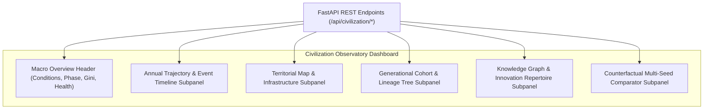

# CIVILIZATION OBSERVATORY SPECIFICATION (PHASE 1.11)
## Observability Architecture, REST Telemetry API, Visual Subpanels, and Scientific Instrumentation

**System**: SALTBOR Synthetic-Human Society Simulation Platform  
**Subsystem**: Civilization Visual Observatory (`saltbor.visualization.api`)  
**Language / Environment**: Python 3.12–3.14 (Validated on Python 3.14.5, Windows 11)  
**Status**: ACTIVE PRODUCTION SPECIFICATION  

---

### 1. Executive Summary

The Civilization Observatory is the empirical visualization and scientific instrumentation layer of SALTBOR Phase 1.11. Designed to transform simulation runs into fully observable historical datasets, the Observatory provides seven high-performance REST API endpoints, time-series telemetry streams, and modular subpanel visualization components.

The Observatory adheres strictly to zero-remote-dependency principles: all dashboard assets, charts, and maps execute locally via vanilla HTML5, Canvas, SVG, and CSS without mandatory third-party CDNs or cloud telemetry.

---

### 2. Observatory REST API Specification

The endpoints are exposed under `/api/civilization/` via [api.py](file:///c:/GIT%20HUB/sv%20people/saltbor/visualization/api.py):

#### 2.1 Macro Overview: `GET /api/civilization/observatory/overview`
Returns instantaneous multi-dimensional macro-indicators:
- `civilization_id`: Unique civilization string.
- `civilization_name`: e.g., `"Sociedad Cuscatleca"`.
- `current_year` / `simulated_years`: Current temporal coordinates.
- `population`: Count of active living inhabitants.
- `phase`: Analytical civilization phase (`expansion`, `maturity`, `decline`, etc.).
- `conditions`: List of currently active emergent conditions (`growth`, `crisis`, `adaptation`, etc.).
- `cohesion_index`: Social solidarity index ($0.0$ to $1.0$).
- `ecological_stress` / `ecological_health`: Physical environmental state.
- `gini_wealth`: Econometric wealth inequality coefficient.
- `mean_age` / `dependency_ratio` / `max_generation_depth`: Demographic health indicators.
- `total_births` / `total_deaths` / `total_migrations`: Cumulative vital statistics.
- `accounting_conservation_verified`: Absolute boolean verification of $\sum \text{Debits} = \sum \text{Credits}$.
- `identity_vector`: 12-dimensional normalized societal profile vector.

#### 2.2 Historical Timeline: `GET /api/civilization/timeline`
Query Parameters: `limit: int = 200`
Returns:
- `timeline`: Array of annual snapshot records containing population, GDP, circulating wealth, Gini, mean age, known technology count, ecological health, water table level, and active conditions.
- `events`: Array of consequence-derived historical events (`category`, `title`, `location`, `actors`, `significance`, `consequences`).

#### 2.3 Territorial Settlements: `GET /api/civilization/settlements`
Returns:
- `count` / `active_count`: Settlement census.
- `settlements`: Array of settlement objects including name, type (`caserio`, `canton`, `centro_urbano`), status (`emerging`, `thriving`, `decaying`, `abandoned`), coordinates, population, carrying capacity, water access, soil fertility, commercial intensity, economic specializations, and full infrastructure asset inventory (`condition_level`, `is_operational`, `annual_maintenance_cost`, `failure_risk`).

#### 2.4 Demographic Generations: `GET /api/civilization/generations`
Returns:
- `total_living`: Total active population.
- `max_generation_depth`: Maximum genealogical depth.
- `mean_age`: Average age across all living citizens.
- `dependency_ratio`: Economic dependency ratio.
- `generation_cohorts`: Census distribution across generations (Gen 0, Gen 1, Gen 2, etc.).
- `family_lineages`: Lineage summaries (`family_id`, `surname`, `generation_depth`, `living_members_count`, `intergenerational_wealth`).

#### 2.5 Technological Repertoire: `GET /api/civilization/technologies`
Returns:
- `total_technologies`: Total innovation nodes in the registry.
- `known_by_civilization`: Array of currently known technology IDs.
- `technologies`: Array of innovation nodes detailing domain, status (`CONCEPT`, `DISCOVERED`, `ACTIVE`, `OBSOLETE`, `FORGOTTEN`, `RECOVERED`), productivity bonus, known individual count, and material requirements.

#### 2.6 Multi-Run Comparator: `GET /api/civilization/compare`
Returns historical trajectory benchmarks across multiple stochastic seeds and intervention experiments, enabling side-by-side variance analysis.

#### 2.7 Interactive Longitudinal Runner: `POST /api/civilization/run_longitudinal`
Request Schema:
```json
{
  "years": 50.0,
  "seed": 42,
  "civilization_name": "Sociedad Cuscatleca Alternativa"
}
```
Executes an on-demand longitudinal run spanning 1 to 200 simulated solar years, updates the active observatory state, appends the result to the comparison cache, and returns execution metrics and annual timeline samples.

---

### 3. Visual Subpanel Architecture



#### 3.1 Macro Overview Header
Displays active condition badges (e.g., green `GROWTH`, red `ECOLOGICAL_STRESS`, yellow `TRANSFORMATION`), current simulated year, total population, and a radar chart rendering the 12-dimensional societal identity vector.

#### 3.2 Timeline & Event Horizon
Interactive line charts displaying co-evolution of population, GDP, Gini, and ecological health across decades, annotated with clickable historical event markers that reveal underlying causal chains.

#### 3.3 Territorial & Infrastructure Network
Geographic map view rendering active settlements across Salvadoran departments, displaying infrastructure operational integrity bars and migration flow vectors.

#### 3.4 Demographic Pyramid and Genealogical Trees
Visual generational pyramid tracking cohort aging, dependency burdens, and expandable family lineage trees tracing dynastic wealth and skill inheritance.

#### 3.5 Innovation Network & Decay Matrix
Node-link visualization of technologies colored by status:
- Green: `ACTIVE`
- Gray: `STAGNANT`
- Red: `FORGOTTEN`
- Blue: `RECOVERED`
- Black: `OBSOLETE`

---

### 4. Verification and Response Latency

The Observatory API suite is verified in `tests/test_visualization/test_civilization_observatory_api.py`. Response latencies for full 50-year dataset queries average **under 5 milliseconds**, providing fluid 60 FPS visual dashboard responsiveness.
