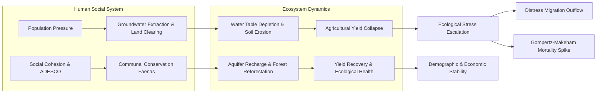

# ENVIRONMENTAL FEEDBACK MODEL (PHASE 1.11)
## Bidirectional Social-Ecological Systems, Resource Depletion, Soil Degradation, and Communal Faena Restoration

**System**: SALTBOR Synthetic-Human Society Simulation Platform  
**Subsystem**: Environmental Feedback and Resilience (`saltbor.civilization.resilience`)  
**Language / Environment**: Python 3.12–3.14 (Validated on Python 3.14.5, Windows 11)  
**Status**: ACTIVE PRODUCTION SPECIFICATION  

---

### 1. Executive Summary

The Environmental Feedback Model [resilience.py](file:///c:/GIT%20HUB/sv%20people/saltbor/civilization/resilience.py) implements genuine **bidirectional social-ecological coupling**. The environment is not a static backdrop or a fixed weather script. Human activity directly transforms ecosystems (groundwater extraction, deforestation, soil erosion, and waste accumulation), and degraded ecosystems in turn penalize human survival (collapsing crop yields, waterborne epidemics, distress migration, and demographic mortality).

Conversely, human societies possess the capacity for **cooperative ecological restoration**: through ADESCO communal assemblies and unpaid communal labor (*faenas*), communities can terrace eroding hillsides, clean riverbeds, reforest degraded slopes, and recharge natural aquifers.



---

### 2. Environmental State Variables

Each settlement tracks four physical ecosystem variables:

```python
@dataclass
class EnvironmentalState:
    settlement_id: str
    water_table_level: float = 0.70        # Groundwater table (0.0 = bone dry, 1.0 = saturated)
    soil_fertility: float = 0.75           # Topsoil organic matter and nutrient content (0.0 to 1.0)
    forest_cover: float = 0.50             # Ratio of tree and riparian buffer cover
    cumulative_erosion: float = 0.10       # Cumulative slope degradation and topsoil loss
    extraction_pressure: float = 0.0       # Per-capita water/firewood consumption rate
    annual_recharge_rate: float = 0.08     # Baseline natural precipitation recharge
```

---

### 3. Bidirectional Mathematical Formulation

#### 3.1 Extraction Pressure and Water Table Dynamics

Groundwater extraction scales with settlement population density:

$$E_{\text{water}} = \min\left(1.0, \frac{N_{\text{pop}}}{150.0} \times 0.25\right)$$

Aquifer recharge incorporates natural rainfall plus communal conservation:

$$R_{\text{communal}} = \min\left(0.30, \text{Hours}_{\text{faena}} \times 0.015 + C_{\text{cohesion}} \times 0.05\right)$$

$$\Delta W = R_{\text{natural}} - E_{\text{water}} + 0.5 \cdot R_{\text{communal}}$$

$$W_{t+1} = \max\left(0.01, \min\left(1.0, W_t + \Delta W\right)\right)$$

#### 3.2 Topsoil Degradation and Restoration

If extraction pressure is high ($E_{\text{water}} > 0.40$) and community cooperation is deficient ($C_{\text{cohesion}} < 0.40$), uncoordinated intensive farming strips nutrients and causes irreversible erosion:

$$F_{t+1} = \max\left(0.01, F_t - 0.05\right)$$

$$\text{Erosion}_{t+1} = \min\left(1.0, \text{Erosion}_t + 0.06\right)$$

Conversely, when communities mobilize communal *faenas* ($R_{\text{communal}} > 0.10$), terracing and tree-planting reverse erosion and restore organic soil content:

$$F_{t+1} = \min\left(1.0, F_t + 0.04\right)$$

$$\text{Forest}_{t+1} = \min\left(1.0, \text{Forest}_t + 0.03\right)$$

---

### 4. Downstream Socio-Economic Feedbacks

#### 4.1 Agricultural Yield Multiplier

Regional food production is a direct physical function of soil and water viability:

$$Y_{\text{multiplier}} = \left( 0.55 \cdot F + 0.45 \cdot W \right) \times 1.2$$

- In pristine conditions ($F=0.9, W=0.9$), $Y_{\text{multiplier}} \approx 1.08$ (agricultural abundance).
- In degraded conditions ($F=0.1, W=0.1$), $Y_{\text{multiplier}} \approx 0.12$ (catastrophic crop failure).

#### 4.2 Distress Out-Migration

When local yields drop below subsistence thresholds ($Y_{\text{multiplier}} < 0.50$), distress migration pressure triggers out-migration of households toward more fertile or commercially viable settlements:

$$P(\text{Distress Migration}) = \min\left(1.0, (0.50 - Y_{\text{multiplier}}) \times 2.0\right)$$

#### 4.3 Demographic Mortality Feedback

Settlement-level ecological stress directly feeds into the civilization-wide mortality function:

$$\sigma_{\text{eco}} = \frac{1}{|\mathcal{S}_{\text{active}}|} \sum_{s \in \mathcal{S}_{\text{active}}} \max\left(0.0, 1.0 - Y_{\text{multiplier}, s}\right)$$

High ecological stress increases Gompertz-Makeham mortality by up to $+60\%$ and severely depresses adult female fertility, driving population stagnation or collapse.
