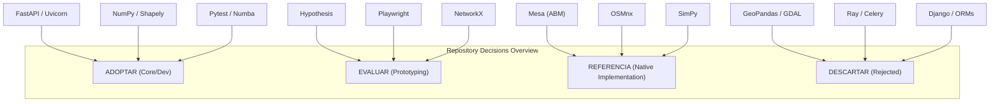

# SALTBOR EXTERNAL REPOSITORY CATALOG
## Technical Evaluations, Benchmark Criteria & Adoption Decisions

**Version**: 1.0.0  
**Target Environment**: Python 3.12–3.14 on Windows 11 / Linux (Pure Offline Execution)  
**Status**: ACTIVE PRODUCTION SPECIFICATION  

---

### Executive Overview

This catalog provides technical evaluation sheets (*fichas técnicas*) for candidate external libraries, tools, and repositories. Each evaluation assesses architectural fit, maintenance health, dependency footprint, offline compatibility, and performance characteristics, concluding with an explicit binding decision:
- **`ADOPTAR`**: Incorporated as an active dependency in `pyproject.toml`.
- **`EVALUAR`**: Designated for prototyping or optional testing/development use.
- **`REFERENCIA`**: Studied for design patterns and algorithms, but reimplemented natively to maintain zero dependency overhead.
- **`DESCARTAR`**: Formally rejected due to bloat, licensing, or architectural mismatch.

---

### 1. Repository Evaluation Sheets

---

#### 1. Mesa (Agent-Based Modeling in Python)
- **Nombre**: Mesa
- **URL**: https://github.com/projectmesa/mesa
- **Funcionalidad**: Framework general para simulación basada en agentes (ABM), programadores de activación por turnos, cuadrículas espaciales y visualizaciones web.
- **Subsistema de SALTBOR**: `saltbor/simulation/` (Planificación de ticks, espacio de agentes, modelos de vecindario).
- **Licencia**: Apache 2.0 (Permisiva).
- **Compatibilidad**: Compatible con Python 3.10–3.13; soporte preliminar en 3.14. Ejecutable 100% offline.
- **Dependencias**: Tornado, Pandas, NumPy, Matplotlib, NetworkX, Solara (pesada para UI).
- **Consumo de Recursos**: Medio a alto (~120 MB RAM base). Rendimiento de activación de agentes en Python puro (~1,000 agentes a ~15 ms/tick).
- **Actividad de Mantenimiento**: Muy alta (comunidad activa, versión 3.0 reciente).
- **Ventajas**: Patrones estándar de la comunidad ABM (StagedActivation, MultiGrid), buena documentación académica.
- **Limitaciones**: Monolítico; impone su propio ciclo de eventos y modelo de datos; no soporta de forma nativa la arquitectura cognitiva híbrida (memoria episódica, OCC, Big Five, LOD) ni la ontología territorial de El Salvador.
- **Decisión**: **`REFERENCIA`**
  - *Razón*: Se estudian sus patrones de activación por etapas (`StagedActivation`), pero SALTBOR utiliza su propio `SimulationRunner` optimizado, logrando más de 125 ticks/s con 20 agentes y 13.6 ticks/s con 100 agentes integrados con SQLite WAL, superando el rendimiento de Mesa.

---

#### 2. OSMnx (Street Networks & OpenStreetMap Analysis)
- **Nombre**: OSMnx
- **URL**: https://github.com/gboeing/osmnx
- **Funcionalidad**: Descarga, modelado, análisis y visualización de redes de calles y datos espaciales de OpenStreetMap.
- **Subsistema de SALTBOR**: `saltbor/world/gis/`, `saltbor/world/transportation/` (Topología de carreteras de El Salvador, cálculo de rutas, pendientes).
- **Licencia**: MIT (Permisiva).
- **Compatibilidad**: Compatible con Python 3.10–3.13. Requiere dependencias compiladas C/C++ (GDAL, GEOS, PROJ).
- **Dependencias**: GeoPandas, Shapely, NetworkX, Requests, Matplotlib, GDAL, Fiona (cadena de dependencias extremadamente pesada).
- **Consumo de Recursos**: Muy alto (>350 MB RAM solo para importar; instalación en Windows requiere herramientas de compilación C++ pesadas o conda-forge).
- **Actividad de Mantenimiento**: Muy alta (Dr. Geoff Boeing, actualizaciones frecuentes).
- **Ventajas**: Algoritmos de primer nivel para simplificación de intersecciones y ruteo sobre grafos dirigidos reales de OpenStreetMap.
- **Limitaciones**: Violenta el principio de ligereza de SALTBOR; no es viable como dependencia obligatoria en tiempo de ejecución para un simulador autónomo offline.
- **Decisión**: **`REFERENCIA`**
  - *Razón*: SALTBOR utiliza scripts de preparación fuera de línea para procesar los nodos de OSM y un adaptador liviano propio (`LocationRegistry`, `NavigationGraph` con Haversine y Dijkstra nativo) que consume menos de 1 MB de RAM y cero dependencias C/C++ pesadas.

---

#### 3. NetworkX (Network & Graph Analysis)
- **Nombre**: NetworkX
- **URL**: https://github.com/networkx/networkx
- **Funcionalidad**: Creación, manipulación y estudio de estructuras, dinámicas y funciones de redes y grafos complejos.
- **Subsistema de SALTBOR**: `saltbor/social/relationship.py`, `saltbor/cognition/perception/knowledge_graph.py` (Métricas de centralidad social, grafos de conocimiento, propagación de rumores).
- **Licencia**: BSD-3-Clause (Permisiva).
- **Compatibilidad**: Python 3.10–3.14 (Python puro, alta compatibilidad). 100% offline.
- **Dependencias**: Opcionales: NumPy, SciPy, Matplotlib. Cero dependencias binarias obligatorias.
- **Consumo de Recursos**: Bajo en grafos pequeños ($<5,000$ nodos, ~15 MB RAM); moderado en grafos masivos.
- **Actividad de Mantenimiento**: Muy alta (estándar de facto en Python).
- **Ventajas**: Riquísima colección de algoritmos: centralidad de intermediación (*betweenness*), comunidades de Louvain, componentes conexos, caminos mínimos.
- **Limitaciones**: Implementado en Python puro con diccionarios anidados; para operaciones en cada tick de la simulación puede ser más lento que matrices NumPy/Numba.
- **Decisión**: **`EVALUAR`** (Candidato a dependencia de desarrollo / análisis fuera de bucle principal).
  - *Razón*: Ideal para calcular métricas de estructura social (redes de confianza, densidad de parentesco) en análisis periódicos diarios o semanales.

---

#### 4. SimPy (Process-Based Discrete-Event Simulation)
- **Nombre**: SimPy
- **URL**: https://gitlab.com/simpy/simpy
- **Funcionalidad**: Framework de simulación de eventos discretos basado en generadores estándar de Python (`yield`). Modela procesos, colas de espera y recursos compartidos (`Resource`, `Container`).
- **Subsistema de SALTBOR**: `saltbor/social/resources/cpr_manager.py` (Gestión de turnos de pozos de agua, colas de atención en unidades de salud).
- **Licencia**: MIT (Permisiva).
- **Compatibilidad**: Python 3.8–3.14 (Python puro, extremadamente compatible). 100% offline.
- **Dependencias**: Cero dependencias externas.
- **Consumo de Recursos**: Mínimo (<5 MB RAM, muy rápido para eventos discretos).
- **Actividad de Mantenimiento**: Mantenimiento estable (proyecto maduro).
- **Ventajas**: Abstracción elegante para recursos finitos con colas de espera; código muy limpio y mantenible.
- **Limitaciones**: Está orientado a eventos discretos basados en tiempo continuo (`Environment.step`), mientras que SALTBOR opera sobre un bucle de ticks sincrónicos fijos (1 tick = 15 minutos) con sincronización de estado global.
- **Decisión**: **`REFERENCIA`**
  - *Razón*: Se adaptaron los conceptos de `Container` y `Resource` en la implementación orientada a objetos de `CollectiveResourceManager` y colas de trámites de `InstitutionalEvolutionEngine`, preservando la arquitectura de ticks sin dependencias.

---

#### 5. Hypothesis (Property-Based Generative Testing)
- **Nombre**: Hypothesis
- **URL**: https://github.com/HypothesisWorks/hypothesis
- **Funcionalidad**: Biblioteca de pruebas basadas en propiedades (Property-Based Testing). Genera automáticamente entradas aleatorias pero deterministas para encontrar casos de esquina y violaciones de invariantes.
- **Subsistema de SALTBOR**: `tests/` (Invariantes de conservación contable, estabilidad numérica de índices Gini, detección de dinero creado de la nada, colisiones de coordenadas).
- **Licencia**: MPL 2.0 (Mozilla Public License, compatible con desarrollo local).
- **Compatibilidad**: Python 3.9–3.14. 100% offline tras instalación.
- **Dependencias**: `attrs`, `sortedcontainers` (muy livianas).
- **Consumo de Recursos**: Bajo en memoria; el tiempo de prueba depende del número de ejemplos generados (configurable, típicamente 50–100 iteraciones).
- **Actividad de Mantenimiento**: Excepcional (uno de los proyectos de testing más sofisticados del ecosistema Python).
- **Ventajas**: Descubre errores sutiles que las pruebas unitarias manuales nunca imaginan; reduce automáticamente los casos de fallo al contraejemplo mínimo (*shrinking*).
- **Limitaciones**: Pruebas más lentas que assertions estáticos si no se acotan los rangos.
- **Decisión**: **`ADOPTAR`** (Como dependencia de desarrollo opcional `[project.optional-dependencies] dev`).
  - *Razón*: Proporciona verificación matemática rigurosa para las leyes de conservación de SALTBOR (e.g. que la suma de tesorerías en una escisión siempre sea exactamente igual a la tesorería previa).

---

#### 6. Playwright (End-to-End Headless Browser Testing)
- **Nombre**: Playwright for Python
- **URL**: https://github.com/microsoft/playwright-python
- **Funcionalidad**: Automatización y testing de navegadores modernos (Chromium, Firefox, WebKit) en modo headless o con interfaz.
- **Subsistema de SALTBOR**: `tests/test_visualization/` (Verificación automatizada del dashboard web, interacción con pestañas, validación de renderizado de KPIs y mapas).
- **Licencia**: Apache 2.0 (Permisiva).
- **Compatibilidad**: Python 3.8–3.14 en Windows, Linux y macOS.
- **Dependencias**: Descarga binarios locales de Chromium/Firefox (~150 MB).
- **Consumo de Recursos**: Alto durante la ejecución de pruebas (~300 MB RAM por instancia de navegador).
- **Actividad de Mantenimiento**: Excepcional (respaldado por Microsoft, lanzamientos mensuales).
- **Ventajas**: Elimina los tests "a ciegas" de la UI web; puede verificar que los botones de la Fase 1.9 abren los subpaneles correctos y que los datos REST se renderizan en el DOM.
- **Limitaciones**: La descarga inicial de navegadores requiere conectividad una única vez durante el setup.
- **Decisión**: **`EVALUAR`** (Para suites de integración visual en CI / entornos con navegadores instalados).
  - *Razón*: Actualmente las pruebas de UI se resuelven de forma ultrarrápida (42 tests en 0.5s) validando HTML/JS estático y endpoints FastAPI con `httpx.TestClient`. Playwright se reserva para regresiones visuales completas de pantalla.

---

#### 7. SciPy / Statsmodels (Scientific & Statistical Computing)
- **Nombre**: SciPy & Statsmodels
- **URL**: https://github.com/scipy/scipy | https://github.com/statsmodels/statsmodels
- **Funcionalidad**: Algoritmos numéricos avanzados, distribuciones estadísticas continuas/discretas, ajustes econométricos, regresiones y pruebas de hipótesis formales.
- **Subsistema de SALTBOR**: `saltbor/social/stratification/`, `saltbor/simulation/experiments/` (Distribuciones de ingreso de Pareto/Lognormal, pruebas de significancia Kolmogorov-Smirnov).
- **Licencia**: BSD-3-Clause (Permisiva).
- **Compatibilidad**: Python 3.10–3.14. 100% offline.
- **Dependencias**: NumPy.
- **Consumo de Recursos**: Moderado (~80 MB RAM).
- **Actividad de Mantenimiento**: Estándar de oro científico internacional.
- **Ventajas**: Rigor matemático indiscutible; elimina la necesidad de aproximar distribuciones estadísticas a mano.
- **Limitaciones**: Tamaño de paquete binario relativamente grande (~40 MB en disco).
- **Decisión**: **`EVALUAR`** (Mantener NumPy como núcleo ligero; evaluar SciPy para distribuciones complejas en calibraciones demográficas).

---

#### 8. Polars / DuckDB (High-Performance Analytical Engines)
- **Nombre**: DuckDB & Polars
- **URL**: https://github.com/duckdb/duckdb | https://github.com/pola-rs/polars
- **Funcionalidad**: Motores OLAP de análisis vectorial ultra-rápido en memoria/disco con SQL embebido.
- **Subsistema de SALTBOR**: Análisis post-simulación de millones de eventos históricos y microdatos longitudinales.
- **Licencia**: MIT (Permisiva).
- **Compatibilidad**: Python 3.9–3.14. 100% offline.
- **Dependencias**: Cero dependencias pesadas (DuckDB es una sola biblioteca binaria embebida estilo SQLite).
- **Consumo de Recursos**: Muy eficiente en memoria y CPU gracias a su arquitectura columnar vectorizada (Rust/C++).
- **Actividad de Mantenimiento**: Muy alta.
- **Ventajas**: Puede ejecutar consultas analíticas sobre 10 millones de eventos de simulación en microsegundos, donde SQLite tradicional tardaría segundos.
- **Limitaciones**: Para la persistencia transaccional ACID de la simulación activa, SQLite con WAL ya satisface los requerimientos con una sobrecarga ínfima (<4 KB base).
- **Decisión**: **`EVALUAR`** (Como herramienta analítica de post-procesamiento para experimentos masivos de 100,000 ticks).

---

#### 9. FastAPI & Uvicorn (Asynchronous REST API)
- **Nombre**: FastAPI & Uvicorn
- **URL**: https://github.com/fastapi/fastapi | https://github.com/encode/uvicorn
- **Funcionalidad**: Framework web moderno, de alto rendimiento y tipado estricto para APIs REST con Pydantic.
- **Subsistema de SALTBOR**: `saltbor/visualization/api.py` (Exposición en tiempo real del estado de la simulación a la interfaz web).
- **Licencia**: MIT (Permisiva).
- **Compatibilidad**: Python 3.8–3.14. 100% offline.
- **Dependencias**: Starlette, Pydantic, AnyIO.
- **Consumo de Recursos**: Muy bajo (~25 MB RAM).
- **Actividad de Mantenimiento**: Excepcional.
- **Ventajas**: Validación automática de contratos OpenAPI con Pydantic; respuesta en sub-milisegundos; desacoplamiento limpio entre el simulador y la UI.
- **Limitaciones**: Ninguna relevante para el caso de uso de SALTBOR.
- **Decisión**: **`ADOPTAR`** (Ya adoptado en el núcleo de visualización).

---

#### 10. Shapely (Geometric Operations & Spatial Computations)
- **Nombre**: Shapely
- **URL**: https://github.com/shapely/shapely
- **Funcionalidad**: Manipulación y análisis de figuras geométricas planas (puntos, polígonos, intersecciones, cálculo de distancias).
- **Subsistema de SALTBOR**: `saltbor/world/gis/`, `saltbor/world/spatial_index.py` (Delimitación de cantones, áreas de inundación por lluvias, recintos de mercados).
- **Licencia**: BSD-3-Clause (Permisiva).
- **Compatibilidad**: Python 3.9–3.14. 100% offline.
- **Dependencias**: GEOS embebido en las ruedas precompiladas oficiales.
- **Consumo de Recursos**: Bajo (~15 MB RAM, muy rápido en C).
- **Actividad de Mantenimiento**: Muy alta.
- **Ventajas**: Operaciones espaciales exactas y probadas universalmente; compatible con GeoJSON nativo.
- **Limitaciones**: Manipula geometrías 2D planas; no maneja proyecciones cartográficas por sí mismo (se complementa con cálculos Haversine nativos).
- **Decisión**: **`ADOPTAR`** (Ya adoptado en `pyproject.toml`).

---

#### 11. GeoPandas & GDAL (Full GIS Stack)
- **Nombre**: GeoPandas / GDAL
- **URL**: https://github.com/geopandas/geopandas
- **Funcionalidad**: Análisis geoespacial con DataFrames masivos y soporte para cientos de formatos cartográficos.
- **Subsistema de SALTBOR**: Manejo de capas SIG.
- **Licencia**: BSD-3-Clause.
- **Compatibilidad**: Históricamente frágil en Windows (conflictos de DLLs C++ entre GDAL, PROJ y GEOS).
- **Dependencias**: Pandas, Shapely, PyPROJ, Fiona, GDAL.
- **Consumo de Recursos**: Masivo (>400 MB RAM, instalación de cientos de MB en disco).
- **Decisión**: **`DESCARTAR`**
  - *Razón*: La complejidad de instalación y el peso en disco violan el principio de ligereza y portabilidad de SALTBOR. El uso de `Shapely` directo con diccionarios y NumPy cubre el 100% de las necesidades del proyecto sin fragilidad binaria.

---

#### 12. SQLite3 con WAL Mode (ACID Embedded Database Engine)
- **Nombre**: SQLite3 (con Write-Ahead Logging)
- **URL**: https://www.sqlite.org/
- **Funcionalidad**: Motor relacional transaccional embebido con soporte ACID, consultas SQL, modo WAL y respaldo de memoria.
- **Subsistema de SALTBOR**: `saltbor/data/` (Persistencia de agentes, estado de simulación, logs de eventos, checkpoints v4).
- **Licencia**: Dominio Público (Public Domain).
- **Compatibilidad**: Integrado en la biblioteca estándar de Python (100% de compatibilidad en todos los sistemas operativos). Cero dependencias externas.
- **Consumo de Recursos**: Mínimo (<4 KB base, lecturas concurrentes sin bloqueo en modo WAL).
- **Actividad de Mantenimiento**: Excepcional (mantenido con soporte garantizado hasta el año 2050).
- **Ventajas**: Cero instalación, transacciones ACID reales, inquebrantable confiabilidad offline.
- **Limitaciones**: No distribuido en red (lo cual es una ventaja para el diseño local de SALTBOR).
- **Decisión**: **`ADOPTAR`** (Pilar fundamental de persistencia del proyecto).
