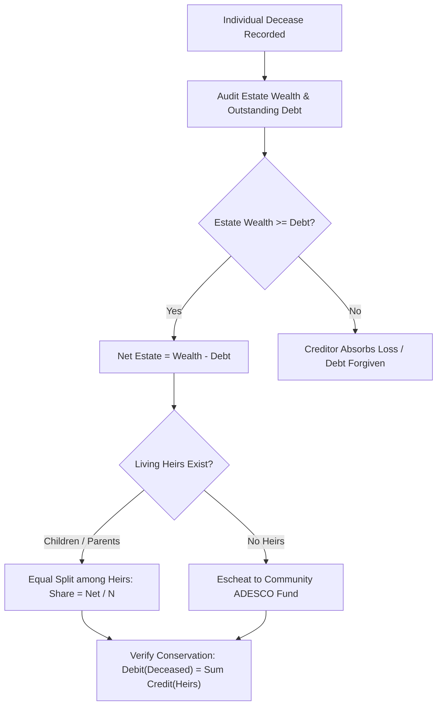

# GENERATIONS AND DEMOGRAPHICS MODEL (PHASE 1.11)
## Multi-Generational Replacement, Genealogical Trees, Probate Conservation, and Imperfect Knowledge Drift

**System**: SALTBOR Synthetic-Human Society Simulation Platform  
**Subsystem**: Multi-Generational Lifecycle (`saltbor.civilization.multigenerational`)  
**Language / Environment**: Python 3.12–3.14 (Validated on Python 3.14.5, Windows 11)  
**Status**: ACTIVE PRODUCTION SPECIFICATION  

---

### 1. Executive Summary

The Multi-Generational Engine [multigenerational.py](file:///c:/GIT%20HUB/sv%20people/saltbor/civilization/multigenerational.py) operationalizes demographic progression across 10 to 200 simulated years (encompassing up to 8–10 continuous biological generations). The model simulates the full lifecycle of synthetic individuals: birth, parent-child bonding, education, adult labor, elder mentorship, natural death, probate estate distribution, and knowledge transmission.

Crucially, **population growth is never imposed**. Fertility rates, mortality curves, family formation, and household fissions emerge dynamically from biological viability, environmental carrying capacity, and economic solvency.

---

### 2. Genealogical Lineages and Family Lineage Trees

Each individual in the simulation belongs to a biological and social lineage rooted in initial founding cohorts or emergent marriages:

```python
@dataclass
class FamilyLineage:
    family_id: str                          # Unique identifier of the lineage
    surname: str                            # Patronymic or matronymic family name
    founder_ids: List[str]                  # UIDs of original generation-0 founders
    generation_depth: int                   # Maximum generational tree depth reached
    total_members_count: int                # Cumulative historical members born
    living_members_count: int               # Currently living active members
    primary_settlement_id: Optional[str]    # Settlement where family has deepest roots
    accumulated_traditions: List[str]       # Family-specific cultural lore
    intergenerational_wealth: float         # Aggregate circulating wealth in lineage
```

#### Individual Generational Records

```python
@dataclass
class IndividualGenerationRecord:
    human_id: str
    generation_index: int                   # Gen 0 = founder, Gen 1 = child, Gen 2 = grandchild...
    birth_year: float
    death_year: Optional[float]
    parent_ids: List[str]
    children_ids: List[str]
    transmitted_skills: List[str]
    inherited_wealth_usd: float
    living: bool
    occupation: Optional[str]
    settlement_id: Optional[str]
```

Genealogical lineage trees track depth over centuries, enabling sociological analysis of social mobility, dynastic wealth persistence, and family line extinction.

---

### 3. Biological Demographics: Fertility and Mortality

#### 3.1 Age-Specific Fertility Function

Fertility is evaluated annually for all living reproductive-age adults (ages 18 to 42):

$$P(\text{Conception}) = \max\left(0.0, \frac{0.22 - 0.045 \cdot N_{\text{children}}}{\Omega_{\text{overcrowding}}^{1.35}} \cdot \left(1.0 - 0.45 \cdot \sigma_{\text{eco}}\right) \cdot M_{\text{fertility}}\right) \cdot \Delta t$$

Where:
- $N_{\text{children}}$: Parity count (number of living children previously born to the mother).
- $\Omega_{\text{overcrowding}}$: Ratio of living population to aggregate carrying capacity.
- $\sigma_{\text{eco}}$: Environmental stress factor.
- $M_{\text{fertility}}$: Fertility policy multiplier (defaults to $1.0$).

When $M_{\text{fertility}} = 0.0$ or ecological collapse occurs, births halt completely, inducing rapid demographic aging.

#### 3.2 Gompertz-Makeham Mortality Function

Natural aging and mortality are evaluated annually using an empirical bio-actuarial formulation:

$$\mu(x) = \left( 0.004 + 0.00014 \cdot e^{0.082 \cdot \min(95, x)} \right) \cdot \left(1.0 + 0.45 (\Omega_{\text{overcrowding}} - 1.0)\right) \cdot \left(1.0 + 0.60 \cdot \sigma_{\text{eco}}\right)$$

For elders over age 85, mortality accelerates rapidly:

$$\mu(x \ge 85) = \min(0.70, \mu(x) \times 1.5)$$

---

### 4. Probate, Inheritance, and Strict Accounting Conservation

When an individual dies, their accumulated physical wealth and parcel rights pass through a strict probate procedure.



#### The Conservation Theorem

Let $W_d$ be the estate wealth of the deceased, $D_d$ be outstanding debt, and $H = \{h_1, h_2, \dots, h_k\}$ be the set of living heirs:

$$\sum_{h_i \in H} \Delta W_{h_i} + \Delta W_{\text{creditor}} + \Delta W_{\text{community}} = W_d$$

Every dollar credited to an heir or creditor is debited from the deceased's estate. **Zero dollars are generated or destroyed in probate.**

---

### 5. Imperfect Generational Transmission & Cultural Drift

Children do not clone their parents' worldviews, skills, or social status. The transmission of knowledge (farming practices, artisanal techniques, oral traditions, and religious customs) is modeled as a probabilistic learning process subject to **generational drift and disagreement**:

$$\text{Skill Proficiency}_{\text{learner}} = \text{Proficiency}_{\text{mentor}} \times \text{Fidelity}$$

Where $\text{Fidelity} \sim \mathcal{N}(\mu=0.88, \sigma=0.06)$.

Furthermore, generational disagreement emerges when youth reject parental occupations:
- Innovation adoption is higher among younger cohorts (ages 18–30).
- Older cohorts (ages 55+) exhibit higher resistance to technological change and institutional amendments, creating intergenerational cultural friction.

---

### 6. Demographic Analytical Metrics

The engine continuously computes standardized macro-demographic indicators:
- **Dependency Ratio**: $\frac{\text{Pop}_{<18} + \text{Pop}_{\ge 65}}{\text{Pop}_{18-64}}$.
- **Mean Population Age**: $\bar{x} = \frac{1}{N} \sum_{i=1}^N x_i$.
- **Generational Depth**: $\max_{r \in \text{Records}} r.\text{generation\_index}$.
- **Cohort Survivorship**: Longitudinal tracking of cohort survival curves ($l_x$).
