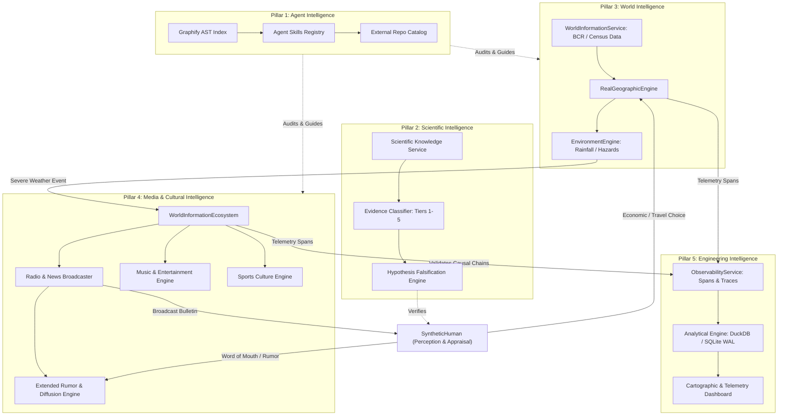

# INTELLIGENCE ECOSYSTEM AUDIT
**Date**: November 2026  
**System**: SALTBOR Phase 1.10 Architecture  
**Focus**: Structural Interaction Across the Five Intelligence Pillars

---

## 1. Pillar Interaction Topology

To transition SALTBOR into an interconnected intelligence ecosystem, the five pillars must interact through clean, typed interfaces without circular dependencies:

---

## 2. Interface Definitions & Contracts

### 2.1 World Intelligence $\rightarrow$ Media Intelligence
- **Event Producer**: `EnvironmentEngine` emits an `EnvironmentalHazardEvent` (e.g. `LOS_CHORROS_LANDSLIDE`, `TORRENTIAL_RAIN`).
- **Media Consumer**: `WorldInformationEcosystem` ingests the event and synthesizes a `MediaBroadcast` (Radio bulletin, newspaper headline).
- **Provenance & Ground Truth**: Real source provenance (`DataProvenanceRegistry`) separates true environmental facts from distorted rumors.

### 2.2 Media Intelligence $\rightarrow$ Synthetic Human Cognition
- **Exposure Channel**: When a `SyntheticHuman` is at home, in a transit vehicle, or in an establishment with active media (`Radio`, `TV`, `Newspaper`), the human receives a `MediaExposureEvent`.
- **Cognitive Appraisal**: The agent evaluates:
  - Source credibility $C \in [0, 1]$.
  - Personal relevance $R = f(\text{location}, \text{family\_location}, \text{vulnerability})$.
  - Emotional reaction: Fear, caution, or skepticism.
  - Decision outcome: Delay trip, take alternate road, or discuss with neighbor.

### 2.3 Peer-to-Peer Information Diffusion $\rightarrow$ Social Network
- **Oral Propagation**: Agent shares news with neighbors (`RumorEngine.transmit()`).
- **Distortion Dynamics**: Transmissions alter statement fidelity and confidence based on trust, educational background, and anxiety.

### 2.4 Engineering Observability
- All events and engine execution ticks publish lightweight structured spans to `ObservabilityService`.
- Zero overhead in default mode; detailed traces enabled for experiments and benchmarks.
