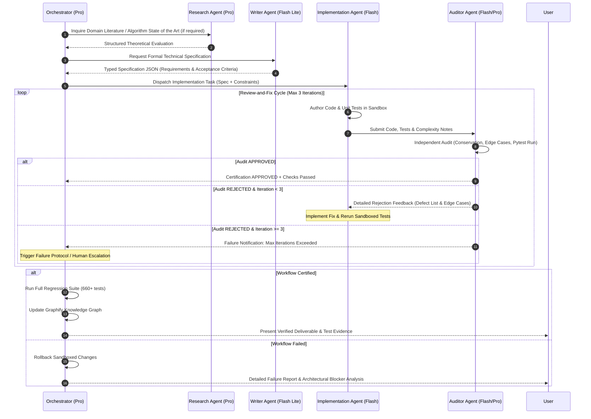
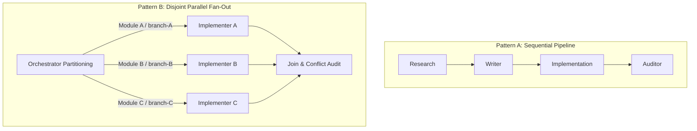

# SALTBOR MULTI-AGENT LOOP EXECUTION POLICY

## 1. Overview & Core Execution Directives

This document specifies the operational rules, state machines, and fail-safe protocols governing multi-agent loops in **SALTBOR**. 

**Primary Mandate**: All multi-agent workflows must terminate deterministically within a bounded number of iterations, execute under explicit token and time budgets, and never enter an infinite loop.

---

## 2. Canonical Development Loop Architecture

The standard SALTBOR development cycle follows an orchestrated, closed-loop pipeline with automated review and remediation:



---

## 3. Loop Termination & Convergence Guarantees

To mathematically prevent non-terminating loops, the orchestration engine enforces four immutable convergence controls:

### 3.1 Hard Iteration Bounding (`max_iterations = 3`)
- Under no circumstances may an Implementation-Auditor cycle exceed **3 iterations**.
- **Iteration 1**: Initial implementation against formal specification.
- **Iteration 2**: Targeted remediation addressing specific defects identified by the Auditor.
- **Iteration 3**: Final resolution turn. If the Auditor rejects the third attempt, the loop halts immediately with status `FAILED_MAX_ITERATIONS`.

### 3.2 Time & Execution Quotas (`with_budget`)
Every dynamic workflow must wrap agent calls with the native `with_budget` primitive:
- Maximum execution time per turn: **180 seconds**.
- Maximum cumulative pipeline time: **600 seconds** (10 minutes).
- If a timeout occurs, `BudgetExceeded` is caught, the active agent is terminated, and the coordinator initiates rollback.

### 3.3 Strict Progress Invariants
On each fix turn, the Implementation Agent must submit a `fix_summary` explaining how each numbered item from the Auditor's feedback was resolved. If the Auditor determines that the feedback was ignored or that previously passing checks were broken (regression), the task is escalated immediately to Tier 3 (`pro`) or terminated.

---

## 4. Execution Patterns: Sequential vs. Parallel



### 4.1 Sequential Execution Rules
Sequential pipelines are mandatory when:
- Tasks exhibit linear dependencies (e.g. specification must precede coding; coding must precede auditing).
- Changes touch core simulation loops (`SimulationRunner`, `EventBus`, database schema).

### 4.2 Parallel Execution & Collision Prevention
Antigravity's `parallel(items, fn)` enables concurrent agent execution, subject to strict isolation rules:
1. **Disjoint Target Sets**: Parallel execution is only permitted when agents modify completely distinct files or modules. Two agents must **never** edit the same file simultaneously.
2. **Workspace Isolation Modes**:
   - `workspace="branch"`: Each parallel agent receives an isolated git clone.
   - `workspace="share"`: Agents share the repository through a dedicated worktree.
   - `workspace="inherit"`: Read-only tasks (e.g. parallel code audits across 10 modules).
3. **Merge Conflict Verification**: Before merging parallel branches into `main`, the Orchestrator runs static conflict detection and regression testing.

---

## 5. Multi-Turn State Retention vs. Stateless Agents

Antigravity dynamic workflows support two operational agent modes:

### 5.1 Stateless Single-Turn Agents (`await agent(...)`)
Used for independent tasks where past conversation context is not required:
- Writer generating a specification from prompt arguments.
- Research agent surveying a specific paper or algorithm.
- Initial implementation from scratch.

### 5.2 Stateful Multi-Turn Agents (`a = agent(...)` then `await a(...)`)
Used for Review-and-Fix loops where retaining the conversational history of previous findings is critical:
```python
# The Auditor retains context across turns to verify fix fidelity
auditor = agent(
    prompt="You are an uncompromising QA Auditor for SALTBOR.",
    role="Auditor Agent",
    model="flash"
)

# Turn 1: Initial Audit
verdict_turn1 = await auditor(audit_prompt, schema=auditor_schema)

if verdict_turn1["status"] == "REJECTED":
    # Turn 2: Re-evaluation of the fix against earlier findings
    verdict_turn2 = await auditor(re_audit_prompt, schema=auditor_schema)
```
Stateful retention prevents the Auditor from repeating solved issues or forgetting previous edge-case discoveries.

---

## 6. Safety & Rollback Protocol

1. **Working Copy Cleanliness**: No agent may commence work if `git status` reports uncommitted user changes, unless operating in an isolated `workspace="branch"`.
2. **Atomic Rollback**: If a workflow fails or is aborted:
   - All temporary files in `scratch/` are purged.
   - The isolated git branch is deleted without touching the user's working copy.
   - An incident record is written to the run log.
3. **Never Fake Success**: An agent or workflow must never claim tests passed without actual execution stdout containing `=== N passed in X.XXs ===`.
