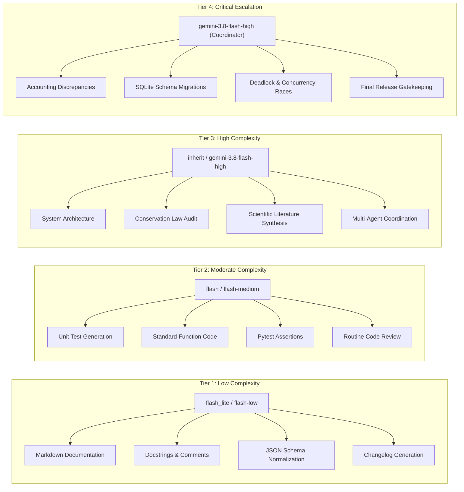
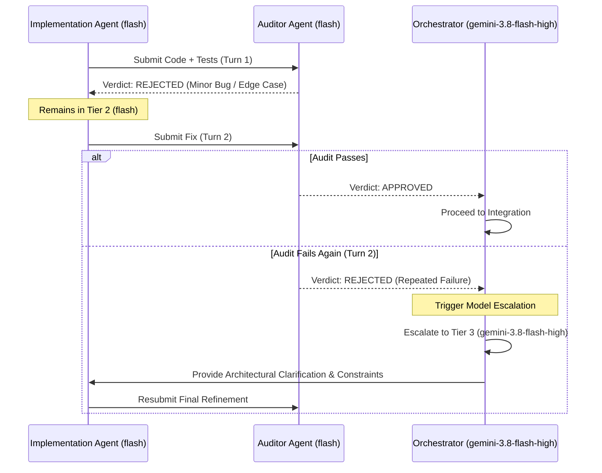

# SALTBOR MODEL ROUTING & EFFICIENCY POLICY

## 1. Overview & Policy Objective

This policy defines the operational rules for assigning language models and computational reasoning tiers to agent tasks within SALTBOR. 

**Core Imperative**: Never utilize a high-cost reasoning model for a task that can be reliably performed by a lighter, faster model. Every agent invocation must justify its reasoning expenditure based on measurable task complexity.

> [!IMPORTANT]
> **EXCLUSION DIRECTIVE ON `pro`**:
> El modelo `pro` **NO SE EMPLEARÁ** en la arquitectura de orquestación de SALTBOR debido a que su capacidad de razonamiento y rendimiento es marcadamente inferior respecto a **Gemini 3.8 Flash (High)** (`gemini-3.8-flash-high`).
> Toda la capacidad de razonamiento profundo, deducción científica, auditoría crítica y orquestación jerárquica se asigna a **Gemini 3.8 Flash (High)** (empleando `model="inherit"` en Dynamic Workflows y `model="gemini-3.8-flash-high"` en Native Swarm). El identificador `"pro"` queda formalmente deprecado y prohibido en las políticas de enrutamiento.

---

## 2. Antigravity Supported Model Identifiers

In the installed Antigravity environment, model assignment differs depending on whether execution runs via **Dynamic Workflows** (`run_workflow` / `invoke_subagent`) or via **Native Swarm** (`swarm` tool). The system strictly uses verified, supported identifiers:

### 2.1 Dynamic Workflows & Subagent API
In Python Dynamic Workflows (`agent(model=...)`) and `invoke_subagent(Model=...)`, the active tier identifiers are:

| Tier Identifier | Target Runtime Tier | Typical Latency | Assigned Role |
| :--- | :--- | :--- | :--- |
| `"flash_lite"` | Gemini Flash Lite / Low Reasoning Tier | $1.0\times$ (Fastest, $<5$s) | Writer Agent, docstrings, schema normalization |
| `"flash"` | Gemini Flash / Medium Reasoning Tier | $1.5\times$ ($5-15$s) | Implementation Agent, standard unit tests, routine audit |
| `"inherit"` | **Gemini 3.8 Flash (High)** (Coordinator Model) | $2.5\times$ ($15-30$s) | **Orchestrator, Research, Critical Invariant Auditor** |
| ~~`"pro"`~~ | *Gemini Pro (DEPRECATED)* | N/A | **EXCLUIDO POR INFERIORIDAD DE CAPACIDAD** |

### 2.2 Native Swarm API
In the native multi-agent message board (`swarm{action: "add", model: ...}`), explicit model strings must be passed. The active models and live quotas in the environment are:

| Swarm Model Identifier | Display Name | Live Quota Status | Assigned Complexity |
| :--- | :--- | :--- | :--- |
| `gemini-3.8-flash-low` | Gemini 3.8 Flash (Low) | Active (84%) | Low Complexity / Writing |
| `gemini-3.8-flash-medium` | Gemini 3.8 Flash (Medium) | Active (84%) | Moderate Complexity / Code |
| `gemini-3.8-flash-high` | Gemini 3.8 Flash (High) | Active (84%) | High / Critical Reasoning |
| `claude-opus-4-6-thinking` | Claude Opus 4.6 (Thinking) | 0% (Fallback only) | High (when quota permits) |
| `claude-sonnet-4-6` | Claude Sonnet 4.6 (Thinking) | 0% (Fallback only) | High (when quota permits) |
| `gpt-oss-120b-medium` | GPT-OSS 120B (Medium) | 0% (Fallback only) | Medium (when quota permits) |

---

## 3. Complexity Classification Matrix

Every task entering the orchestration pipeline is categorized into one of four complexity tiers:



### Detailed Routing Criteria:

1. **Tier 1 — Low Complexity (`flash_lite` / `gemini-3.8-flash-low`)**:
   - **Allowed Tasks**: Markdown summaries, file renaming, data serialization/deserialization, writing pytest test signatures, docstrings, schema conversion.
   - **Disallowed**: Changing simulation equations, modifying state transitions, making architectural decisions.
   - **Token Budget**: 4,000 max output tokens per turn.

2. **Tier 2 — Moderate Complexity (`flash` / `gemini-3.8-flash-medium`)**:
   - **Allowed Tasks**: Implementing functions against existing Pydantic models, writing unit tests with fixtures, refactoring function bodies for speed, debugging isolated single-file errors.
   - **Disallowed**: Altering multi-engine event flows, redesigning database schemas.
   - **Token Budget**: 8,000 max output tokens per turn.

3. **Tier 3 — High Complexity (`inherit` / `gemini-3.8-flash-high`)**:
   - **Allowed Tasks**: Designing new simulation engines, reviewing mathematical proofs for economic conservation, diagnosing cross-module state leaks, literature research across economic and cognitive domains.
   - **Usage Cap**: Maximum 1 concurrent agent unless explicitly partitioned across disjoint subsystems.

4. **Tier 4 — Critical Escalation (`gemini-3.8-flash-high`)**:
   - **Trigger Conditions**:
     - An implementation agent fails the auditor 2 consecutive times.
     - A financial transaction or inventory calculation violates zero-sum conservation.
     - A database schema migration threatens existing SQLite tables.
   - **Action**: Escalation passes the failure trajectory directly to the Orchestrator for deep diagnosis on Gemini 3.8 Flash (High).

---

## 4. Escalation Protocol & Failure Recovery



### Escalation Rules:
1. **First Failure**: The Implementer receives structured auditor feedback and retries within the same model tier (`flash`).
2. **Second Consecutive Failure**: The task is flagged as **ESCALATED**. The model tier for the fix is elevated to `pro`, or the Orchestrator intervenes directly with a refined specification.
3. **Third Failure (Hard Termination)**: If the task fails on turn 3, the loop terminates immediately. The Orchestrator logs a failure report, rolls back the branch, and alerts the user.

---

## 5. Token & Resource Governance

To prevent runaway billing and token exhaustion, all workflow runs must use the native `with_budget` and `tokens_used` primitives:

```python
# Standard Governance Wrapper
result = await with_budget(
    agent(prompt=task_prompt, schema=task_schema, model="flash"),
    max_tokens=60000,
    max_seconds=120
)
```

### Metrics Tracked:
- `input_tokens`: Raw prompt tokens.
- `cache_read_tokens`: Tokens served from Antigravity context cache (yielding massive cost savings).
- `output_tokens`: Tokens generated by the model.
- `total_tokens`: Cumulative consumption across the pipeline.
- `escalation_rate`: Percentage of tasks requiring Tier 3/4 intervention (target: $<15\%$).
