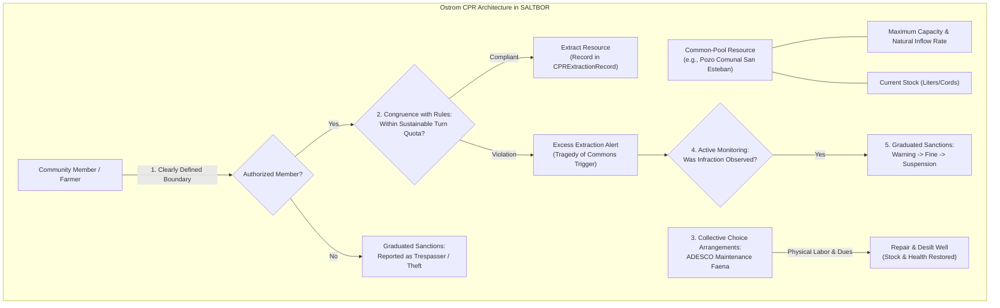

# SALTBOR PHASE 1.9: INSTITUTIONAL REPORT
## Institutional Evolution, Collective Governance, Ostrom CPR Dynamics & Social Stratification

**Author**: Antigravity (Lead Architect & Institutional Economist)  
**Date**: November 2026  
**Scope**: 11 Institutional Domains, Elinor Ostrom Common-Pool Resources, Deliberative Democracy, and Multidimensional Stratification in El Salvador  

---

### Executive Overview

Institutional structures in SALTBOR Phase 1.9 are neither exogenous constants nor cost-free coordinating mechanisms. Drawing from new institutional economics (North, Williamson), Ostrom's design principles for common-pool resource governance, and complexity sociology, institutions in SALTBOR emerge from collective needs, operate with finite throughput and budgets, face organizational inertia, and risk delegitimization, decay, or dissolution when failing to serve their constituents.

This report documents the theoretical foundations, implementation mechanisms, and behavioral dynamics observed across the institutional systems of Phase 1.9.

---

### 1. The 11 Institutional Domains

The `InstitutionalEvolutionEngine` supports formal and informal institutions across 11 functional domains of Salvadoran social life:

| Domain Enum | Typical Real-World Expression | Core Responsibilities & Operational Metrics | Failure Modes & Vulnerabilities |
| :--- | :--- | :--- | :--- |
| `COMMUNITY_ADMINISTRATION` | ADESCO, Alcaldía Auxiliar, Junta Cantonal | Resident registration, neighborhood certificates, solar titling disputes. | Bureaucratic backlog accumulation, favoritism in document issuance. |
| `EDUCATION` | Escuela Rural, Taller Artesanal, Centro de Saberes | Apprenticeships, literacy, vocational craft certification. | Master attrition, pedagogical decay, tuition unaffordability. |
| `HEALTH` | Unidad de Salud Comunitaria, Botiquín Comunal | First aid, dengue prevention campaigns, emergency triage. | Medicine stockouts, doctor absence, budget depletion. |
| `COMMERCE` | Comité de Comerciantes de Mercado, Cooperativa de Ahorro | Market stall allocation, credit lines, wholesale bargaining. | Price gouging, default cascades, factional market capture. |
| `SECURITY` | Vigilancia Vecinal, Ronda Nocturna | Anti-theft night watches, boundary patrols, order keeping. | Vigilantism, abuse of authority, abandonment due to fear. |
| `CONFLICT_RESOLUTION` | Juzgado de Paz Local, Mesa de Conciliación Vecinal | Boundary dispute mediation, debt agreements, family pacts. | Loss of perceived neutrality, unenforceable pacts. |
| `COMMON_POOL_RESOURCES` | Junta de Agua Comunal, Comité de Bosque Comunitario | Water turn schedules, pump maintenance, pipe repair fees. | Free-riding, aquifer over-extraction, infrastructure neglect. |
| `INFRASTRUCTURE` | Comité de Caminos, Faena de Mantenimiento Vial | Ditch clearance, pothole filling (*bacheo*), culvert repairs. | Storm damage overwhelming volunteer labor capacity. |
| `CULTURE` | Cofradía Patronal, Comité de Festejos, Danza Tradicional | Patron saint celebrations, folklore transmission, historical lore. | Generational apathy, youth emigration, desuetudo. |
| `SOCIAL_ASSISTANCE` | Cuchubal de Emergencia, Red de Cuido Infantil, Ayuda Funeraria | Mutual aid rotating funds, emergency burial expenses. | Free-riding default, fund manager embezzlement. |
| `LOCAL_GOVERNANCE` | Concejo Municipal Plural, Cabildo Abierto | Tax assessment, public works prioritization, vendor permits. | Clientelism, budgetary starvation, assembly boycotts. |

---

### 2. Ostrom Common-Pool Resource (CPR) Governance in Action

Elinor Ostrom's Nobel prize-winning framework establishes 8 design principles for long-enduring common-pool resources. Phase 1.9 embeds these principles directly into `CollectiveResourceManager` and `SocialNormEvolutionEngine`:

#### Empirical CPR Observations in Phase 1.9:
1. **Sustainable Regime (`EXP_19_I`)**:
   - Monitored water extraction conforming to turns and quotas maintained well stock above 90% over prolonged dry seasons.
   - Routine community *faenas* contributed labor points that fully offset natural silting and physical wear.
2. **Tragedy of the Commons Regime (`EXP_19_J`)**:
   - When enforcement was zeroed and free extraction permitted, agents maximized individual withdrawals.
   - Within 15 ticks, stock plummeted by 84% from 1,200L to 190L, triggering the `CPRHealthStatus.DEPLETED` state and severe community crisis.

---

### 3. Deliberative Governance & Decision Protocols

Decision-making in `CollectiveGovernanceEngine` rejects the simplistic assumption that all agents vote identically or possess equal power. Governance processes feature:

- **Formal Proposals**: Authored by individuals or factions with specific budgetary costs, statutory rules, or policy changes.
- **Debate & Influence Phase**: Agents participate based on their `civic_score`, interpersonal affinity, and economic stakes.
- **Multiple Voting Protocols**:
  - `MAJORITY_50`: Simple majority (>50% of cast votes).
  - `SUPERMAJORITY_66`: Qualified two-thirds majority (>66.6%) required for constitutional or land use changes.
  - `CONSENSUS_UNANIMOUS`: Requires zero dissenting votes; single veto blocks proposal.
  - `WEIGHTED_INFLUENCE`: Votes weighted by the agent's multidimensional social capital, prestige, and institutional seniority.
- **Persistent Minority Dissent**: Dissenters are not erased. Dissent is recorded in the immutable assembly log, generating latent tension that can fuel future institutional reform or organizational fission.

---

### 4. Multidimensional Social Stratification & Mobility

Phase 1.9 breaks away from single-variable economic models by implementing a **7-dimensional Socioeconomic Status (SES) composite**:

$$\text{SES} = 0.20 \cdot I + 0.20 \cdot W + 0.15 \cdot H + 0.15 \cdot E + 0.10 \cdot O + 0.10 \cdot S + 0.10 \cdot C$$

Where:
- $I$ (**Income**): Daily earnings and cash liquidity ($/day).
- $W$ (**Wealth**): Accumulated assets, livestock, tools, and inventory.
- $H$ (**Housing Tenure**): Formal owner ($0.95$), renter ($0.60$), informal settlement / bahareque ($0.35$), temporary shelter ($0.10$).
- $E$ (**Human Capital & Education**): Procedural skill proficiencies across craft, trade, and agricultural domains.
- $O$ (**Occupational Prestige**): Community standing from doctor/leader ($0.90$) down to casual day laborer (*jornalero*, $0.30$).
- $S$ (**Social Capital**): Size of friend network and average bilateral trust degrees.
- $C$ (**Civic Influence**): Leadership roles in ADESCOs, cofradías, or business associations.

#### Inequality Metrics:
- **Income & Wealth Gini**: Calculated across all living agents in $O(N \log N)$ time.
- **Palma Ratio**: The share of total income/wealth held by the top 10% divided by the share held by the bottom 40%.
- **Quintile Mobility Transitions**: Tracks individual agents moving between Quintiles Q1 through Q5 over time (upward/downward).

---

### 5. Institutional Pathology & Reform Lifecycles

An institution in SALTBOR can transition through 4 discrete lifecycle states:
1. `ACTIVE_FUNCTIONING`: Operating budget positive, processing citizen petitions without severe delays, legitimacy $>0.60$.
2. `CAPACITY_STRAINED`: Budget deficit restricts daily throughput; backlog queue exceeds double daily capacity; citizens experience mounting delays.
3. `LEGITIMACY_CRISIS`: Legitimacy drops below $0.40$ due to chronic service failures, unaddressed grievances, or leadership scandals. Citizen petitions drop sharply.
4. `DORMANT_DEFUNCT`: Zero throughput, depleted treasury, director abandoned post.

**Reformation Mechanism**: When an institution suffers a legitimacy crisis, citizen assemblies can propose leadership succession (`EXP_19_F`) or statutory bylaws reform (`EXP_19_E`), replacing discredited directors and injecting emergency community capital to restore operational legitimacy.
