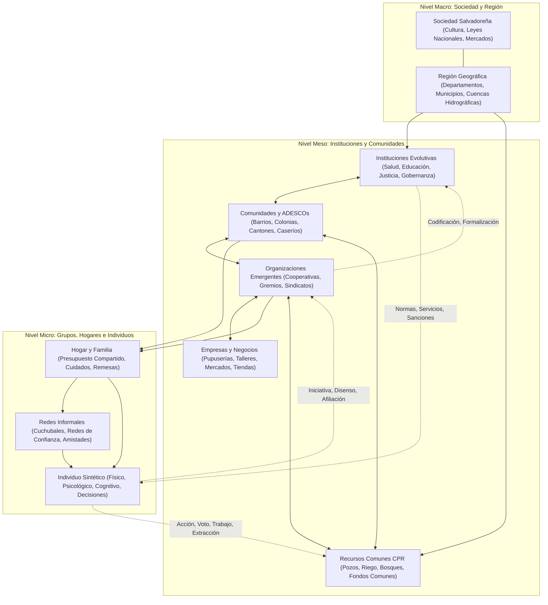

# SALTBOR — FASE 1.9: MAPA DEL SISTEMA SOCIAL Y DINÁMICAS MULTINIVEL
## Cartografía de Interacciones Colectivas, Estructuras Emergentes y Evolución Institucional

**Fecha:** 13 de noviembre de 2026  
**Línea base:** SALTBOR 1.8 / Fase 1.9  
**Autor:** Arquitecto Principal de SALTBOR  

---

## 1. ARQUITECTURA MULTINIVEL DE LA SOCIEDAD SINTÉTICA

SALTBOR concibe la sociedad no como una jerarquía piramidal rígida preprogramada, sino como un **sistema adaptativo complejo multinivel** donde las estructuras emergen desde las interacciones locales y, a su vez, ejercen restricciones e incentivos (retroalimentación descendente) sobre los individuos.



---

## 2. DESCRIPCIÓN DE LOS NIVELES SOCIALES Y FLUJOS CAUSALES

### 2.1. Nivel Individual (Micro)
- **Componentes clave:** [SyntheticHuman](file:///C:/GIT%20HUB/sv%20people/saltbor/population/human.py), `PhysicalState`, `PsychologicalState`, `Personality` (Big Five), `MemoryEngine`, `DecisionEngine`, `GoalAutonomyLifecycle`.
- **Dinámica:** El individuo experimenta necesidades biológicas (hambre, energía, hidratación, salud), estados afectivos OCC (estrés, esperanza, orgullo, resentimiento), y evalúa opciones cotidianas ponderadas por su biotipo, rutina cultural salvadoreña y recursos disponibles.
- **Acción Social:** Puede afiliarse a organizaciones, participar en asambleas comunales, solicitar fiado, aportar cuotas, trabajar en faenas o sobreexplotar recursos comunes.

### 2.2. Nivel Familiar y Hogar (Micro-Meso)
- **Componentes clave:** [HouseholdLedger](file:///C:/GIT%20HUB/sv%20people/saltbor/economy/household/ledger.py), [FamilyCaregivingEngine](file:///C:/GIT%20HUB/sv%20people/saltbor/lifecycle/family/caregiving.py), [HousingLease](file:///C:/GIT%20HUB/sv%20people/saltbor/economy/housing/engine.py), [RemittanceEngine](file:///C:/GIT%20HUB/sv%20people/saltbor/economy/salvadoran/remittances.py).
- **Dinámica:** Mancomunación de ingresos, gastos de alimentación y vivienda, cuidado intergeneracional de menores y ancianos, recepción de remesas del exterior y amortiguación ante crisis económicas.

### 2.3. Nivel Grupal y Redes Informales (Micro-Meso)
- **Componentes clave:** [SocialNetworkEngine](file:///C:/GIT%20HUB/sv%20people/saltbor/social/network/graph_engine.py), `ReputationEngine`, círculos de ahorro rotativo ([CuchubalSavingsCircle](file:///C:/GIT%20HUB/sv%20people/saltbor/social/salvadoran/community.py)), redes de reciprocidad vecinal.
- **Dinámica:** Construcción gradual de confianza ($T \in [0, 1]$), reciprocidad no monetaria, circulación de información ('chambre' e información de oportunidades laborales), apoyo emocional y crédito informal.

### 2.4. Nivel Organizacional Emergente (Meso)
- **Componentes clave:** [EmergentOrganizationEngine](file:///C:/GIT%20HUB/sv%20people/saltbor/social/organization/engine.py), [CollectiveEconomyEngine](file:///C:/GIT%20HUB/sv%20people/saltbor/social/economy/collective_economy.py).
- **Tipología:**
  1. *Asociaciones Comerciales y Gremios de Vendedoras*: Defensa de puestos, compras al por mayor de maíz y frijol.
  2. *Cooperativas Agrícolas y de Productores*: Procesamiento y acopio de granos básicos, compra colectiva de insumos.
  3. *Grupos de Ayuda Mutua y Sociedades de Socorro*: Fondos de emergencia ante enfermedad, gastos fúnebres o desastres.
  4. *Asociaciones Vecinales y Comités Locales*: Seguridad comunitaria, mantenimiento de caminos, festividades patronales.
  5. *Redes de Transporte Local*: Coordinación de viajes compartidos, fletes de carga agrícola.
  6. *Sindicatos y Colectivos Laborales*: Negociación salarial frente a talleres o patronos.
- **Ciclo de Vida:**
  - *Génesis:* Surge cuando $\ge 3$ agentes comparten necesidades críticas, proximidad geográfica y umbral mínimo de confianza interpersonal.
  - *Evolución de Propósito:* Adaptación de metas según cambios de contexto (e.g. de fondo de emergencia a cooperativa de crédito).
  - *Fisión / Escisión:* Cuando el conflicto interno supera el umbral de tolerancia ($\Delta \text{conflict} > 0.65$), la facción disidente se separa y forma una nueva organización.
  - *Fusión:* Dos organizaciones con objetivos complementarios y alta confianza mutua unen tesorerías y miembros.
  - *Disolución:* Quiebra financiera, desconfianza generalizada ($L < 0.20$) o pérdida de masa crítica de miembros activos ($N < 2$).

### 2.5. Nivel Institucional Evolutivo (Meso-Macro)
- **Componentes clave:** `InstitutionalEvolutionEngine`, [GovernanceEngine](file:///C:/GIT%20HUB/sv%20people/saltbor/institutions/governance.py), [DistributedEducationEngine](file:///C:/GIT%20HUB/sv%20people/saltbor/institutions/education.py), [JudicialTribunal](file:///C:/GIT%20HUB/sv%20people/saltbor/institutions/legal/court.py).
- **Características Verificables:**
  - **Identidad e Historial:** Acta fundacional, fecha de creación, código identificador único y registro cronológico inmutable de reformas, crisis y acuerdos.
  - **Ubicación y Sede:** Anclaje geográfico verificable en la jerarquía territorial salvadoreña (distrito, barrio o cantón).
  - **Función y Mandato:** Dominio operativo tipado (Salud, Educación, Comercio, Justicia, Infraestructura, Agua, Asistencia Social).
  - **Reglas y Procedimientos:** Estatutos formales, requerimientos de quórum y protocolos de votación.
  - **Capacidad Operativa y Eficiencia:** Capacidad finita de tramitación de casos o servicios; propensa a cuellos de botella y fallas administrativas si el presupuesto o personal es insuficiente.
  - **Legitimidad:** Percepción pública acumulada; se deteriora por corrupción, promesas incumplidas o exclusión arbitraria.

### 2.6. Gestión Colectiva de Recursos Comunes (CPR - Elinor Ostrom)
- **Componente clave:** `CollectiveResourceManager`.
- **Recursos Modelados:**
  1. *Agua Comunal:* Pozos comunitarios, tanques de captación, acequias de riego en cantones.
  2. *Tierra Agrícola y Pastos Comunes:* Parcelas ejidales o cooperativas para cultivo y pastoreo.
  3. *Bosques y Leña:* Extracción de leña para cocinas y protección de cuencas hidrológicas.
  4. *Infraestructura y Caminos:* Cuestas de tierra transitables, puentes de hamaca, casas comunales.
  5. *Fondos Comunitarios de Emergencia:* Caja chica comunal administrada por tesorería electa.
- **Mecanismos Ostrom Implementados:**
  - *Límites claros:* Quién tiene derecho de extracción y quién es usuario externo.
  - *Reglas de provisión y apropiación:* Cuotas máximas de extracción por turno y días de mantenimiento obligatorio (faenas).
  - *Monitoreo mutuo:* Detección de aprovechamiento indebido o sobreexplotación por miembros de la comunidad.
  - *Sanciones graduadas:* Amonestación verbal $\to$ Pérdida de reputación $\to$ Multa económica $\to$ Suspensión temporal de acceso $\to$ Exclusión definitiva.
  - *Trazabilidad estricta:* Cada metro cúbico de agua, libra de leña o quintal extraído se descuenta del balance biofísico real del recurso.

### 2.7. Estratificación Social Multidimensional y Movilidad
- **Componente clave:** `SocialStratificationEngine`.
- **Dimensiones Evaluadas:**
  1. *Ingresos corrientes:* Salarios, ventas comerciales, utilidades de cooperativas, remesas recibidas.
  2. *Patrimonio y Activos:* Vivienda propia vs alquiler/albergue, posesión de herramientas productivas, ahorros en banco o cuchubal.
  3. *Seguridad Habitacional:* Propietario con título, arrendatario formal, mesón informal, albergue de emergencia.
  4. *Capital Humano y Educación:* Nivel de alfabetización, oficios aprendidos (carpintería, panadería, agricultura tecnificada).
  5. *Prestigio Ocupacional:* Jornalero ocasional, vendedora de mercado, maestro artesano, comerciante establecido, directivo de ADESCO.
  6. *Capital Social y Redes:* Grado de centralidad en la red social, confianza recibida de pares, conexiones interclase.
  7. *Poder e Influencia Cívica:* Capacidad de fijar agendas en asambleas, proponer políticas, influir en votaciones institucionales.
- **Métricas de Desigualdad y Movilidad:**
  - Coeficiente de Gini de Ingreso y Gini de Riqueza.
  - Ratio de Palma (ingreso del decil superior / ingreso del 40% inferior).
  - Matriz de transición de quintiles socioeconómicos a lo largo del tiempo (movilidad ascendente, estancamiento y descenso por choque catastrófico).

---

## 3. MAPA DE INTERCONEXIÓN DE MOTORES

```
[SimulationRunner.step()]
   │
   ├── 1. Entorno y Territorio
   │       └── EnvironmentEngine (Clima, lluvia, temporales)
   │       └── RegionalTradeEngine (Flujos de comercio intermunicipal)
   │
   ├── 2. Dinámica Colectiva y Social (NUEVO FASE 1.9)
   │       ├── SocialNormEvolutionEngine.step()
   │       │     └── Evaluación de normas, cumplimiento, sanciones y desuetudo
   │       ├── CollectiveResourceManager.step()
   │       │     └── Regeneración hídrica, balances CPR, faenas de mantenimiento
   │       ├── EmergentOrganizationEngine.step()
   │       │     └── Detección de necesidades, formación, fisión, fusiones y balances
   │       ├── InstitutionalEvolutionEngine.step()
   │       │     └── Capacidad de servicio, legitimidad, reformas y presupuesto
   │       ├── IntergroupConflictEngine.step()
   │       │     └── Tensiones territoriales, huelgas, negociaciones y mediación
   │       └── SocialStratificationEngine.step()
   │             └── Índices de Gini, estratificación y matrices de movilidad
   │
   ├── 3. Ciclo de Vida Individual y Físico
   │       ├── IntegratedWorldSimulationEngine.step()
   │       │     └── Tránsito cinemático OSM, aforos de lugares, historial
   │       ├── Human.update()
   │       │     └── DecisionEngine (modulado por normas, CPR, membresías y estratos)
   │       ├── ExtensionRuntime.step()
   │       │     └── Salud, accidentes, ciclo familiar, romance
   │       └── PsychologicalEngine.step_population()
   │             └── Afrontamiento OCC, estrés, apoyo social y regulación
   │
   └── 4. Observabilidad, Causalidad y Persistencia
           ├── CausalEventGraph (Enlace causal de eventos colectivos)
           ├── SalvadoranHistoricalMemoryEngine (Consolidación de hitos)
           └── DatabaseManager (Persistencia en SQLite WAL)
```
