# PHASE 1.11 ARCHITECTURE PLAN
## Emergent Civilization, Longitudinal Simulation & Historical Evolution

**System**: SALTBOR Phase 1.11  
**Author**: SALTBOR Engineering Team  
**Date**: November 2026  
**Status**: APPROVED DESIGN SPECIFICATION  

---

## 1. High-Level Architectural Vision

Phase 1.11 evolves SALTBOR from an integrated synthetic human and social simulation into a **scientifically observable, long-running civilization simulator**. 

The core architectural principle is **uncompromising bottom-up emergence**:
- No predefined historical stages or scripts.
- No forced growth, guaranteed technological progress, or artificial cultural convergence.
- A society may grow, prosper, stagnate, fragment, migrate, transform, lose knowledge, suffer inequality, recover from crisis, decline, become depopulated, or collapse entirely.
- All macro outcomes are analytical descriptions derived from micro- and meso-level observable variables under strict accounting conservation and physical constraints.

```mermaid
graph TD
    subgraph MicroMeso [Micro & Meso Execution Loop]
        Pop[SyntheticHuman Population]
        House[Households & Families]
        EconMicro[Stores, Fiado, Labor, Remittances]
        Places[Places, Roads, OSM Spatial Index]
        ADESCO[ADESCOs, Faenas, Assemblies]
        CPR[CPR Common Resources & Norms]
    end

    subgraph MacroEvolution [Civilization Evolution Engine]
        CivEng[CivilizationEvolutionEngine]
        SettleEng[SettlementEvolutionEngine]
        MultiGen[MultiGenerationalEngine]
        HistMem[CivilizationalMemoryEngine]
        EconMacro[EconomicCivilizationEngine]
        TechEng[TechnologicalEvolutionEngine]
        Resilience[CivilizationResilienceEngine]
        EnvLoop[EnvironmentalFeedbackLoop]
    end

    subgraph ObservabilityPersist [Observatory & Persistence]
        Vector[SocietalIdentityVector - 18 Dimensions]
        HistGraph[HistoricalKnowledgeGraph]
        API[Visualization Observatory API & Web Dashboard]
        DB[(SQLite WAL Persistence)]
    end

    Pop -->|Life events, deaths, births| MultiGen
    House -->|Mobility, fission| SettleEng
    EconMicro -->|Aggregated trade, business lifecycle| EconMacro
    Places -->|Settlement infrastructure & decay| SettleEng
    ADESCO & CPR -->|Institutional memory & crises| HistMem
    TechEng -->|Validated tools & techniques| EconMacro

    CivEng --> SettleEng
    CivEng --> MultiGen
    CivEng --> HistMem
    CivEng --> EconMacro
    CivEng --> TechEng
    CivEng --> Resilience
    CivEng --> EnvLoop

    CivEng --> Vector
    HistMem --> HistGraph
    Vector --> API
    HistGraph --> API
    CivEng --> DB
```

---

## 2. Core Engine Architecture Specifications

### 2.1 Central `CivilizationEvolutionEngine`
- **Location**: [saltbor/civilization/engine.py](file:///c:/GIT%20HUB/sv%20people/saltbor/civilization/engine.py).
- **Role**: Coordinates long-term civilizational evolution across settlements without dictating individual decisions.
- **Dynamic Civilization Conditions**:
  - `GROWTH`: Population expanding, GDP rising, infrastructure expanding.
  - `STABILITY`: Demographic replacement steady, low inflation, high institutional trust.
  - `EXPANSION`: Founding new secondary settlements, extending road network.
  - `FRAGMENTATION`: Internal factionalism or geographic distance splits community into autonomous units.
  - `ADAPTATION`: Shift in economic sector or governance response following environmental shock.
  - `CRISIS`: Severe supply disruption, resource exhaustion, or epidemic.
  - `DECLINE`: Sustained depopulation, out-migration, and business closures.
  - `RECOVERY`: Regrowth following crisis resolution.
  - `TRANSFORMATION`: Fundamental shift in economic specialization or institutional regime.
- Societies may exhibit multiple conditions simultaneously (e.g. `GROWTH` + `INEQUALITY` + `ENVIRONMENTAL_DEGRADATION`).

### 2.2 Settlement & Territorial Evolution (`SettlementEvolutionEngine`)
- **Location**: [saltbor/civilization/settlement.py](file:///c:/GIT%20HUB/sv%20people/saltbor/civilization/settlement.py).
- **Hierarchical Anchors**: Integrates OpenStreetMap topology with official Salvadoran CNR administrative boundaries.
- **Dynamic Dynamics**:
  - Foundations arise from water access, agricultural soil, and road proximity.
  - Transitions: *Caserío $\rightarrow$ Comunidad Rural $\rightarrow$ Aldea $\rightarrow$ Barrio / Colonia $\rightarrow$ Centro Urbano $\rightarrow$ Ciudad*.
  - Decay & Abandonment: If water depletes or roads become impassable, population concentrates in viable centers; deserted settlements transition to `ABANDONED`.
  - Infrastructure Lifecycles: Roads, bridges, clinics, markets have construction costs, capacity limits, maintenance overhead, and wear-and-tear degradation.

### 2.3 Generational & Demographic Evolution (`MultiGenerationalEngine`)
- **Location**: [saltbor/civilization/multigenerational.py](file:///c:/GIT%20HUB/sv%20people/saltbor/civilization/multigenerational.py).
- **Lineage Trees**: Tracks family lineages, generation depth ($G_0, G_1, \dots, G_n$), founder surnames, and intergenerational wealth records.
- **Probate & Inheritance**:
  - Upon death, liquid wealth and debt are processed under exact accounting conservation.
  - Enterprises and parcels pass to heirs or close kin.
- **Imperfect Cultural Transmission**:
  - Children inherit traditions with probabilistic fidelity:
    $$\text{Trait}_{\text{child}} = (1 - \alpha) \cdot \text{Trait}_{\text{parents}} + \alpha \cdot \text{PeerEnvironment} + \epsilon$$
  - Models generational disagreement, value divergence, and independent learning.

### 2.4 Civilizational Memory & Causality (`CivilizationalMemoryEngine`)
- **Location**: [saltbor/civilization/history.py](file:///c:/GIT%20HUB/sv%20people/saltbor/civilization/history.py).
- **Four Distinct Strata**:
  1. *Ground Truth*: Objective physical reality of what occurred.
  2. *Institutional Archives*: Formal municipal, church, and judicial registries.
  3. *Oral Narratives*: Folklore and collective memory subject to transmission drift.
  4. *Subjective Individual Memory*: Biased by emotional valence and cognitive retention.
- **Causal Reconstruction**: Encodes directed causal graphs:
  $$\text{Drought} \xrightarrow{\text{causes}} \text{Crop Failure} \xrightarrow{\text{causes}} \text{Income Loss} \xrightarrow{\text{causes}} \text{Out-Migration} \xrightarrow{\text{causes}} \text{Labor Shortage}$$

### 2.5 Economic Civilization Evolution (`EconomicCivilizationEngine`)
- **Location**: [saltbor/civilization/economy.py](file:///c:/GIT%20HUB/sv%20people/saltbor/civilization/economy.py).
- **Structural Sectors**: Agriculture, Fishing, Cattle, Informal Commerce, Manufacturing, Transport, Services, Tech.
- **Endogenous Crises**:
  - Supply disruption, harvest failures, or sudden remittance halts lead to firm insolvencies without artificial injections.
- **Solvency & Restructuring**: Bankruptcy liquidation strictly follows creditor hierarchy.

### 2.6 Technological & Knowledge Evolution (`TechnologicalEvolutionEngine`)
- **Location**: [saltbor/civilization/technology.py](file:///c:/GIT%20HUB/sv%20people/saltbor/civilization/technology.py).
- **Innovation Cycle**: Need $\rightarrow$ Observation $\rightarrow$ Hypothesis $\rightarrow$ Experiment $\rightarrow$ Validation $\rightarrow$ Diffusion.
- **Material Constraints & Failure**: Experiments can fail; techniques become unreliable or obsolete.
- **Knowledge Loss & Rediscovery**: If all knowledgeable artisans in a settlement die or emigrate, the technology becomes `FORGOTTEN` and must be rediscovered or re-imported through trade.

### 2.7 Environmental Interdependence & Feedback Loops
- **Location**: [saltbor/civilization/resilience.py](file:///c:/GIT%20HUB/sv%20people/saltbor/civilization/resilience.py).
- **Bidirectional Couplings**:
  - Population pressure $\rightarrow$ excessive groundwater extraction $\rightarrow$ well dry-up $\rightarrow$ agricultural decline $\rightarrow$ distress migration.
  - Collective action (ADESCO reforestation, faena ditch maintenance) $\rightarrow$ soil stabilization $\rightarrow$ flood mitigation $\rightarrow$ community resilience.

### 2.8 Multi-Scale Temporal Stepper (`LongitudinalSimulationRunner`)
- Supports running consecutive decades and centuries:
  - 10-year mode ($\sim 1.5\text{ s}$)
  - 25-year mode ($\sim 3.75\text{ s}$)
  - 50-year mode ($\sim 7.5\text{ s}$)
  - 100-year mode ($\sim 15.0\text{ s}$)
  - 200-year mode ($\sim 30.0\text{ s}$)
- Automatically toggles LOD, preserves exact conservation laws, and emits time-series snapshots for visualization.

---

## 3. The 24 Longitudinal Experiments (EXP_111_A through EXP_111_X)

The test and scientific validation suite will implement 24 rigorous experiments in [saltbor/simulation/experiments/phase111_civilization_experiments.py](file:///c:/GIT%20HUB/sv%20people/saltbor/simulation/experiments/):

1. **EXP_111_A**: Ten-year settlement evolution (growth, density, infrastructure).
2. **EXP_111_B**: Generational population transitions (births, aging, natural deaths).
3. **EXP_111_C**: Fifty-year family and social mobility (wealth accumulation vs downward drift).
4. **EXP_111_D**: One-hundred-year historical continuity (lineage depth $> 4$ generations).
5. **EXP_111_E**: Two-hundred-year civilization persistence (macro persistence over centuries).
6. **EXP_111_F**: Settlement formation and abandonment (resource exhaustion triggers desertion).
7. **EXP_111_G**: Rural-to-urban migration (economic and educational pull factors).
8. **EXP_111_H**: Regional economic specialization (agricultural vs commercial centers).
9. **EXP_111_I**: Economic crisis and recovery (shock absorption without money fabrication).
10. **EXP_111_J**: Technological innovation and failure (successful vs failed experiments).
11. **EXP_111_K**: Knowledge loss across generations (extinction of unpracticed craft).
12. **EXP_111_L**: Cultural emergence and disappearance (tradition emergence and desuetudo).
13. **EXP_111_M**: Environmental degradation and adaptation (soil exhaustion and crop rotation).
14. **EXP_111_N**: Institutional evolution (ADESCO formalization and charter amendments).
15. **EXP_111_O**: Intergenerational inequality (Gini and Palma trajectory across 3 generations).
16. **EXP_111_P**: Historical memory distortion (oral narrative drift over 75 years).
17. **EXP_111_Q**: Population decline and demographic aging (fertility slump and dependency ratios).
18. **EXP_111_R**: Multi-region trade and migration (inter-society exchange and tariffs).
19. **EXP_111_S**: Historical causal reconstruction (tracing 7-link causal chain from event log).
20. **EXP_111_T**: Longitudinal persistence and recovery after interruption (SQLite WAL checkpoint reload).
21. **EXP_111_U**: Sensitivity to initial conditions (slight initial wealth delta causing divergent fates).
22. **EXP_111_V**: Alternative random seeds and outcome diversity (5 seeds showing distinct trajectories).
23. **EXP_111_W**: Performance under sustained simulation (tick throughput and memory stability).
24. **EXP_111_X**: Full civilization integration (all 10 capability areas active simultaneously).

---

## 4. Civilization Observatory & REST API Extensions

To enable comprehensive inspection without breaking the local UI architecture, [api.py](file:///c:/GIT%20HUB/sv%20people/saltbor/visualization/api.py) will be extended with:
- `GET /api/civilization/observatory/overview`: Complete macro state, condition flags, and 18-variable Societal Identity Vector.
- `GET /api/civilization/timeline`: Multi-decadal historical event browser with causal links.
- `GET /api/civilization/settlements`: Dynamic settlement hierarchy, carrying capacities, and infrastructure status.
- `GET /api/civilization/generations`: Lineages, generational cohorts, and inheritance records.
- `GET /api/civilization/technologies`: Known, experimenting, and forgotten technology trees.
- `GET /api/civilization/compare`: Comparative endpoint contrasting two settlements, two generations, or two seeds.

---

## 5. Implementation Roadmap & Execution Order

1. **Step 1: Core Engine Refactoring & Consolidation**:
   - Refactor [saltbor/civilization/](file:///c:/GIT%20HUB/sv%20people/saltbor/civilization/) to unify duplicates and wire `CivilizationEvolutionEngine`.
2. **Step 2: SimulationRunner & IntegratedWorld Integration**:
   - Instantiate `CivilizationEvolutionEngine` in `SimulationRunner`.
   - Wire daily and annual hooks in `step()`.
   - Implement `LongitudinalSimulationRunner` for multi-scale leaps.
3. **Step 3: Implementation of the 24 Experiments**:
   - Implement `EXP_111_A` through `EXP_111_X` in `saltbor/simulation/experiments/`.
   - Implement test suite in `tests/test_experiments/test_phase111_civilization_experiments.py`.
4. **Step 4: Visualization Observatory API**:
   - Expose observatory endpoints in `saltbor/visualization/api.py`.
5. **Step 5: Verification & Benchmarking**:
   - Execute all tests deterministically.
   - Run benchmarks on latency, memory, and persistence.
6. **Step 6: Graphify Update & Final Documentation Deliverables**:
   - Update Graphify knowledge graph.
   - Produce all 13 final markdown deliverables.
