# PHASE 1.11 MANDATORY BASELINE AUDIT
## Emergent Civilization, Longitudinal Simulation & Historical Evolution

**Date**: November 2026  
**Environment**: Python 3.14.5, Windows 11, local-first offline execution  
**Target Subsystem**: SALTBOR Phase 1.11 Emergent Civilization Infrastructure  
**Verification Tools**: Graphify AST Knowledge Graph (12,155 nodes, 34,903 edges) & Pytest 9.1.1 (629 / 629 tests passing)

---

## 1. Executive Summary & Audit Scope

Prior to undertaking implementation of **Phase 1.11: Emergent Civilization, Longitudinal Simulation & Historical Evolution**, an exhaustive architectural, structural, and causal audit of the existing SALTBOR repository was performed.

As mandated by system directives:
1. The entire existing code base, test suite, and operational engines were inspected.
2. The Graphify AST indexer was executed against the repository to map dependencies, communities, and call-paths.
3. The baseline regression suite was executed: **629 passed in 78.57 seconds** across all subsystems.
4. All existing engines related to civilization, settlements, history, demographics, economy, technology, and culture were audited for connectivity to [runner.py](file:///c:/GIT%20HUB/sv%20people/saltbor/simulation/runner.py).

The key finding of this audit is that **SALTBOR possesses powerful micro-, meso-, and partial macro-engines in [saltbor/civilization/](file:///c:/GIT%20HUB/sv%20people/saltbor/civilization/) and [saltbor/simulation/](file:///c:/GIT%20HUB/sv%20people/saltbor/simulation/)**, but several critical civilizational components have remained **partially disconnected from the live simulation loop in `SimulationRunner`**, existing primarily as laboratory test fixtures or isolated scenario runners.

Phase 1.11 will unify these engines into a single, cohesive, multi-scale emergent civilization simulator capable of running multi-generational trajectories (10 to 200 simulated years) without scripting, teleology, or accounting violations.

---

## 2. Graphify Architectural & Dependency Inspection

The Graphify index of the SALTBOR codebase contains **12,155 nodes** and **34,903 edges**.

```mermaid
graph TD
    subgraph Layer0 [Layer 0: Core & Clock]
        Clock[SimulationClock]
        Types[core/types.py]
    end

    subgraph Layer1 [Layer 1: Individual Agents]
        Human[SyntheticHuman]
        Psych[PsychologicalEngine]
        Bio[LifeCycle / HealthEngine]
        Cognition[CognitiveBrainArchitecture]
    end

    subgraph Layer2 [Layer 2: Space & Environment]
        World[IntegratedWorldSimulationEngine]
        OSM[OSMRoadNetwork / TransportEngine]
        Weather[Environment / ClimateEngine]
        Places[PlaceHierarchy & Capabilities]
    end

    subgraph Layer3 [Layer 3: Social & Meso-Institutions]
        Social[SocialEngine / Relationships]
        ADESCO[ADESCO / Faenas / Cuchubales]
        Norms[SocialNormEvolutionEngine]
        CPR[CollectiveResourceManager]
        Commerce[InformalCommerce / Stores / Fiado]
    end

    subgraph Layer4 [Layer 4: Civilization Macro - CURRENT STATUS]
        CivEng[CivilizationEvolutionEngine - PARTIALLY DISCONNECTED]
        Settle[SettlementEvolutionEngine - DISCONNECTED FROM RUNNER]
        History[HistoricalMemoryEngine - DUPLICATED / SEPARATED]
        Tech[TechnologicalEvolutionEngine - DISCONNECTED FROM RUNNER]
        MultiGen[MultiGenerationalEngine - DISCONNECTED FROM LIVE POP]
        EconMacro[EconomicCivilizationEngine - DISCONNECTED FROM RUNNER]
        Resilience[CivilizationResilienceEngine - STANDALONE]
    end

    subgraph Layer5 [Layer 5: Orchestration & Runtime]
        Runner[SimulationRunner]
        Orchestrator[SimulationRuntimeOrchestrator]
        Ecosystem[EcosystemIntegrationManager]
    end

    Clock --> Runner
    Runner --> Human
    Runner --> World
    Runner --> Social
    Runner --> ADESCO
    Runner --> Norms
    Runner --> CPR
    Runner --> Commerce
    Runner -.->|GAP: Not Stepped in Live Loop| CivEng
    Runner -.->|GAP: Locations Static, Settlements Not Dynamic| Settle
    Runner -.->|GAP: No Multi-Decadal Stepping Pipeline| MultiGen
```

### 2.1 Graphify Quantitative Metrics
- **Total Nodes**: 12,155
- **Civilization-Related Nodes**: 298 directly referenced in [saltbor/civilization/](file:///c:/GIT%20HUB/sv%20people/saltbor/civilization/)
- **Core Orchestrator Connections**: [runner.py](file:///c:/GIT%20HUB/sv%20people/saltbor/simulation/runner.py) connects directly to 68 domain classes, but zero imports connect to `saltbor.civilization.engine.CivilizationEvolutionEngine`.
- **Top God Nodes**: `SimulationRunner` (degree > 120), `SyntheticHuman` (degree > 85), `EventBus` (degree > 75), `DatabaseManager` (degree > 60).

---

## 3. Inventory of Civilization Evolution Engines

| Engine Class | Location | Current State | Missing Integration / Issue |
| :--- | :--- | :--- | :--- |
| `CivilizationEvolutionEngine` | [saltbor/civilization/engine.py](file:///c:/GIT%20HUB/sv%20people/saltbor/civilization/engine.py) | Implemented (Phase 1.0) | Not registered or stepped by `SimulationRunner`. Operates only in isolated unit tests. |
| `SettlementEvolutionEngine` | [saltbor/civilization/settlement.py](file:///c:/GIT%20HUB/sv%20people/saltbor/civilization/settlement.py) | Implemented | Disconnected from `runner.locations` and GIS. Locations are static; settlement founding, growth, decay, and abandonment do not update live physical world. |
| `MultiGenerationalEngine` | [saltbor/civilization/multigenerational.py](file:///c:/GIT%20HUB/sv%20people/saltbor/civilization/multigenerational.py) | Implemented | Tracks lineages in memory, but not synchronized with `runner.population` deaths, births, or household fissions in live ticks. |
| `HistoricalMemoryEngine` | [saltbor/civilization/history.py](file:///c:/GIT%20HUB/sv%20people/saltbor/civilization/history.py) | Implemented | Duplicated functionality with `SalvadoranHistoricalMemoryEngine` in [saltbor/knowledge/salvadoran/history.py](file:///c:/GIT%20HUB/sv%20people/saltbor/knowledge/salvadoran/history.py). |
| `HistoricalKnowledgeGraph` | [saltbor/civilization/graph.py](file:///c:/GIT%20HUB/sv%20people/saltbor/civilization/graph.py) | Implemented | Wraps `KnowledgeGraphEngine`, but historical nodes are not continuously populated from live simulation event logs. |
| `EconomicCivilizationEngine` | [saltbor/civilization/economy.py](file:///c:/GIT%20HUB/sv%20people/saltbor/civilization/economy.py) | Implemented | Simulates abstract macro economic cycles; disconnected from live daily cash flows in `CommercialEstablishments`, `BusinessRegistry`, and `HouseholdLedger`. |
| `TechnologicalEvolutionEngine` | [saltbor/civilization/technology.py](file:///c:/GIT%20HUB/sv%20people/saltbor/civilization/technology.py) | Implemented | Tracks hypothesis/discovery/diffusion, but not invoked by live agent activities or scientific thinking sessions. |
| `MigrationDynamicsEngine` | [saltbor/civilization/migration.py](file:///c:/GIT%20HUB/sv%20people/saltbor/civilization/migration.py) | Implemented | Calculates push-pull scores, but agents in `SimulationRunner` do not migrate between distinct settlements dynamically. |
| `CivilizationResilienceEngine` | [saltbor/civilization/resilience.py](file:///c:/GIT%20HUB/sv%20people/saltbor/civilization/resilience.py) | Implemented | Evaluates systemic resilience during macro shocks, but environmental shocks from `IntegratedWorldSimulationEngine` do not trigger resilience adaptations. |
| `MultiSocietyInteractionEngine` | [saltbor/civilization/interaction.py](file:///c:/GIT%20HUB/sv%20people/saltbor/civilization/interaction.py) | Implemented | Tracks inter-society relations, but multi-society trade and diplomacy are not tied to regional trade routes. |
| `SocietalIdentityVector` | [saltbor/civilization/society_vector.py](file:///c:/GIT%20HUB/sv%20people/saltbor/civilization/society_vector.py) | Implemented | 18-variable normalized vector exists, but is not continuously computed or exposed via the visualization API. |

---

## 4. Duplication & Parallel Subsystem Analysis

The audit uncovered four major instances of duplicated or parallel functionality that must be consolidated:

1. **Historical Memory Engines**:
   - `HistoricalMemoryEngine` in [saltbor/civilization/history.py](file:///c:/GIT%20HUB/sv%20people/saltbor/civilization/history.py) provides ground truth vs institutional vs oral narrative drift.
   - `SalvadoranHistoricalMemoryEngine` in [saltbor/knowledge/salvadoran/history.py](file:///c:/GIT%20HUB/sv%20people/saltbor/knowledge/salvadoran/history.py) provides real Salvadoran historical benchmarks (Hurricane Mitch, 2001 Earthquakes, Dollarization).
   - *Consolidation Strategy*: Integrate `SalvadoranHistoricalMemoryEngine` into a unified `CivilizationalMemoryEngine` that hosts both empirical national history and procedural emergent event narratives with fidelity drift.

2. **Stratification & Inequality Engines**:
   - `SocialStratificationEngine` in [saltbor/civilization/stratification.py](file:///c:/GIT%20HUB/sv%20people/saltbor/civilization/stratification.py) assigns static tiers (`UPPER`, `MIDDLE`, `WORKING`, `SUBSISTENCE`).
   - `SocialStratificationEngine` in [saltbor/social/stratification/mobility_engine.py](file:///c:/GIT%20HUB/sv%20people/saltbor/social/stratification/mobility_engine.py) computes dynamic Gini, Palma ratio, and intra-/intergenerational upward/downward mobility vectors under accounting conservation.
   - *Consolidation Strategy*: Standardize on `saltbor/social/stratification/mobility_engine.py` as the canonical implementation, eliminating the redundant class in `civilization/stratification.py` and delegating tier classifications directly to live Gini/Palma percentiles.

3. **Knowledge Graph Architectures**:
   - `HistoricalKnowledgeGraph` in [saltbor/civilization/graph.py](file:///c:/GIT%20HUB/sv%20people/saltbor/civilization/graph.py) and `IndividualKnowledgeGraph` / `GlobalKnowledgeGraph` in [saltbor/knowledge/layers/](file:///c:/GIT%20HUB/sv%20people/saltbor/knowledge/layers/).
   - *Consolidation Strategy*: Feed historical entity relationships (`FOUNDED`, `INHERITED_FROM`, `MIGRATED_TO`, `TRANSFORMED`) into the global graph indexable by both agent perception and the historical observatory.

4. **Locations vs Settlements**:
   - `LocationRegistry` in [saltbor/world/locations/registry.py](file:///c:/GIT%20HUB/sv%20people/saltbor/world/locations/registry.py) treats places as static spatial containers.
   - `SettlementEvolutionEngine` in [saltbor/civilization/settlement.py](file:///c:/GIT%20HUB/sv%20people/saltbor/civilization/settlement.py) models settlements as dynamic demographic entities with resources, housing, and infrastructure.
   - *Consolidation Strategy*: Establish a hierarchical container: *Region $\rightarrow$ Settlement (dynamic community) $\rightarrow$ Place / Building (static or dynamic capabilities)*.

---

## 5. Missing Causal Connections

The audit identified five broken causal pathways that prevent emergent civilizational trajectories:

1. **Demographic Renewal to Household Formation**:
   - When agents age and die, their wealth, debt, and tools are partially cleared, but there is no systematic intergenerational inheritance or split of agricultural parcels and enterprises among surviving offspring.
2. **Environmental Feedback Loop**:
   - Human activities consume water and degrade roads, but sustained deforestation or soil degradation does not depress local agricultural yields or trigger out-migration.
3. **Technological Failure and Knowledge Loss**:
   - Technologies currently cannot fail due to resource depletion or lack of practice; once known, they are never lost. Intergenerational knowledge transmission must model transmission fidelity loss and obsolescence.
4. **Economic Crisis to Settlement Viability**:
   - When businesses close or remittances cease, households suffer individual distress, but settlements do not experience systemic contraction, commercial decay, or abandonment.
5. **Historical Memory to Institutional Decision-Making**:
   - ADESCOs and municipal assemblies deliberate, but their proposals do not reference past historical disasters or collective triumphs stored in `HistoricalMemoryEngine`.

---

## 6. Longitudinal Simulation Scaling & Performance Feasibility

### 6.1 Temporal Resolution & Cost Analysis
- 1 Tick = 15 simulated minutes.
- 1 Simulated Day = 96 ticks.
- 1 Simulated Year = 35,040 ticks.
- 10 Simulated Years = 350,400 ticks.
- 100 Simulated Years = 3,504,000 ticks.
- 200 Simulated Years = 7,008,000 ticks.

At the current single-tick throughput of approximately $50\text{--}100\text{ ticks/sec}$ with full individual cognitive updates, running 100 simulated years would require $\sim 10\text{ to }20\text{ hours}$ of continuous execution.

### 6.2 Multi-Scale Temporal Resolution Hierarchy (Solution)
To simulate multi-decade and multi-century longitudinal trajectories within practical local execution times ($< 30\text{ seconds}$ per experiment), SALTBOR must support **Multi-Scale Temporal Scheduling**:
- **Micro Mode (15-min ticks)**: Used for high-fidelity daily life, kinematic transit, and detailed dialogue (e.g. 1 to 30 days).
- **Meso Mode (Daily amortized ticks)**: Advances daily routines, commerce, payroll, and cognitive appraisal in single daily batches (96-tick leaps).
- **Macro Mode (Seasonal / Annual leaps)**: Simulates demographic turnover, births, natural aging, mortality, harvest yields, capital accumulation, and generational knowledge transmission in vectorized annual steps while preserving exact accounting balances.

---

## 7. Audit Conclusion & Next Steps

The baseline architecture of SALTBOR is mathematically sound, offline, and adheres strictly to accounting conservation. The primary gap is the lack of a **unified orchestration layer that connects the civilization engines to `SimulationRunner`** and provides a **multi-scale temporal stepper** for longitudinal runs.

The required initial audit documents are produced in sequence:
1. `PHASE_1_11_BASELINE_AUDIT.md` (this document)
2. `CIVILIZATION_ENGINE_INTEGRATION_AUDIT.md`
3. `LONGITUDINAL_SIMULATION_BASELINE.md`
4. `PHASE_1_11_ARCHITECTURE_PLAN.md`
