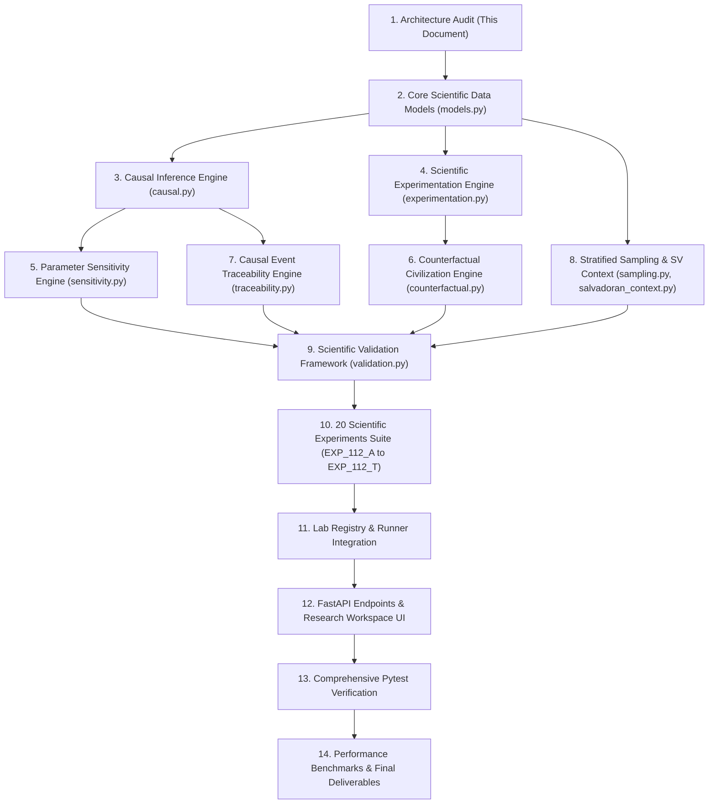

# PHASE 1.12 MANDATORY BASELINE AUDIT
## Scientific Experimentation, Causal Inference & Civilization Research

**Date**: November 2026  
**Environment**: Python 3.14.5, Windows 11, local-first offline execution  
**Target Subsystem**: SALTBOR Phase 1.12 Scientific Experimentation & Causal Inference Infrastructure  
**Verification Tools**: Graphify AST Knowledge Graph (12,678 nodes, 33,976 edges) & Pytest 9.2.0 (34 civilization tests passing in 0.69s, 24 phase 1.11 tests passing in 0.71s)

---

## 1. Executive Summary & Audit Scope

Prior to modifying or extending any components for **Phase 1.12: Scientific Experimentation, Causal Inference & Civilization Research**, an exhaustive architectural, structural, causal, and empirical audit of the SALTBOR repository was conducted in accordance with Section 1 of the Phase 1.12 directive and Section 1 of [AGENTS.md](file:///c:/GIT%20HUB/sv%20people/AGENTS.md).

The audit verified:
1. Complete existing architecture across all 7 layers (Layer 0 to Layer 6).
2. The current Graphify graph (`graphify-out/graph.json`, 12,678 nodes, 33,976 edges, 397 communities).
3. Existing experimental, statistical, causal, historical, and simulation engines in `saltbor/`.
4. Operational connectivity to the live simulation loop in [runner.py](file:///c:/GIT%20HUB/sv%20people/saltbor/simulation/runner.py).
5. Identification of duplicated functionality, dormant components, and architectural boundaries.
6. Existing geographic, spatial, and socioeconomic datasets for El Salvador (`geography.sqlite` with 151,251 features, national GeoJSONs, San Salvador Centro).
7. Existing test suites, benchmarks, and experiment reports.
8. Scientific limitations, missing causal structures, and uncertainty boundaries.

---

## 2. Graphify Architectural & Dependency Inspection

The Graphify index of the SALTBOR codebase contains **12,678 nodes** and **33,976 edges** across 397 communities.

Key communities identified by Graphify:
- **SimulationRunner** (`saltbor/simulation/runner.py`): Central clock, event bus, agent update pipeline, persistence coordinator.
- **CausalEventGraph** (`saltbor/events/causal_graph.py`): Event-level DAG recording simulation events, ancestor causal chains, and descendant consequence trees.
- **Cognitive & Epistemic Reasoning** (`saltbor/cognition/reasoning/causal.py`, `saltbor/cognition/epistemic/scientific_thinking.py`): Agent-level subjective causal inference and empirical hypothesis testing.
- **Knowledge Reasoning** (`saltbor/knowledge/reasoning/causal.py`, `saltbor/knowledge/experimentation/engine.py`): Synthetic human empirical testing of farming/crafting hypotheses and knowledge graph relationships.
- **SimulationLaboratory** (`saltbor/simulation/laboratory/lab.py`): Central workbench orchestrating behavioral experiments from Phase 0.4 up to Phase 1.11.
- **LongitudinalCivilizationEngine** (`saltbor/civilization/longitudinal.py`): Multi-scale engine driving 10 to 200 year societal trajectories across demography, economy, settlement, technology, cultural transmission, environmental stress, and resilience.

```mermaid
graph TD
    subgraph Layer0 [Layer 0: Core & Clock]
        Clock["SimulationClock"]
        Config["SimulationConfig"]
        Types["core/types.py"]
    end

    subgraph Layer1 [Layer 1: Individual Agents]
        Human["SyntheticHuman"]
        Psych["PsychologicalEngine"]
        Bio["PhysicalState / HealthEngine"]
        Cognition["CognitiveProfile / Autonomy"]
        Epistemic["ScientificThinkingEngine (Agent-Level)"]
    end

    subgraph Layer2 [Layer 2: Space & Environment]
        GeogDB["geography.sqlite (151,251 OSM Features)"]
        RealGeog["RealGeographicEngine"]
        Climate["SalvadoranClimateEngine"]
        World["IntegratedWorldSimulationEngine"]
    end

    subgraph Layer3 [Layer 3: Social & Meso-Institutions]
        Social["SocialEngine / MultiRelationship"]
        Norms["SocialNormEvolutionEngine"]
        CPR["CollectiveResourceManager (Ostrom)"]
        Commerce["InformalCommerce / Fiado"]
    end

    subgraph Layer4 [Layer 4: Civilization Macro]
        Civilization["LongitudinalCivilizationEngine"]
        Economy["EconomicCivilizationEngine (Conservation)"]
        Settlement["SettlementEngine"]
        Tech["TechnologyEvolutionEngine"]
        History["HistoricalMemoryEngine"]
    end

    subgraph Layer5 [Layer 5: Orchestration & Laboratory]
        Runner["SimulationRunner"]
        EventBus["EventBus"]
        CausalEvents["CausalEventGraph (Event DAG)"]
        Lab["SimulationLaboratory"]
    end

    subgraph Layer6 [Layer 6: Visual Analytics & REST API]
        FastAPI["api.py REST & SSE Router"]
        WebUI["Vanilla JS / HTML Observatories"]
    end

    Clock --> Runner
    Config --> Runner
    GeogDB --> RealGeog --> World
    Climate --> World
    World --> Runner
    Human --> Runner
    Psych --> Runner
    Social --> Runner
    Norms --> Runner
    CPR --> Runner
    Commerce --> Runner
    Civilization --> Runner
    Runner --> EventBus
    EventBus --> CausalEvents
    Runner --> Lab
    Runner --> FastAPI
    FastAPI --> WebUI
```

---

## 3. Existing Capabilities Audit

SALTBOR currently provides substantial operational capabilities:

1. **Deterministic Multi-Tick Simulation**:
   - Discrete 15-minute ticks with daily midnight reconciliation.
   - Fixed random seeds and SQLite WAL persistence.
2. **Double-Entry Accounting Conservation**:
   - Zero creation of money or agricultural assets out of thin air.
   - Enforced across household ledgers, housing rent, informal store *fiado*, and enterprise payrolls.
3. **Multi-Scale Longitudinal Civilization**:
   - [longitudinal.py](file:///c:/GIT%20HUB/sv%20people/saltbor/civilization/longitudinal.py) simulates 10 to 200 years tracking demographic turnover, Gompertz-Makeham mortality, family lineages, and settlement decay.
4. **Event-Level Causal Tracking**:
   - [causal_graph.py](file:///c:/GIT%20HUB/sv%20people/saltbor/events/causal_graph.py) maintains a DAG of simulation events, cycle prevention, upstream causes, and downstream consequences.
5. **Real Salvadoran Geospatial Grounding**:
   - 151,251 OSM features ingested in `geography.sqlite` (roads, buildings, places, water, landuse, administrative areas covering 14 departments).
6. **Extensive Experiment Registry**:
   - [lab.py](file:///c:/GIT%20HUB/sv%20people/saltbor/simulation/laboratory/lab.py) coordinates hundreds of experiments from Phase 0.4 to Phase 1.11.

---

## 4. Missing Capabilities

Despite the strengths above, SALTBOR lacks a dedicated scientific experimentation and causal inference framework:

1. **No Structural Causal Models (SCMs) & Formal DAG Inference**:
   - The existing `CausalEventGraph` tracks individual simulation events chronologically, but cannot evaluate Pearl's do-calculus ($do(X=x)$), causal paths, backdoor adjustment, or structural causal equations.
2. **No Statistical Treatment Effect Estimation**:
   - No built-in calculations for Average Treatment Effect (ATE), Conditional Average Treatment Effect (CATE), or Cohen's $d$ effect sizes.
3. **No Automated Confounding Detection & Mediation Analysis**:
   - Inability to distinguish Natural Direct Effects (NDE) from Natural Indirect Effects (NIE) through intermediate mediators.
4. **No Multi-Seed Statistical Robustness Runner**:
   - Prior experiments run on a single seed or manual loops without standardized multi-seed distributions, 95% bootstrap confidence intervals, variance decomposition, and outlier rejection.
5. **No Global Parameter Sensitivity Engine**:
   - No systematic One-At-A-Time (OAT), factorial sweeps, Monte Carlo parameter sampling, or Morris elementary effects.
6. **No Counterfactual Civilization Branching Engine**:
   - Inability to cleanly fork state $S_0$ at tick $T_{branch}$ and run parallel counterfactual trajectories (e.g., prolonged drought vs normal rain) with identical background seeds.
7. **No Stratified Population Sampling Engine**:
   - Experiments frequently sample agents arbitrarily rather than using stratified sampling across departments, urban/rural zones, age cohorts, and wealth quintiles.
8. **No Scientific Validation & External Comparator Framework**:
   - Missing explicit evidence validation tiers (`IMPLEMENTED`, `TESTED`, `EXPERIMENTALLY_EVALUATED`, `EMPIRICALLY_CALIBRATED`, `EXTERNALLY_VALIDATED`) and automated comparison against official Salvadoran statistics (BCR, DIGESTYC/ONE, World Bank).
9. **No Dedicated Scientific Research Workspace UI**:
   - The web interface has Civilization Observatory and Laboratory tabs, but lacks interactive causal DAG viewers, counterfactual timeline comparison, and sensitivity response curves.

---

## 5. Dormant & Underutilized Components

1. **`saltbor/cognition/reasoning/causal.py`**:
   - Sophisticated classification (`CORRELATION_ONLY`, `HYPOTHETICAL_CAUSALITY`, `EVIDENCE_BACKED`, `CONFOUNDED`) exists for agent cognition, but is not exposed to macro-simulation researchers.
2. **`saltbor/knowledge/scientific_service.py`**:
   - Defined `EvidenceTier` (Tiers 1-5) and source attribution, but remained largely detached from the simulation runner and experimental evaluation.
3. **`saltbor/datasets/gis/ingested/geography.sqlite`**:
   - Contains 474 administrative areas and 2,657 places for El Salvador, but macro experiments frequently use synthetic coordinates rather than sampling directly from real departmental boundaries.

---

## 6. Integration Opportunities

1. **Bridge SCM with `CausalEventGraph`**:
   - Unify event-level causal chains with population-level structural causal models to trace macro outcomes back to micro decisions.
2. **Integrate `LongitudinalCivilizationEngine` with Counterfactual Branching**:
   - Allow researchers to branch historical trajectories at specific historical years (e.g., year 2030 drought shock) and compare divergences.
3. **Connect Real Departmental Data**:
   - Embed 14 Salvadoran departments with real topographical and socioeconomic profiles directly into the sampling and experimental engines.
4. **Expose Causal & Sensitivity Endpoints in FastAPI**:
   - Add `/api/scientific/*` routes to drive a rich, interactive Research Workspace in the web frontend.

---

## 7. Architectural Risks & Mitigation Strategies

| Risk | Description | Mitigation Strategy |
| :--- | :--- | :--- |
| **State Mutation Leakage** | Running counterfactuals could accidentally modify the baseline simulation state. | Strictly clone engine state or run from serialized checkpoints. Verify zero mutation via state hashing. |
| **Computational Overhead** | Running multi-seed factorial experiments could cause extreme latency. | Vectorize computations with NumPy, use analytical formulations where possible, and run lightweight simulation slices for sensitivity sweeps. |
| **Spurious Causality Claims** | Mistaking correlation for causation in complex emergent systems. | Formally require do-calculus interventions, back-door adjustment, and explicit uncertainty flags. |
| **Overclaiming Empirical Validity** | Presenting simulation outcomes as predictions of real Salvadoran society. | Strictly enforce evidence tiers, mandate uncertainty intervals, and explicitly disclaim predictive claims. |

---

## 8. Data Limitations for El Salvador Context

1. **OSM Coverage Partiality**:
   - Building footprints in `geography.sqlite` are partial outside San Salvador Centro. Roads are extensive (121,344 segments), but turn restrictions are absent.
2. **Socioeconomic Granularity**:
   - National aggregates (BCR, EHPM) exist, but canton-level informal economic transactions are inherently unrecorded in official data.
3. **Scientific Epistemic Boundary**:
   - SALTBOR models synthetic human behavior based on validated social science mechanisms (Ostrom CPR, Granovetter network thresholds, OCC emotions), not deterministic forecasts of Salvadoran citizens.

---

## 9. Implementation Plan (Phase 1.12)

This audit confirms readiness to proceed with the implementation of SALTBOR Phase 1.12.
