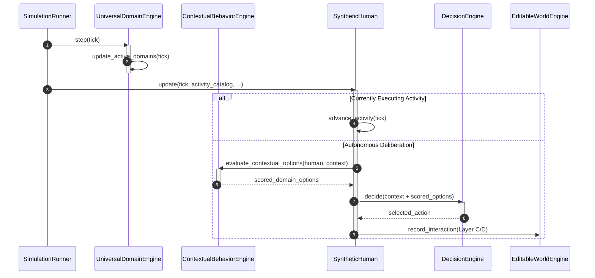

# SALTBOR PHASE 1.13: ARCHITECTURE PLAN & SPECIFICATION
## Universal Human Activity, Domain Simulation & Decision Intelligence Platform

**Target**: Python 3.14+, SQLite (WAL Mode), MapLibre GIS, Graphify Knowledge Graph  
**Directives**: Local-first, offline execution, strict accounting conservation, non-destructive layer isolation  

---

### 1. Conceptual Architecture

SALTBOR evolves from an agent-based simulation into a **configurable, multi-domain human activity platform**. The core premise is that **domains are contexts in which human life unfolds**, not independent simulators. All domains share:
- The synthetic human population core (`SyntheticHuman`, personality, emotions, memory, autonomy).
- The physical and spatial environment (base cartography, road graph, terrain, climate).
- The economic substrate (accounting conservation, double-entry ledgers, currency, *fiado*).
- The social and institutional network (families, communities, ADESCOs, norms, sanctions).
- Historical continuity and causality.

```mermaid
flowchart TD
    subgraph FOUNDATION["Unified Simulation Substrate"]
        POP["Synthetic Human Population & Demographics"]
        GEO["Base Cartography & Spatial Index (Layer A)"]
        ECON["Conserved Economic & Accounting Core"]
        SOC["Social Networks, ADESCOs & CPR Governance"]
    end

    subgraph UDE_LAYER["Universal Domain & Activity Architecture"]
        UDE["UniversalDomainEngine"]
        HAC["HumanActivityCatalog"]
        CBE["ContextualBehaviorEngine"]
        DDR["DomainDataRegistry"]
        DPE["DomainPermissionEngine"]
        EWE["EditableWorldEngine (Layers A, B, C, D)"]
    end

    subgraph DOMAINS["Pluggable Activity Domains"]
        FOOD["Food & Gastronomy Domain"]
        COMM["Commerce & Business Domain"]
        EDU["Education Domain"]
        HLTH["Healthcare Domain"]
        TRAN["Transportation Domain"]
        AGRI["Agriculture Domain"]
        FUTURE["Future Domains (Tourism, Housing, etc.)"]
    end

    subgraph INTELLIGENCE["Decision Intelligence & Experimentation"]
        HCSE["HumanCenteredScenarioEngine (Baseline vs Intervention)"]
        DIE["DecisionIntelligenceEngine (Multi-Objective Optimization)"]
        CED["CompactExperimentDatabase (Definition/Execution/Results/Evidence/Traceability)"]
        EXP["Experiment Explorer (Summary / Evidence / Technical)"]
    end

    subgraph WORKSPACE["Universal Simulation Workspace"]
        API["FastAPI REST & Telemetry Endpoints"]
        UI["Multi-Domain Web Workspace & Layered GIS Viewer"]
    end

    FOUNDATION --> UDE_LAYER
    UDE_LAYER --> DOMAINS
    DOMAINS --> INTELLIGENCE
    INTELLIGENCE --> WORKSPACE
```

---

### 2. Core Modules & Contracts

#### 2.1 Universal Domain Engine (`saltbor/domain/engine.py`)
- **`DomainDefinition`**: Dataclass defining:
  - `domain_id`: Unique identifier (e.g., `"food_gastronomy"`).
  - `name`: Human-readable title.
  - `purpose`: Societal or research objective.
  - `geographic_scope`: Bounding coordinates or administrative boundaries.
  - `relevant_population_filter`: Callable or filter criteria selecting participating agents.
  - `resources`: Resource types utilized (e.g., corn, cheese, gas, labor).
  - `infrastructure`: Required facilities (e.g., kitchens, dining spaces, stores).
  - `activities`: List of activity IDs registered in `HumanActivityCatalog`.
  - `entities`: Custom domain entity types (e.g., `Pupuseria`, `School`).
  - `operational_rules`: Rule engine specifications (sanitation, hours, licensing).
  - `available_services`: Services offered to agents.
  - `economic_relationships`: Payment, credit, wage, or subsidy flows.
  - `behavioral_mechanisms`: Cognitive appraisal, price elasticity, brand loyalty.
  - `indicators`: Primary outcome metrics (e.g., daily sales, dropout rate, wait time).
  - `possible_interventions`: Standard intervention templates.
  - `data_sources`: References to `DomainDataRegistry` entries.
  - `uncertainties`: Known epistemic limitations and stochastic factors.
  - `version`: Semantic version string.
  - `active`: Boolean activation status.
- **`UniversalDomainEngine`**: Coordinates registration, configuration validation, activation, deactivation, and lifecycle steps for all active domains.

#### 2.2 Human Activity Catalog (`saltbor/domain/catalog.py`)
- **`DomainActivity`**: Specification of human activities:
  - `activity_id`: Unique string ID (e.g., `"food.visit_pupuseria"`).
  - `domain_id`: Associated domain.
  - `name`: Display name.
  - `category`: Domain grouping (FOOD, COMMERCE, EDUCATION, HEALTH, TRANSPORT, AGRICULTURE).
  - `description`: Detailed description.
  - `duration_ticks`: Standard duration in 15-minute ticks.
  - `requirements`: Minimum energy, maximum hunger, minimum cash, required facility type.
  - `effects_per_tick`: Energy, hunger, social, financial, health, and skill deltas.
  - `contextual_evaluator`: Dynamic valuation function scoring desirability for an individual given their current context.
  - `is_interruptible`: Whether an agent can abandon the activity if higher-priority needs surge.
- **`HumanActivityCatalog`**: Master catalog exposing query, validation, and dynamic scoring methods.

#### 2.3 Contextual Human Behavior (`saltbor/domain/behavior.py`)
- **`ContextualBehaviorEngine`**:
  - Models bounded rationality, limited information, cognitive shortcuts, and mistakes.
  - Evaluates action trade-offs:
    - *Budget Elasticity*: Individuals with low cash opt for cheaper food, delay non-critical healthcare, or prioritize wage labor over education.
    - *Distance Decay*: Individuals prefer proximate vendors unless quality/price difference outweighs travel cost and time.
    - *Familiarity & Habit*: High trust/familiarity dampens willingness to switch suppliers without strong price or social incentives.
    - *Social Proof & Word-of-Mouth*: Recommendations from friends/family increase willingness to try new businesses or schools.
    - *Non-Purchase Option*: Synthetic humans can visit an establishment, inspect prices/menus, and consciously choose NOT to purchase if prices exceed perceived utility or budget.

#### 2.4 Editable World Layers (`saltbor/domain/editable_world.py`)
Strictly decouples spatial data into 4 non-destructive layers:
- **`Layer A — Base Cartography`**: Immutable OpenStreetMap and CNR reference geometries. Read-only.
- **`Layer B — Saltbor World`**: Custom user-created zones, municipal workspaces, custom facilities, and proposed infrastructure.
- **`Layer C — Human and Economic Activity`**: Dynamic population entities, active households, operating businesses, schools, clinics.
- **`Layer D — Interventions`**: Proposed policy, business, or infrastructural changes for scenario evaluation.
- Supports polygon authoring, point creation, facility property updates, scenario cloning, and permission-checked deletion.

#### 2.5 Territorial and Organizational Permissions (`saltbor/domain/permissions.py`)
- 10 distinct roles: `CITIZEN`, `BUSINESS_OWNER`, `BUSINESS_ADMINISTRATOR`, `PROPERTY_ADMINISTRATOR`, `RESEARCHER`, `EDUCATIONAL_INSTITUTION`, `HEALTHCARE_INSTITUTION`, `MUNICIPAL_ADMINISTRATOR`, `GOVERNMENT_INSTITUTION`, `PLATFORM_ADMINISTRATOR`.
- Permission operations: `READ`, `CREATE`, `EDIT`, `DELETE`, `ADMINISTER`.
- Scope boundaries: Geographic bounding polygon, institutional affiliation, and approval states (`DRAFT` $\rightarrow$ `PROPOSED` $\rightarrow$ `APPROVED` $\rightarrow$ `ACTIVE`).
- Full audit log of all authoring and editing actions.

#### 2.6 Human-Centered Scenario Engine (`saltbor/domain/scenarios.py`)
- Defines comparative simulations: Baseline vs. Intervention vs. Counterfactual.
- Tracks affected human populations and organizational entities.
- Records direct consequences (immediate activity changes) and indirect systemic effects (cascading economic, health, or social shifts).
- Preserves reproducibility via fixed random seed sequences and isolated state branching.

#### 2.7 Domain Data Registry (`saltbor/domain/data_registry.py`)
- Maintains explicit epistemic categorization across 6 validation tiers:
  1. `OBSERVED_REAL`: Empirical measurements from verified sources (e.g., BCR, DIGESTYC/ONEC, OSM).
  2. `IMPORTED_REFERENCE`: External benchmark datasets (World Bank, FAO, WHO).
  3. `USER_PROVIDED`: Data uploaded or entered by users.
  4. `SIMULATED`: Emergent outputs generated by the simulation engine.
  5. `HYPOTHETICAL`: Assumptions configured for scenario modeling.
  6. `MODEL_RECOMMENDATION`: Outputs generated by decision intelligence heuristics.
- Records provenance, license, collection date, spatial resolution, and limitations. Prevents silent mixing of simulated data with real records.

#### 2.8 Decision Intelligence Engine (`saltbor/domain/decision_intelligence.py`)
- Generates explainable, multi-objective recommendations.
- Evaluates trade-offs across: Commercial profitability, local employment, educational access, health coverage, community welfare, and environmental resilience.
- Structures every recommendation with: Objective, Context, Data Sources, Key Variables, Alternatives Considered, Expected Benefits, Risks/Disadvantages, Economic/Social Implications, Uncertainty, and Limitations.

#### 2.9 Compact Experiment Database & Explorer (`saltbor/domain/experiment_database.py`)
- Solves the code duplication crisis by separating:
  - **A. Experiment Definition** (protocol ID, research question, hypotheses, parameters, seeds)
  - **B. Experiment Execution** (run ID, timestamp, runtime, resources, status)
  - **C. Results** (indicators, bootstrap CIs, distributions, anomalies)
  - **D. Evidence** (data references, provenance, validation tier)
  - **E. Implementation Traceability** (file paths, classes, functions, git commit, graphify node, test IDs)
- 3-level progressive disclosure: `SUMMARY`, `EVIDENCE`, `TECHNICAL`.
- Stores references to codebase files, eliminating in-record procedural source code bloat.

---

### 3. Execution Flow & Tick Integration

