# SALTBOR PHASE 1.13: MANDATORY ARCHITECTURAL AUDIT
## Universal Human Activity, Domain Simulation & Decision Intelligence

**Audit Date**: November 2026  
**System Target**: SALTBOR Core & Multi-Domain Simulation Platform  
**Target Architecture**: Python 3.14+, SQLite (WAL Mode), MapLibre GIS, Graphify Knowledge Graph  
**Directives**: Local-first, pure offline, accounting conservation, strict non-destructive layering  

---

### 1. Existing System Architecture Overview

SALTBOR is built on an interconnected multi-agent simulation foundation where autonomous synthetic humans interact within physical, social, economic, cognitive, and institutional environments. The core codebase comprises **122 registered engine classes across 14 major subsystems**:

1. **Population Core (`saltbor/population/`)**:
   - `SyntheticHuman`: High-fidelity autonomous individual maintaining physical state, demographics, Big-Five personality traits, emotional appraisal state, episodic/semantic/procedural memory, goal autonomy lifecycle, and cognitive profile.
   - `PopulationRegistry`: In-memory and indexed registry of live humans with spatial hash-grid lookups for $O(1)$ co-location queries.
   - `HumanFactory`: Demographically representative agent generator calibrated to Salvadoran census distributions (age, sex, occupation, literacy).

2. **Cognitive & Decision Engine (`saltbor/cognition/`)**:
   - `DecisionEngine`: Bounded-rational choice engine utilizing `DecisionContext` (needs, energy, funds, location, diurnal phase, nearby peers, social invitations, active goals) to rank and select action options.
   - `PersonalityEngine`, `EmotionalEngine`, `MemoryEngine`, `LearningEngine`, `AutonomyEngine`.
   - `PsychologicalEngine` (`saltbor/psychology/`): Longitudinal emotional dynamics, stress vulnerability, cognitive load, and coping strategies.

3. **Geospatial & Environmental Core (`saltbor/world/`, `saltbor/datasets/gis/`)**:
   - `geography.sqlite`: 151,227 real-world geographic features (roads, buildings, natural features, public amenities) derived from Geofabrik OpenStreetMap extracts of El Salvador in WGS84 (`EPSG:4326`).
   - `SalvadoranGeographyEngine`, `SalvadoranClimateEngine`: Seasonal cycles (*invierno*, *verano*, *canícula*), tropical storm events, and terrain topology.
   - `SpatialIndex`, `OSMRouter`, `IntegratedWorldSimulationEngine`: Graph-based spatial navigation, street transit journeys, and place occupancy tracking.

4. **Economic & Commercial Core (`saltbor/economy/`, `saltbor/world/geographic/establishments.py`)**:
   - `CommercialEngine`, `LaborMarketEngine`, `HousingEngine`: Transaction engines enforcing strict double-entry accounting conservation (no money or inventory created *ex nihilo*).
   - `CreditEngine`, `InKindPaymentEngine`: Formal and informal credit instruments (*fiado*, loans, collateral).
   - `RemittanceEngine`, `InformalCommerceEngine`: Remittance flow from diaspora and informal street retail dynamics.

5. **Institutional, Social & Knowledge Core (`saltbor/institutions/`, `saltbor/social/`, `saltbor/knowledge/`)**:
   - `ADESCOEngine`, `GovernanceEngine`: Community development associations and municipal coordination.
   - `EmergentInstitutionEngine`, `CPRManager`: Elinor Ostrom Common-Pool Resource management rules and sanction graduated tiers.
   - `DistributedEducationEngine`, `ScientificThinkingEngine`: Intergenerational knowledge transmission and empirical reasoning.
   - `GlobalKnowledgeGraph`, `IndividualKnowledgeGraph`: Dual-tier semantic knowledge representation.

6. **Scientific & Experimental Framework (`saltbor/scientific/`, `saltbor/simulation/laboratory/`)**:
   - `ScientificExperimentationEngine`, `CausalInferenceEngine`: Structural Causal Models (SCMs), do-calculus interventions, bootstrap confidence intervals, sensitivity analysis.
   - `SimulationLaboratory`: Workbench coordinating multi-phase experiment execution and diagnostics.

---

### 2. Graphify Knowledge Graph & God Node Audit

Consultation of `graphify-out/graph.json` (13,044 nodes, 37,175 edges) reveals the structural coupling and high-centrality anchors of the codebase:

| Node Name | Node Type | Degree Centrality | Primary Role / Risk |
| :--- | :--- | :---: | :--- |
| **`SimulationRunner`** | Class | 893 | **Primary God Node**: Orchestrates all per-tick subsystems. High risk of coupling bloat if domain logic is hardcoded here. |
| **`ExperimentConfig`** | Class | 783 | Data contract used across all experiment suites. Central but lightweight. |
| **`ExperimentResult`** | Class | 753 | Execution result container. Currently captures unstructured metrics and markdown. |
| **`BaseExperiment`** | Class | 374 | Abstract root of all experimental protocols. |
| **`SimulationLaboratory`**| Class | 356 | Registry and execution runner for laboratory experiments. |
| **`SyntheticHuman`** | Class | 284 | Core entity representing synthetic individuals. Must remain domain-agnostic. |
| **`api.py`** | Module | 206 | FastAPI router module (4,763 lines). Heavy aggregation point for visualization. |
| **`SimulationEvent`** | Class | 203 | Event bus messaging payload. Essential for decoupled domain telemetry. |
| **`core/types.py`** | Module | 200 | Enum definitions (`ActivityType`, `NeedType`, `LocationType`). |
| **`IndividualKnowledgeGraph`** | Class | 186 | Epistemic representation of individual beliefs and skills. |

---

### 3. Subsystem Connectivity & Live Integration Matrix

An audit of `SALTBOR_ENGINE_INVENTORY.json` against `SimulationRunner.step()` identifies the actual connection status of existing engines:

| Subsystem | Engines in Inventory | Connected to Live Ticks | Only in Tests / Experiments | Connection Status Assessment |
| :--- | :---: | :---: | :---: | :--- |
| **Population & Demographics** | 3 | 3 | 0 | **Fully Integrated**: `SyntheticHuman.update()` executes every tick. |
| **Cognition & Decision** | 24 | 20 | 4 | **Substantially Integrated**: Decision, emotions, personality, memory, and goals run per tick. |
| **Psychology** | 1 | 1 | 0 | **Fully Integrated**: `PsychologicalEngine` processes events and advances population states. |
| **World GIS & Environment** | 14 | 11 | 3 | **Substantially Integrated**: Climate, terrain, road routing, and integrated world run per tick. |
| **Economy & Commerce** | 8 | 6 | 2 | **Partially Integrated**: Commercial overhead, labor payroll, housing rent, and credit step daily. Specific business operations are episodic. |
| **Social & Governance** | 20 | 14 | 6 | **Partially Integrated**: Social network decay, community formation, and CPR rules step daily. |
| **Civilization & Longitudinal** | 11 | 3 | 8 | **Isolated / Experimental**: Multi-generational settlement and technology engines primarily run in macro-experiments. |
| **Health & Accidents** | 2 | 2 | 0 | **Integrated via Extension**: Stepped daily via `ExtensionRuntime`. |
| **Education & Science** | 2 | 1 | 1 | **Partially Dormant**: Instantiated in runner, but educational enrollment and dropout cycles lack systematic domain hooks. |
| **Knowledge Representation** | 17 | 10 | 7 | **Integrated**: Semantic memory updates on significant events. |

---

### 4. OpenStreetMap Integration & Geographic Capabilities Audit

1. **Current Capabilities**:
   - `geography.sqlite` provides 151,227 real-world geographic features for El Salvador.
   - Road network topology allows A* pathfinding via `OSMRouter`.
   - Real-world locations (pharmacies, clinics, schools, markets, government offices) are mapped as `geo_establishments`.
2. **Current Limitations & Deficiencies**:
   - **Static Read-Only Database**: The GIS repository has no concept of mutable or user-defined layers. All queries hit the base OSM table.
   - **No Layer Separation**: There is no distinction between base cartography, user workspaces, dynamic human economic entities, and proposed intervention scenarios.
   - **No Spatial Authoring**: Users cannot draw custom polygons, propose new infrastructure, add new retail points, or simulate facility closures without modifying base data.

---

### 5. Experiment Storage & Code Duplication Audit (Section 14 Diagnosis)

A critical architectural flaw identified in Section 14 is the **excessive duplication of source code inside experimental records**:
1. **Diagnosis**: In previous phases (`phase111_civilization_experiments.py` with 1,300 lines, `phase112_scientific_experiments.py` with 1,121 lines), each experiment class duplicated 30–60 lines of procedural simulation logic directly inside its `run()` method, effectively creating synthetic shadow simulators instead of exercising reusable simulation engines.
2. **Storage Bloat**: Experiment results exported monolithic markdown reports with embedded synthetic tables and duplicated strings, rather than referencing source code artifacts, commit hashes, and structured statistical metrics.
3. **Missing Schema Separation**: No formal schema cleanly bifurcated:
   - *Experiment Definition* (protocol, parameters, hypotheses, seeds)
   - *Experiment Execution* (execution metadata, resource consumption, runtime status)
   - *Results* (indicators, bootstrap CIs, statistical distributions, anomalies)
   - *Evidence* (data references, provenance, validation tier)
   - *Implementation Traceability* (code references, classes, functions, git commit, graphify node)
4. **Missing Information Tiers**: No 3-level progressive disclosure (SUMMARY $\rightarrow$ EVIDENCE $\rightarrow$ TECHNICAL).

---

### 6. Gap Analysis: Missing Functionality vs Requirements

| Phase 1.13 Requirement | Existing Capability | Missing Capability to Implement |
| :--- | :--- | :--- |
| **Universal Domain Engine** | Hardcoded simulation subsystems in runner. | `UniversalDomainEngine` with dynamic domain registration, configuration schemas, validation, activation/deactivation, versioning. |
| **Human Activity Catalog** | `ActivityCatalog` with 70 predefined static activities. | `HumanActivityCatalog` with domain-contextualized activities (Food, Commerce, Education, Health, Transport, Agriculture), dynamic eligibility, and non-deterministic execution. |
| **Contextual Human Behavior** | Bounded-rational utility scoring in `DecisionEngine`. | `ContextualBehaviorEngine` integrating budget elasticity, distance decay, social recommendations, habituation, and refusal/non-purchase behavior. |
| **Food & Gastronomy Domain** | Informal foodways engine in culture module. | `FoodActivityDomain`: Pupuserías, street stalls, restaurants, menus, pricing, customer acquisition, unmet demand analysis, feasibility queries. |
| **Business & Commerce Domain** | Base commercial establishment accounting. | `BusinessActivityDomain`: Arbitrary business creation, supply chain links, inventory exhaustion, pricing strategies, bankruptcy, and solvent competition. |
| **Education Domain** | Distributed education engine in knowledge. | `EducationActivityDomain`: School enrollment, attendance, dropout mechanisms, transport access barriers, scholarships, meal programs, urban-rural disparity. |
| **Healthcare Domain** | Clinical morbidity in health engine. | `HealthcareActivityDomain`: Operational facility capacity, queues, triage, delayed treatment due to cost/transit, preventive services. |
| **Editable World Layers** | Monolithic OSM `geography.sqlite`. | `EditableWorldEngine`: Layer A (Base OSM), Layer B (Saltbor World), Layer C (Human/Economic Activity), Layer D (Interventions), with polygon/point editing. |
| **Permissions & Roles** | No multi-role security framework. | `DomainPermissionEngine`: 10 roles (Citizen to Platform Admin), scoped permissions, geographic bounds, approval workflow, audit logging. |
| **Scenario & Intervention Engine**| Ad-hoc multi-seed comparisons. | `HumanCenteredScenarioEngine`: Baseline vs. Intervention vs. Counterfactual comparative simulation, uncertainty quantification. |
| **Domain Data Registry** | Ad-hoc provenance strings. | `DomainDataRegistry`: 6-tier epistemic data separation (Observed Real to Model Recommendations), license tracking, metadata registry. |
| **Decision Intelligence** | Raw metric exports. | `DecisionIntelligenceEngine`: Multi-objective optimization (profit, employment, accessibility, resilience), transparent traceable explanations. |
| **Compact Experiment Database**| Monolithic procedural experiment files. | `CompactExperimentDatabase` & `ExperimentExplorer`: 5-part schema, 3-level disclosure, code references instead of inline duplicates, safe migration. |
| **Universal Workspace UI** | Fixed observatory and lab dashboards. | `UniversalSimulationWorkspace`: Multi-domain workspace panels, Layer A–D map toggles, intervention tools, scenario comparison charts. |

---

### 7. Architectural Conflicts & Performance Risks

1. **Accounting Conservation Violation Risk**:
   - Creating custom businesses, subsidies, scholarships, or credit without balanced counter-parties could violate Fundamental Rule 1.
   - *Mitigation*: All domain transactions must route through established ledgers (`HouseholdLedger`, `BusinessRegistry`, `Treasury`), debiting an authorized source (e.g., municipal budget or household savings) for every credit.
2. **Computational Latency & Memory Contention**:
   - Adding domain-specific evaluations for thousands of agents per tick could degrade tick throughput below the required $100\text{ ms/tick}$.
   - *Mitigation*: Utilize lazy evaluation, spatial hash indexing, diurnal gating (agents evaluate commercial options only during awake hours), and vectorized NumPy summaries.
3. **Data Contamination Risk**:
   - Mixing hypothetical user interventions with verified real-world OSM cartography or empirical census figures.
   - *Mitigation*: Strict architectural isolation across Layer A (read-only base) and Layer B/C/D (user/simulated overlays) with cryptographic provenance tags.

---

### 8. Implementation & Integration Plan

The implementation will proceed along a strictly disciplined 7-stage architectural path:

```mermaid
flowchart TD
    subgraph STAGE_1["Stage 1: Core Foundation & Registries"]
        UDE["UniversalDomainEngine"]
        HAC["HumanActivityCatalog"]
        DDR["DomainDataRegistry"]
        DPE["DomainPermissionEngine"]
    end

    subgraph STAGE_2["Stage 2: Geospatial & World Layers"]
        EWE["EditableWorldEngine (Layers A, B, C, D)"]
    end

    subgraph STAGE_3["Stage 3: Contextual Behavior & Specialized Domains"]
        CBE["ContextualBehaviorEngine"]
        FAD["FoodActivityDomain"]
        BAD["BusinessActivityDomain"]
        EAD["EducationActivityDomain"]
        HAD["HealthcareActivityDomain"]
        TAD["TransportationActivityDomain"]
        AAD["AgricultureActivityDomain"]
    end

    subgraph STAGE_4["Stage 4: Decision Intelligence & Scenarios"]
        HCSE["HumanCenteredScenarioEngine"]
        DIE["DecisionIntelligenceEngine"]
    end

    subgraph STAGE_5["Stage 5: Compact Experiment Database & Knowledge"]
        CED["CompactExperimentDatabase"]
        EXP113["Phase 1.13 Experiment Suite (EXP_113_A to EXP_113_T)"]
    end

    subgraph STAGE_6["Stage 6: API & Universal Workspace Integration"]
        API["FastAPI Endpoints (api.py)"]
        UI["Web Workspace (app.js, index.html)"]
    end

    subgraph STAGE_7["Stage 7: Verification, Benchmarking & Graphify"]
        TESTS["Pytest Suites (tests/test_domain/)"]
        BENCH["Performance Benchmarks & Memory Audits"]
        GRAPHIFY["Graphify Knowledge Graph Update"]
    end

    STAGE_1 --> STAGE_2
    STAGE_2 --> STAGE_3
    STAGE_3 --> STAGE_4
    STAGE_4 --> STAGE_5
    STAGE_5 --> STAGE_6
    STAGE_6 --> STAGE_7
```

