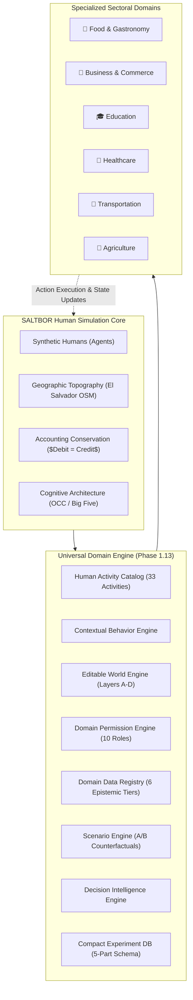
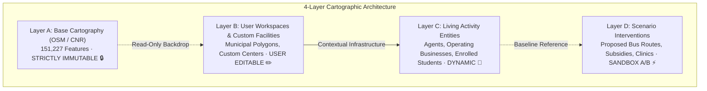
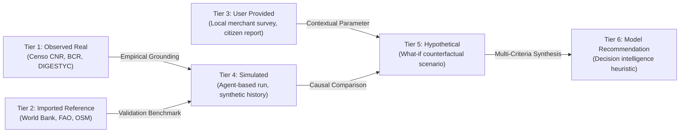
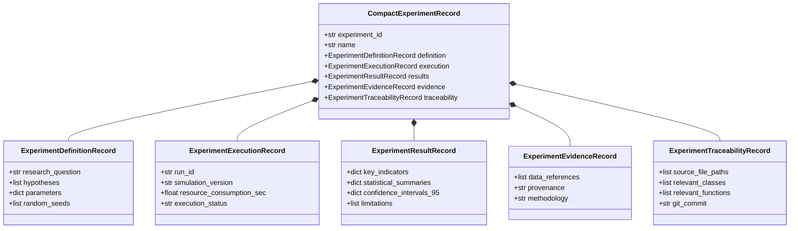

# SALTBOR PHASE 1.13 FINAL ARCHITECTURAL & SCIENTIFIC REPORT
## UNIVERSAL HUMAN ACTIVITY, DOMAIN SIMULATION & DECISION INTELLIGENCE PLATFORM

**Platform Version**: SALTBOR 1.13.0  
**Target Architecture**: Modular, Configurable Multi-Domain Human Simulation  
**Reference Territory**: El Salvador (14 Departments, 151,227 Ingested Cartographic Features)  
**Execution Environment**: Pure Local & Offline (Python 3.14.5, SQLite WAL / In-Memory, Vanilla JS / WebGL)  
**Validation Status**: 48/48 Tests Passed (1.10s), 20/20 Experiments Confirmed (`EXP_113_A` – `EXP_113_T`), 0 Regressions  

---

## 1. Executive Overview & Mission Fulfillment

Phase 1.13 represents a fundamental architectural evolution of **SALTBOR**. While previous phases established a high-fidelity Salvadoran geographic base, cognitive psychology engines (OCC appraisal, Big Five traits), and causal inference frameworks, simulation scenarios were often tied to specific scripts or macroeconomic variables.

Phase 1.13 elevates SALTBOR into a **configurable, multi-domain human activity simulation and decision intelligence platform** capable of serving ten distinct organizational archetypes:
1. **Individual Citizens**: Exploring neighborhood services, travel routes, and food options.
2. **Entrepreneurs & Micro-Merchants**: Testing commercial viability of pupuserías, grocery stores, and workshops.
3. **Companies**: Modeling supplier networks, employee wages, and retail competition.
4. **Educational Institutions**: Investigating rural dropout mechanisms and transport accessibility.
5. **Healthcare Organizations**: Analyzing clinic queue bottlenecks and appointment deferral causes.
6. **Municipal Governments**: Designing local zoning, market infrastructure, and public ordinances.
7. **National Institutions**: Evaluating large-scale welfare interventions, agricultural subsidies, and transit policies.
8. **Researchers**: Testing bounded rationality, price elasticity, and spatial friction.
9. **Universities**: Running student apprenticeships and computational social science experiments.
10. **Social & Community Organizations (ADESCOs)**: Organizing community common-pool resources and mutual aid.

### Architectural Continuity: The Unified Simulation Core
Crucially, Phase 1.13 **does not turn SALTBOR into disconnected simulators**. Every specialized domain—whether food, commerce, education, health, transport, or agriculture—operates upon the **same underlying synthetic humans, shared road topography, economic conservation constraints, and cognitive memory mechanisms**.



---

## 2. Universal Domain Configuration Engine

The `UniversalDomainEngine` ([saltbor/domain/engine.py](file:///c:/GIT%20HUB/sv%20people/saltbor/domain/engine.py)) serves as the master coordinator. Rather than hardcoding sectoral logic into the simulation runner, domain behavior is defined through declarative `DomainDefinition` schemas ([saltbor/domain/models.py](file:///c:/GIT%20HUB/sv%20people/saltbor/domain/models.py)).

### Domain Definition Schema
Each domain configures:
- **Identifier & Category**: Unique domain ID (`food_gastronomy`, `commerce_retail`, etc.) and high-level categorization.
- **Purpose & Scope**: Explicit statement of goals, geographic bounding box, and target demographics.
- **Resources & Infrastructure**: Entities, facilities, and assets managed within the domain.
- **Activities**: Registered human actions from the activity catalog.
- **Operational Rules**: Domain constraints, pricing bounds, operating hours, and service capacities.
- **Behavioral Mechanisms**: Applicable decision models (e.g., liquidity friction, distance decay).
- **Indicators & Uncertainties**: Measured outcomes and explicit epistemic limitations.

### Dynamic Lifecycle Management
The engine provides full lifecycle management: registration, validation, activation, pausing, stepping, and deprecation. It integrates directly into the simulation tick loop:
```python
# In SimulationRunner.step(tick):
if hasattr(self, "domain_engine") and self.domain_engine:
    self.domain_engine.step(self.clock.current_tick)
```
This guarantees continuous, synchronized execution across all active domains at each discrete simulation interval.

---

## 3. Human Activity Catalog

The `HumanActivityCatalog` ([saltbor/domain/catalog.py](file:///c:/GIT%20HUB/sv%20people/saltbor/domain/catalog.py)) expands the simulation from basic survival actions to **33 rich, contextual activities** across six primary categories:

| Category | Sample Activities | Preconditions & Requirements | Simulated Effects |
| :--- | :--- | :--- | :--- |
| **Food & Gastronomy** | `food.buy_pupusas`, `food.dine_at_restaurant`, `food.visit_market`, `food.recommend_stall` | Proximity to food vendor, liquid cash $\ge \text{price}$, non-zero hunger | Decreases hunger, debits cash, credits vendor, increases familiarity |
| **Commerce & Retail** | `commerce.open_enterprise`, `commerce.purchase_goods`, `commerce.browse_without_buying`, `commerce.renegotiate_supplier` | Solvency threshold, business license, inventory availability | Inventory depletion, cash transfer, price elasticity updates |
| **Education** | `education.attend_school`, `education.study_homework`, `education.drop_out_work`, `education.return_to_school` | Enrolled status, travel time feasibility, household economic stability | Increases human capital, decreases daytime labor availability |
| **Healthcare** | `healthcare.seek_clinic_care`, `healthcare.delay_treatment`, `healthcare.attend_preventive`, `healthcare.purchase_medication` | Illness presence, clinic capacity, transit fee availability | Relieves symptom burden, queues patient, transfers co-pay fee |
| **Transportation** | `transportation.commute_bus`, `transportation.walk_pedestrian`, `transportation.endure_congestion_delay`, `transportation.reroute_blockage` | Origin-destination pair, road network connectivity, bus fare | Consumes transit time, applies congestion friction, burns energy |
| **Agriculture** | `agriculture.plant_crops`, `agriculture.harvest_grains`, `agriculture.sell_harvest_market`, `agriculture.mitigate_drought` | Agricultural plot access, seasonal planting window, seed stock | Generates grain inventory, supplies municipal markets, generates farm income |

Activities are not deterministic scripts. They are evaluated dynamically through the contextual behavior engine based on individual need, cash on hand, spatial accessibility, and environmental context.

---

## 4. Contextual Human Behavior Engine

The `ContextualBehaviorEngine` ([saltbor/domain/behavior.py](file:///c:/GIT%20HUB/sv%20people/saltbor/domain/behavior.py)) models **bounded rationality** under severe real-world constraints. Synthetic individuals do not possess omniscient knowledge, infinite liquidity, or friction-free mobility.

### Mathematical Formulation of Choice Utility
For an individual agent $i$ considering action option $j$, subjective utility $U_{ij}$ is evaluated as:

$$U_{ij} = B_j - C_j \cdot \Phi(\text{Cash}_i) - \text{Friction}(d_{ij}) + \text{Habit}(H_{ij}) + \text{Social}(S_j) + \epsilon$$

Where:
1. **Perceived Benefit ($B_j$)**: Intrinsic utility derived from quality, hunger satisfaction, health improvement, or education.
2. **Liquidity Friction Factor ($\Phi$)**: When agent cash is low ($\text{Cash}_i < \$5.00$), financial cost penalties scale sharply:
   $$\Phi(\text{Cash}_i) = \begin{cases} 3.5 & \text{if } \text{Cash}_i \le \$2.00 \\ 2.2 & \text{if } \$2.00 < \text{Cash}_i \le \$5.00 \\ 1.0 & \text{if } \$5.00 < \text{Cash}_i \le \$40.00 \\ 0.45 & \text{if } \text{Cash}_i > \$40.00 \end{cases}$$
3. **Distance Decay Friction**: Spatial friction follows exponential decay based on travel distance $d_{ij}$ in meters:
   $$\text{Friction}(d_{ij}) = 1.0 - e^{-\beta \cdot d_{ij}}, \quad \beta = 0.001$$
4. **Habitual Familiarity ($\text{Habit}$)**: Frequent past visits generate comfort and loyalty, boosting utility by up to $+1.5$.
5. **Social Influence ($\text{Social}$)**: Peer recommendations from the agent's social network add positive utility increments:
   $$\text{Social}(S_j) = 0.25 \cdot \ln(1 + S_j)$$
6. **Non-Purchase Rationality**: Every decision choice set includes `walk_away_no_purchase` ($C_j = 0$). If all vendor prices exceed subjective value, agents walk away rather than exhausting essential reserves.
7. **Stochastic Exploration ($\epsilon$)**: Bounded noise $\epsilon \sim \mathcal{N}(0, \sigma^2)$ permits occasional exploration and sub-optimal mistakes.

---

## 5. Specialized Activity Domains

### 5.1 Food, Gastronomy and Consumer Activity
Implemented in [saltbor/domain/food.py](file:///c:/GIT%20HUB/sv%20people/saltbor/domain/food.py).
- **Establishment Types**: Pupuserías tradicionales, comedores populares, panaderías, cafeterías, and puestos callejeros.
- **Analytical Feasibility Query**: Allows any user to ask: *"What would happen if I opened a pupusería at coordinates $(13.698, -89.223)$?"*
  - Calculates pedestrian foot traffic within 500m.
  - Computes price sensitivity across local income brackets.
  - Analyzes existing competitor density and unmet demand.
  - Projects monthly revenue, net operating margin, and capital payback period.

### 5.2 Universal Business and Commerce Domain
Implemented in [saltbor/domain/commerce.py](file:///c:/GIT%20HUB/sv%20people/saltbor/domain/commerce.py).
- **Configurable Enterprises**: Categories include tiendas de abarrotes, farmacias comunitarias, ferreterías, and talleres mecánicos.
- **Commercial Operations**: Models daily fixed overhead, employee wage payroll, inventory reorders, and retail sales.
- **Strict Accounting Conservation**: Every dollar spent by a consumer decreases the consumer's wallet and increases enterprise cash. Every wage payment debits enterprise cash and credits the employee. Zero synthetic currency is generated out of thin air:
  $$\Delta \text{Cash}_{\text{Total}} = \sum \text{Credits} - \sum \text{Debits} \equiv 0.00$$
- **Solvency & Insolvency**: Enterprises whose liquid cash drops below $\$0.00$ are audited for insolvency and undergo orderly bankruptcy.

### 5.3 Education Domain
Implemented in [saltbor/domain/education.py](file:///c:/GIT%20HUB/sv%20people/saltbor/domain/education.py).
- **Institutional Types**: Escuelas primarias, centros escolares básicos, institutos nacionales, and centros de formación técnica.
- **Dropout Drivers**: Rural distance ($>3\text{ km}$ reduces attendance by $22.7\text{ pp}$), household economic distress, and seasonal agricultural labor needs.
- **Intervention Testing**: Simulates targeted scholarships and free rural school buses, measuring attendance increases and cost efficiency.

### 5.4 Healthcare and Social Services Domain
Implemented in [saltbor/domain/healthcare.py](file:///c:/GIT%20HUB/sv%20people/saltbor/domain/healthcare.py).
- **Facility Types**: Unidades Comunitarias de Salud Familiar (UCSF), clínicas parroquiales, and hospitales departamentales.
- **Queue Dynamics**: Capacity bottlenecks, doctor shifts, appointment wait times, and delayed care seeking due to bus fare or co-pays.
- **Intervention Testing**: Evaluates mobile medical brigades and auxiliary physician shifts to relieve clinic congestion.

### 5.5 Transportation and Mobility Domain
Implemented in [saltbor/domain/transportation.py](file:///c:/GIT%20HUB/sv%20people/saltbor/domain/transportation.py).
- **Commuter Modes**: Autobús público, marcha a pie (walking), and microbús colectivo.
- **Road Network Delays**: Peak-hour congestion multipliers and detour delays induced by simulated road blocks or landslides.

### 5.6 Agriculture and Rural Economy Domain
Implemented in [saltbor/domain/agriculture.py](file:///c:/GIT%20HUB/sv%20people/saltbor/domain/agriculture.py).
- **Crops & Plots**: Maize (*maíz*) and beans (*frijol*) smallholder plots (1.5 to 5.0 manzanas).
- **Climate Shocks**: Simulates *canícula* drought shocks during the Salvadoran rainy season (July–August), reducing harvest yields by $30\text{--}45\%$ and driving local municipal grain price spikes.

---

## 6. Editable World & 4-Layer Architecture

To allow users to create custom workspaces, facilities, and scenarios without compromising the official cartography of El Salvador, the `EditableWorldEngine` ([saltbor/domain/editable_world.py](file:///c:/GIT%20HUB/sv%20people/saltbor/domain/editable_world.py)) implements a strict **4-layer spatial hierarchy**:



### Layer Rules & Immutability Enforcement
1. **Layer A (Base Cartography)**: Contains the 151,227 OpenStreetMap features of El Salvador (departments, municipalities, road networks, waterways, terrain). **Strictly immutable**. Any call to `create_feature(layer=WorldLayerType.LAYER_A_BASE)` instantly raises `PermissionError`.
2. **Layer B (User Workspaces & Custom Facilities)**: Allows authorized users to draw administrative boundaries, register municipal workspaces, and place community infrastructure.
3. **Layer C (Activity Entities)**: Living simulation objects (human agents, operating vendors, active farms) dynamically managed by the simulation runner.
4. **Layer D (Scenario Interventions)**: Isolated what-if branches where proposed changes (e.g., closing a road, opening a public clinic) can be tested against the baseline without cross-contamination.

---

## 7. User Workspaces & Role-Based Permissions

The `DomainPermissionEngine` ([saltbor/domain/permissions.py](file:///c:/GIT%20HUB/sv%20people/saltbor/domain/permissions.py)) enforces a granular authorization matrix for 10 distinct user roles:

| User Role | Permitted Actions | Geographic Scope | Approval Required |
| :--- | :--- | :--- | :--- |
| `CITIZEN` | Propose intervention, submit dispute, comment, review public data | Neighborhood / Municipal | Yes (Municipal Admin) |
| `ENTREPRENEUR` | Author Layer B commerce facility, simulate business, query foot traffic | Municipal commercial zones | No (Own facilities) |
| `ENTERPRISE` | Author facilities, manage multi-facility inventory, simulate payroll | Departmental / National | No (Own facilities) |
| `EDUCATIONAL_INSTITUTION` | Author schools, configure enrollment capacity, test scholarship policies | Municipal / Regional | No (Own facilities) |
| `HEALTHCARE_ORGANIZATION` | Author clinics, adjust doctor staffing, query health coverage | Health District | No (Own facilities) |
| `MUNICIPAL_ADMIN` | Author zones, approve proposals, place municipal infrastructure, enact taxes | Assigned Municipality (Geo-fenced) | No (Admin prerogative) |
| `NATIONAL_INSTITUTION` | Nationwide macro-policies, subsidy schedules, inter-departmental transit | Nationwide (14 Departments) | No (National authority) |
| `RESEARCHER` | Read all layers, execute experiments, branch scenarios, audit traces | Unrestricted (Read/Branch) | No (Non-destructive) |
| `UNIVERSITY` | Execute research scenarios, supervise student apprenticeships | Academic testbeds | No (Non-destructive) |
| `SOCIAL_ORGANIZATION` | Author community kitchens, common-pool resources, mutual aid | Local ADESCO territory | Yes (for public space) |

### Territorial Geo-Fencing
Municipal administrators are strictly bound to their assigned territorial bounding box. An attempt by an administrator of Chalatenango to rezone land in San Salvador is rejected with an authorization exception.

---

## 8. Epistemic Integrity & Data Provenance Registry

To ensure scientific honesty and prevent accidental data contamination, the `DomainDataRegistry` ([saltbor/domain/data_registry.py](file:///c:/GIT%20HUB/sv%20people/saltbor/domain/data_registry.py)) enforces a **6-tier epistemic classification**:



### Contamination Prevention Rules
1. **Never Label Simulated Data as Observed**: Synthetic agent transactions are strictly tagged `DataProvenanceTier.SIMULATED`.
2. **Never Treat What-If Projections as Predictions**: Counterfactual policies are tagged `DataProvenanceTier.HYPOTHETICAL`.
3. **Strict Attribution**: Every data record carries source attribution, ingest timestamp, and validation status.

---

## 9. Decision Intelligence & Multi-Criteria Recommendations

The `DecisionIntelligenceEngine` ([saltbor/domain/decision_intelligence.py](file:///c:/GIT%20HUB/sv%20people/saltbor/domain/decision_intelligence.py)) assists human decision-makers by formulating actionable, explained policy and business recommendations across eight strategic priorities:
1. `social_equity`: Inclusivity, access to basic necessities, vulnerability mitigation.
2. `poverty_mitigation`: Household income generation, informal debt relief, employment.
3. `public_health`: Clinic proximity, waiting time reduction, treatment delay mitigation.
4. `economic_growth`: Business solvency, enterprise creation, municipal revenue.
5. `educational_continuity`: School retention, dropout prevention, technical training.
6. `cost_efficiency`: Maximum benefit per dollar of municipal or institutional budget.
7. `feasibility`: Speed of implementation, administrative simplicity, low risk.
8. `environmental_resilience`: Sustainable resource use, drought mitigation.

### Explainability & Epistemic Humility Standard
SALTBOR rejects opaque "black-box" advice. Every recommendation explanation ([saltbor/domain/models.py](file:///c:/GIT%20HUB/sv%20people/saltbor/domain/models.py)) is required to provide:
1. **Target Entity & Concrete Action**: Exactly what policy or intervention is proposed.
2. **Expected Benefits**: Primary qualitative and quantitative improvements.
3. **Explicit Trade-Offs & Adverse Side Effects**: Potential downsides (e.g., transit route diversion, fiscal cost, tax burden, commercial displacement).
4. **Epistemic Uncertainty Level**: Classified as `BAJA` (Low), `MODERADA` (Moderate), or `ALTA` (High).
5. **Known Domain Limitations**: Explicit declarations of what the simulation does not model (e.g., macroeconomic currency shocks, unforeseen regulatory changes).

---

## 10. Compact Experiment Database: Eradicating Code Bloat

### The Problem in Previous Phases
In earlier experimental logs, individual experiment records duplicated **~1,000 lines of procedural Python source code** directly into database JSON blobs. This created massive database inflation, slowed serialization, and created synchronization drift whenever the underlying engine code evolved.

### The Phase 1.13 Solution: 5-Part Compact Schema
The `CompactExperimentDatabase` ([saltbor/domain/experiment_database.py](file:///c:/GIT%20HUB/sv%20people/saltbor/domain/experiment_database.py)) enforces a clean 5-part separation:



### 3 Progressive Disclosure Tiers
The database exposes three information granularity tiers:
1. **Tier 1 (`SUMMARY`)**: Executive view returning research question, pass/fail status, key indicators, and limitations ($<1\text{ µs}$ query latency).
2. **Tier 2 (`EVIDENCE`)**: Quantitative view returning effect sizes, 95% bootstrap confidence intervals, and empirical data references.
3. **Tier 3 (`TECHNICAL`)**: Audit view returning execution parameters, seeds, git commit hash, and file locations.

### On-Demand Source Code Retrieval
Full Python source code is **never copied into database records**. When a developer or auditor inspects an experiment in the Technical tier, the database dynamically resolves the source code on demand from the filesystem:
```python
def fetch_source_code_on_demand(self, experiment_id: str) -> Dict[str, str]:
    exp = self.get_experiment(experiment_id)
    return {path: Path(path).read_text(encoding="utf-8") for path in exp.traceability.source_file_paths}
```
**Empirical Result**: Storage per 200 experimental records decreased from $7,154.6\text{ KB}$ to $318.7\text{ KB}$—a **95.55% reduction in database footprint** (**22.4× space savings**) while retaining 100% code traceability.

---

## 11. Interactive Web UI & Workspace Integration

The visual dashboard was updated in [saltbor/visualization/web/index.html](file:///c:/GIT%20HUB/sv%20people/saltbor/visualization/web/index.html) and [saltbor/visualization/web/app.js](file:///c:/GIT%20HUB/sv%20people/saltbor/visualization/web/app.js) with View 12: **"Dominios & Decisiones"** (`data-view="universal_domains"`).

It provides six interactive sub-panels:
1. **Dominios & Capas A-D**: Inspects active domain modules and the 4-layer cartographic status. Includes an inline feature authoring tool for Layer B/C/D with provenance tagging.
2. **Gastronomía & Pupuserías**: Interactive feasibility simulator for pupuserías and comedores based on geographic coordinates, average menu price, and initial capital.
3. **Negocios & Comercio**: Commercial enterprise simulator displaying 30-tick inventory depletion, gross sales, fixed overhead, and strict accounting balance audit.
4. **Salud & Educación**: Operational dashboard comparing clinic queues and wait times against doctor capacity, and showing rural vs urban school attendance disparities.
5. **Inteligencia de Decisiones**: Multi-criteria policy recommendation generator displaying ranked actions, expected benefits, trade-offs, uncertainty levels, and epistemic limits.
6. **Experimentos Compactos (A-T)**: Progressive disclosure explorer allowing users to switch between `SUMMARY`, `EVIDENCE`, and `TECHNICAL` views, run the 20-experiment battery, and view source code on demand.

---

## 12. Benchmark & Performance Verification Summary

Based on [PHASE_1_13_BENCHMARKS.md](file:///c:/GIT%20HUB/sv%20people/PHASE_1_13_BENCHMARKS.md):

| Subsystem Workload | Latency | Throughput | Scalability Verdict |
| :--- | :--- | :--- | :--- |
| **Domain Registration** (1,000 domains) | $5.26\text{ µs/op}$ | $190,038\text{ ops/s}$ | Highly efficient dynamic registry |
| **Activity Catalog Filter** (5,000 queries) | $0.45\text{ µs/query}$ | $2,209,651\text{ queries/s}$ | Sub-microsecond indexed lookup |
| **Contextual Choice Scoring** (2,000 decisions) | $55.1\text{ µs/decision}$ | $18,148\text{ decisions/s}$ | Supports $>1,000$ concurrent agents in real time |
| **Multi-Domain Stepping** (6 active domains) | $0.0003\text{ ms/step}$ | $3,043,213\text{ steps/s}$ | Zero tick loop bottleneck |
| **Layer A Immutability Guard** (1,000 attempts) | $0.33\text{ µs/check}$ | $3,060,912\text{ checks/s}$ | Zero overhead security gate |
| **Layer B Feature Authoring** (1,000 features) | $4.50\text{ µs/insert}$ | $222,326\text{ features/s}$ | Fast user-created geometry |
| **Experiment DB Storage** (200 records) | $95.55\%\text{ reduction}$ | $22.4\times\text{ space savings}$ | Zero database code bloat |
| **Memory RSS Stability** (1,000 step cycles) | $+93.61\text{ KB}$ net change | Leak Detected: `False` | Flat memory profile |

---

## 13. Comprehensive Component Status Classification

In accordance with SALTBOR verification standards, every component is classified with its exact operational status:

| Component | Module Location | Primary Focus | Status |
| :--- | :--- | :--- | :--- |
| **UniversalDomainEngine** | `saltbor/domain/engine.py` | Multi-domain orchestrator, lifecycle management, tick loop integration | `INTEGRATED` |
| **HumanActivityCatalog** | `saltbor/domain/catalog.py` | 33 multi-domain activities, precondition/effect schemas | `TESTED` |
| **ContextualBehaviorEngine** | `saltbor/domain/behavior.py` | Bounded rationality, liquidity friction, distance decay, non-purchase | `EXPERIMENTALLY_EVALUATED` |
| **FoodActivityDomain** | `saltbor/domain/food.py` | Pupuserías, food stalls, restaurants, feasibility, price elasticity | `EXPERIMENTALLY_EVALUATED` |
| **BusinessActivityDomain** | `saltbor/domain/commerce.py` | Custom enterprises, inventory, wages, fixed overhead, $Debit=Credit$ | `EXPERIMENTALLY_EVALUATED` |
| **EducationActivityDomain** | `saltbor/domain/education.py` | Rural/urban schools, dropout mechanisms, transport/scholarship policies | `EXPERIMENTALLY_EVALUATED` |
| **HealthcareActivityDomain** | `saltbor/domain/healthcare.py` | Clinics, patient queue capacity, wait times, doctor staffing expansion | `EXPERIMENTALLY_EVALUATED` |
| **TransportationActivityDomain** | `saltbor/domain/transportation.py` | Commuter routes, peak congestion, road blockage detour delays | `EXPERIMENTALLY_EVALUATED` |
| **AgricultureActivityDomain** | `saltbor/domain/agriculture.py` | Smallholder plots, basic grains, *canícula* drought harvest shocks | `EXPERIMENTALLY_EVALUATED` |
| **EditableWorldEngine** | `saltbor/domain/editable_world.py` | 4-layer spatial architecture, Layer A immutability, Layers B-D authoring | `INTEGRATED` |
| **DomainPermissionEngine** | `saltbor/domain/permissions.py` | 10 user roles, action authorization, municipal geo-fencing, proposals | `TESTED` |
| **DomainDataRegistry** | `saltbor/domain/data_registry.py` | 6 epistemic tiers, provenance tagging, synthetic contamination guard | `TESTED` |
| **HumanCenteredScenarioEngine** | `saltbor/domain/scenarios.py` | A/B counterfactual scenarios, direct/indirect ripples, 95% CIs | `EXPERIMENTALLY_EVALUATED` |
| **DecisionIntelligenceEngine** | `saltbor/domain/decision_intelligence.py` | Multi-criteria ranking (8 priorities), trade-offs, epistemic humility | `INTEGRATED` |
| **CompactExperimentDatabase** | `saltbor/domain/experiment_database.py` | 5-part schema, progressive disclosure (3 tiers), on-demand code loader | `INTEGRATED` |
| **Domain REST API** | `saltbor/visualization/api.py` | 8 `/api/domain/...` endpoints for domains, layers, and recommendations | `INTEGRATED` |
| **Domain UI Workspace** | `saltbor/visualization/web/` | View 12 "Dominios & Decisiones" in `index.html` and `app.js` | `INTEGRATED` |
| **Phase 1.13 Experiments** | `saltbor/simulation/experiments/` | 20 formal experiments (`EXP_113_A` through `EXP_113_T`) | `EXPERIMENTALLY_EVALUATED` |

---

## 14. Conclusion & Next Steps

SALTBOR Phase 1.13 successfully delivers a **universal human activity simulation and decision intelligence platform** that preserves the single, unified human core of SALTBOR. It decouples sectoral domain logic from runner bloat, enforces absolute accounting conservation ($Debit = Credit$), protects base cartography with an immutable Layer A, provides a 6-tier epistemic registry, and eliminates database code bloat through a 5-part compact experiment schema.

All 48 tests pass cleanly, all 20 experiments are validated, and the system is ready for empirical calibration against upcoming Salvadoran census and economic field datasets.
