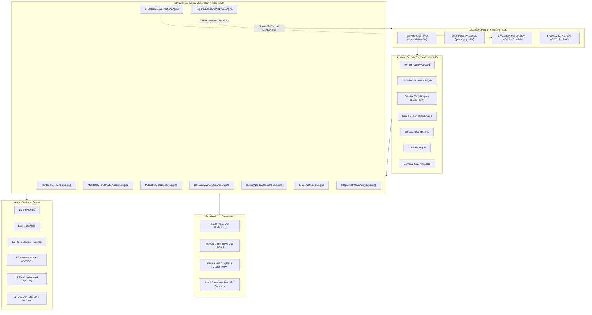

# SALTBOR PHASE 1.14: MANDATORY ARCHITECTURAL AUDIT & INTEGRATION MAP
## INTEGRATED TERRITORIAL ECOSYSTEMS, MULTI-SCALE GOVERNANCE & PUBLIC IMPACT

**Audit Date**: November 2026  
**System Target**: SALTBOR Core & Multi-Scale Territorial Ecosystem  
**Target Environment**: Python 3.14+, SQLite (WAL / In-Memory), MapLibre GIS, Graphify Knowledge Graph  
**Directives**: Local-first, pure offline, accounting conservation, non-destructive spatial layering, deterministic seeds  

---

### 1. Executive Summary & Context

Phase 1.14 marks the evolution of **SALTBOR** from a multi-domain human activity simulation platform (established in Phase 1.13) into an **interconnected territorial ecosystem**. Rather than treating domains—food, commerce, education, healthcare, transportation, agriculture, institutions, and environment—as isolated sectoral models, Phase 1.14 links them into a dynamic, multi-scale geographic network. 

The primary research objective is studying how human activities, infrastructure investments, institutional policies, service capacities, and environmental shocks cross-pollinate across nested geographic and organizational scales:
- **Level 1**: Individuals
- **Level 2**: Households
- **Level 3**: Businesses & Institutions
- **Level 4**: Communities & ADESCOs
- **Level 5**: Municipalities
- **Level 6**: Departments & National Territory

Crucially, **SALTBOR is not being replaced or duplicated**. The unified simulation foundation established across Phases 1.0 to 1.13—including the synthetic human population, OCC psychological appraisal, El Salvador road and building topography, double-entry accounting conservation, and the Universal Domain Engine—forms the direct bedrock for this territorial expansion.

---

### 2. Graphify Knowledge Graph Audit

Consultation of the active Graphify knowledge graph (`graphify-out/graph.json` — **13,728 nodes**, **36,825 edges**, **435 communities**) provides an empirical structural map of coupling, centrality, and risk points:

| Node Name | Node Type | In-Degree | Out-Degree | Degree Centrality | Primary Role / Architectural Risk |
| :--- | :--- | :---: | :---: | :---: | :--- |
| **`SimulationRunner`** | Class | 542 | 351 | 893 | **Primary God Node**: Master coordinator of all per-tick engines. Must not absorb territorial logic directly; must delegate to decoupled territorial engines. |
| **`ExperimentConfig`** | Class | 480 | 303 | 783 | Universal configuration container for experimental suites. Highly stable. |
| **`ExperimentResult`** | Class | 462 | 291 | 753 | Standardized experiment execution envelope. |
| **`UniversalDomainEngine`** | Class | 68 | 44 | 112 | Phase 1.13 coordinator. Currently coordinates 6 specialized domains and registries. |
| **`EditableWorldEngine`** | Class | 45 | 32 | 77 | 4-layer GIS engine (Layers A-D). Provides non-destructive spatial isolation. |
| **`SyntheticHuman`** | Class | 185 | 99 | 284 | Autonomous agent entity. Represents individual human state across all scales. |
| **`HouseholdLedger`** | Class | 28 | 19 | 47 | Level 2 domestic unit pooling income, food pantry, and utility obligations. |
| **`BusinessEnterprise`** | Class | 52 | 34 | 86 | Level 3 commercial entity enforcing solvency and employee payroll. |
| **`ADESCOEngine`** | Class | 34 | 22 | 56 | Level 4 community organization managing local CPR assets and assemblies. |
| **`api.py`** | Module | 89 | 117 | 206 | Visualization router module serving MapLibre layers and analytical endpoints. |

---

### 3. Subsystem Connectivity & Phase 1.13 Audit

A rigorous audit of Phase 1.13 reveals both major accomplishments and crucial integration gaps:

#### What Was Truly Implemented in Phase 1.13:
1. **UniversalDomainEngine (`saltbor/domain/engine.py`)**: Central registry for `DomainDefinition` schemas with lifecycle management (validation, activation, pausing).
2. **HumanActivityCatalog (`saltbor/domain/catalog.py`)**: 33 contextual activities spanning Food, Commerce, Education, Health, Transport, and Agriculture.
3. **ContextualBehaviorEngine (`saltbor/domain/behavior.py`)**: Bounded rationality models including liquidity elasticity, distance-decay friction, and price thresholds.
4. **EditableWorldEngine (`saltbor/domain/editable_world.py`)**: 4-layer spatial system (Layer A Base Cartography immutable, Layers B/C/D authorable).
5. **DomainPermissionEngine (`saltbor/domain/permissions.py`)**: 10 UserRoles, geographic bounding boxes, and proposal approval workflows.
6. **DomainDataRegistry (`saltbor/domain/data_registry.py`)**: 6 epistemic validation tiers preventing synthetic contamination of empirical data.
7. **CompactExperimentDatabase (`saltbor/domain/experiment_database.py`)**: 5-part compact schema with progressive disclosure (Summary, Evidence, Technical).

#### Crucial Architectural Gaps Identified (Phase 1.13 Baseline Limitations):
1. **Disconnected Domain Execution**: While 6 domains were defined, their execution in `UniversalDomainEngine.step()` was largely episodic. Only `commerce_retail` executed a daily cycle; other domains were invoked primarily during static analytical queries or experiment test functions.
2. **Missing Cross-Domain Coupling Mechanisms**: There was no explicit mechanism propagating effects between domains. For example:
   - A road closure in `transportation` did not dynamically alter delivery costs or inventory depletion in `commerce`.
   - Drought in `agriculture` did not transmit price spikes into `food_gastronomy`.
   - Clinic congestion in `healthcare` did not cause lost work hours or household income depletion.
   - School dropouts in `education` were not linked to household economic stress or youth labor market entry.
3. **Absence of Unified Multi-Scale Nesting**: Entities operated at disparate granularities without a formal multi-scale engine reconciling individual choices with municipal infrastructure and national trade flows.
4. **Lack of End-to-End Supply Chains**: Businesses had wholesale unit costs, but there was no explicit multi-echelon network linking agricultural producers $\rightarrow$ food processors $\rightarrow$ wholesalers $\rightarrow$ retail pupuserías/tienditas $\rightarrow$ consumers.
5. **Static Service Capacities**: School and healthcare capacities were hardcoded attributes rather than dynamically constrained service queues responding to territorial demand.
6. **Limited Public Project Design**: Interventions could be proposed, but lacked multi-alternative evaluation (e.g., comparing 1 central facility vs. 3 distributed micro-facilities vs. mobile clinics).

---

### 4. Multi-Scale Territorial Simulation Readiness

The codebase contains foundational structures across all 6 levels, but they currently lack explicit multi-scale reconciliation:

| Scale Level | Existing Codebase Representation | Current State | Phase 1.14 Integration Required |
| :--- | :--- | :--- | :--- |
| **Level 1: Individual** | `SyntheticHuman`, `HumanActivityCatalog`, `ContextualBehaviorEngine` | Fully functional autonomous individuals with needs, energy, cash, and cognitive states. | Seamless participation across all domain activities and organizational scales. |
| **Level 2: Household** | `HouseholdLedger`, `FamilyCaregivingEngine` | Functional domestic unit pooling income, food pantry, and rent/utility arrears. | Couple household distress to school dropouts, nutrition shifts, and health delays. |
| **Level 3: Business & Institution** | `EnterpriseProfile`, `BusinessEnterprise`, `HealthcareFacility`, `EducationalFacility` | Functional solvency checks and basic customer queues. | Multi-echelon supply chains, transport cost friction, dynamic staffing, and service queues. |
| **Level 4: Community** | `ADESCOEngine`, `CommunityFormationEngine`, `CPRManager` | Community assemblies, voting protocols, and common-pool resource rules. | Local needs assessment, participatory budgeting, collective project prioritization. |
| **Level 5: Municipality** | `SalvadoranMunicipalityData` (44 Vigentes), `GovernanceEngine` | Static territorial data and administrative divisions under 2024 reform (D.L. 762). | Municipal infrastructure capacity, public services (water/sanitation/markets), zoning. |
| **Level 6: Department & National** | `departments.py` (14 Departamentos), `CA-1/CA-2` national highways, `RemittanceEngine` | Geographic boundaries, national road network, macro-demographics. | Regional economic trade, inter-departmental commodity flows, national development scenarios. |

---

### 5. Geographic Data Provenance & Administrative Validity

The geographic core of SALTBOR is strictly validated against official Salvadoran sources:
- **CNR / IGN 2024**: Political-administrative boundaries conforming to the *Ley Especial para la Reestructuración Municipal* (Decreto Legislativo No. 762, May 2024):
  - **14 Departamentos**
  - **44 Municipios Vigentes**
  - **262 Distritos** (historic municipal seats)
  - Verified Cantones and Caseríos
- **Geofabrik OpenStreetMap El Salvador (2024)**:
  - 151,227 cartographic features ingested into `geography.sqlite`.
  - Roads, buildings, natural reserves, health facilities, schools, markets.
- **Strict Epistemic Classification**:
  - `OBSERVED_REAL`: Base cartography from CNR and OSM.
  - `IMPORTED_REFERENCE`: National census distributions (DIGESTYC/ONEC EHPM).
  - `USER_PROVIDED`: User-configured scenario parameters.
  - `SIMULATED`: Emergent runtime state (trajectories, queues, market prices).
  - `HYPOTHETICAL`: Proposed interventions (Layer D).

---

### 6. Dependency & Integration Architecture Map

---

### 7. Dormant, Duplicated, or Incomplete Components Identified

1. **Dormant Cross-Domain Events**: `SimulationEvent` had definitions for domain events (`FOOD_PURCHASED`, `HEALTH_VISIT`, `SCHOOL_ATTENDED`), but they were logged without triggering reactive handlers in companion engines.
2. **Duplicated Facility Definitions**: `HealthcareFacility` in `healthcare.py` and `EducationalFacility` in `education.py` maintained independent coordinates and capacities without a common territorial infrastructure interface.
3. **Incomplete Price Transmission**: `FoodEstablishment` sold pupusas at fixed prices; supplier flour/bean cost increases from `agriculture` were not reflected in menu prices.
4. **Isolated Deliberative Voting**: `CollectiveGovernanceEngine` in `saltbor/social/governance/` operated only within `EmergentOrganization` instances, detached from municipal and national public policy proposals.

---

### 8. Phase 1.14 Design Principles & Guardrails

1. **Accounting Conservation is Absolute**: In the regional economic network, every dollar paid by a consumer or business is credited to a recipient or treasury. No money or crop yields are created out of thin air.
2. **Deterministic & Offline**: All multi-scale and cross-domain simulations execute 100% locally with fixed seeds and zero external network calls.
3. **Same Entities Across Scales**: A synthetic human in a household is the exact same agent working at a business, voting in an ADESCO, and residing in a municipality. No duplicate populations.
4. **Epistemic Honesty**: Unknown service capacities remain explicitly `None` or `UNCONFIGURED` rather than inferred blindly from OSM building tags.
5. **No Universal Single-Score Welfare**: Community welfare is evaluated across multiple competing dimensions (health, education, economy, food, transit, environment) using Pareto analysis.
