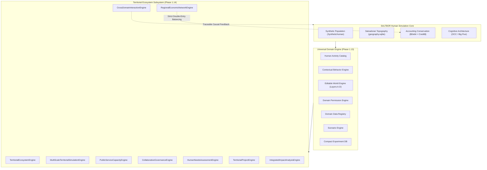

# SALTBOR PHASE 1.14: ARCHITECTURAL DESIGN SPECIFICATION
## INTEGRATED TERRITORIAL ECOSYSTEMS, MULTI-SCALE GOVERNANCE & PUBLIC IMPACT

**Version**: SALTBOR 1.14.0  
**Target Environment**: Python 3.14+, SQLite (WAL / In-Memory), MapLibre GIS, Graphify Knowledge Graph  
**Directives**: Local-first, pure offline, accounting conservation, non-destructive spatial layering, deterministic seeds  

---

### 1. Architectural Vision & Scope

Phase 1.14 expands **SALTBOR** from an agent-based multi-domain human activity platform into an **interconnected territorial ecosystem**. Rather than treating sectoral domains (food, retail, schools, clinics, transportation, agriculture, institutions, and climate) as parallel isolated silos, Phase 1.14 formalizes the dynamic mechanisms by which infrastructure, economic networks, public services, and institutional decisions cross-pollinate across nested geographic and organizational scales:
- **Level 1**: Individuals
- **Level 2**: Households
- **Level 3**: Businesses & Facilities
- **Level 4**: Communities & ADESCOs
- **Level 5**: Municipalities (44 Vigentes under 2024 reform)
- **Level 6**: Departments (14) & National Territory

Crucially, the system does not rebuild the human simulation core. The synthetic human population, OCC cognitive appraisals, Geofabrik OpenStreetMap road and building topography, double-entry accounting ledgers, and Universal Domain Engine from Phase 1.13 are reused as foundational building blocks.

---

### 2. Subsystem Architecture & Engine Structure

---

### 3. Engine Specifications & Mathematical Models

#### 3.1. `CrossDomainInteractionEngine` ([saltbor/territory/cross_domain.py](file:///c:/GIT%20HUB/sv%20people/saltbor/territory/cross_domain.py))
Implements explicit, traceable causal linkages:
1. **Transportation $\rightarrow$ Commerce**:
   - Customer reach: $\text{Reach}_{eff} = \frac{\text{Reach}_{base}}{\mu_{road} \cdot (2.5 \text{ if disrupted else } 1.0)}$
   - Delivery freight markup: $\Delta C_{delivery} = (\mu_{road} - 1.0) \cdot c_{km} \cdot 0.45 + (1.20 \text{ if disrupted})$
   - Customer footfall: $F_{cust} = 1.0 + \Delta \text{Reach}_{\%} \cdot \varepsilon_{reach} + \mathcal{N}(0, \sigma^2)$
2. **Education $\rightarrow$ Economy**:
   - Poverty-driven dropout: $P_{dropout} = \max(0.02, 0.42 \cdot \text{PovertyRate} - 0.25 \cdot \text{Attendance} + \mathcal{N}(0, \sigma^2))$
   - Skilled human capital growth: $\Delta \text{Skill} = (\text{Attendance} - 0.70) \cdot \varepsilon_{edu}$
3. **Healthcare $\rightarrow$ Household Economy**:
   - Out-of-pocket transit cost: $C_{transit} = 2 \cdot D_{clinic} \cdot \$0.20/\text{km}$
   - Lost wage hours: $T_{lost} = \frac{2 \cdot D_{clinic}}{20\text{ km/h}} + T_{queue}$
   - Care deferral probability: $P_{defer} = \frac{D_{clinic}}{15} \cdot 0.35 + \frac{T_{queue}}{6} \cdot 0.40$
4. **Agriculture $\rightarrow$ Food Commerce**:
   - Staple scarcity multiplier: $M_{scarcity} = \left(\frac{Y_{crop}}{Y_{baseline}}\right)^{-0.65}$
   - Echelon pricing: $P_{wholesale} = P_{farm} \cdot M_{scarcity} + C_{freight} + \text{Margin}_{wholesale}$
5. **Environment $\rightarrow$ Multiple Domains**:
   - Drought crop loss: $\Delta Y_{\%} = \min(0.90, I_{drought} \cdot 0.75 + \mathcal{N}(0, \sigma^2))$
   - Corredor Seco climate displacement risk: $R_{disp} = \min(0.35, I_{drought} \cdot 0.25 + I_{flood} \cdot 0.15 - 0.05)$
6. **Institutions $\rightarrow$ Community**:
   - Effective public service coverage: $Cov_{eff} = 0.85 \cdot \text{BudgetExec} + 0.20 \cdot \text{Trust} + \mathcal{N}(0, \sigma^2)$
   - ADESCO community project completion: $Rate_{comp} = 0.40 + \frac{\text{Members}}{250} \cdot 0.45 + 0.20 \cdot \text{Trust}$

#### 3.2. `MultiScaleTerritorialSimulationEngine` ([saltbor/territory/multi_scale.py](file:///c:/GIT%20HUB/sv%20people/saltbor/territory/multi_scale.py))
- Nested directory connecting individual agents to households, workplaces, communities/cantones, municipalities (44 Vigentes D.L. 762), and 14 departments.
- Mathematical Population Conservation:
  $$\sum_{h \in H} \text{members}(h) = \sum_{c \in C} \text{pop}(c) = \sum_{m \in M} \text{pop}(m) = N_{total}$$
  Verified with $0$ duplicate population records.

#### 3.3. `RegionalEconomicNetworkEngine` ([saltbor/territory/regional_economics.py](file:///c:/GIT%20HUB/sv%20people/saltbor/territory/regional_economics.py))
- Multi-echelon supply chains linking:
  $$\text{Agricultural Farm} \xrightarrow{\text{Freight}} \text{Wholesaler (La Tiendona)} \xrightarrow{\text{Freight}} \text{Retailer / Pupusería} \xrightarrow{\text{Consumer Sale}} \text{Households}$$
- Strict Double-Entry Accounting Conservation:
  $$\Delta \text{Cash}_{buyer} = -(P_{goods} + C_{freight})$$
  $$\Delta \text{Cash}_{seller} = +P_{goods}$$
  $$\Delta \text{Cash}_{transporter} = +C_{freight}$$
  $$\sum_{n \in \text{Nodes}} \Delta \text{Cash}_n = 0$$
  No money or physical units created ex nihilo.

#### 3.4. `PublicServiceCapacityEngine` ([saltbor/territory/public_services.py](file:///c:/GIT%20HUB/sv%20people/saltbor/territory/public_services.py))
- Physical throughput constraints: $Throughput_{eff} = Capacity_{daily} \cdot Score_{equipment}$.
- Queue dynamics: If $Demand > Capacity_{eff}$, excess demand spills into waiting queues.
- Epistemic Safeguard: Unknown capacities remain explicitly `None` (`UNCONFIGURED`) rather than inferred blindly from OSM building tags.

#### 3.5. `CollaborativeGovernanceEngine` ([saltbor/territory/governance.py](file:///c:/GIT%20HUB/sv%20people/saltbor/territory/governance.py))
- 9 Authorized Governance Roles: Citizen, Business Owner, ADESCO Leader, Researcher, Educator, Health Worker, Municipal Administrator, Ministry Official, NGO Coordinator.
- Strict geographic jurisdiction: Municipal administrators cannot approve projects outside their municipal boundaries.
- Deliberative conflict resolution creating versioned proposals with immutable audit logs.

#### 3.6. `HumanNeedsAssessmentEngine` ([saltbor/territory/needs_assessment.py](file:///c:/GIT%20HUB/sv%20people/saltbor/territory/needs_assessment.py))
- 12 Evaluated Dimensions: Food, Employment, Education, Healthcare, Housing, Transit, Water, Sanitation, Social Support, Recreation, Culture, Economic Opportunity.
- Epistemic Taxonomy: Confirmed Service Shortages, Potential Accessibility Gaps, Simulated Unmet Demand, User-Reported Needs, Unverified Hypotheses.
- Pareto Multi-Objective Prioritization: Ranks urgency without reducing community welfare to an arbitrary single score.

#### 3.7. `TerritorialProjectEngine` ([saltbor/territory/projects.py](file:///c:/GIT%20HUB/sv%20people/saltbor/territory/projects.py))
- Multi-alternative design evaluation comparing centralized vs distributed vs mobile configurations across cost per citizen served and coverage equity.
- Non-biased: Most expensive alternative is not assumed optimal.

#### 3.8. `IntegratedImpactAnalysisEngine` ([saltbor/territory/impact_analysis.py](file:///c:/GIT%20HUB/sv%20people/saltbor/territory/impact_analysis.py))
- Traces direct, indirect, feedback, delayed, and distributional impacts (Gini index change and bottom quintile gains).
- Surfaces negative externalities (traffic congestion, solid waste generation, displacement of informal tienditas).
