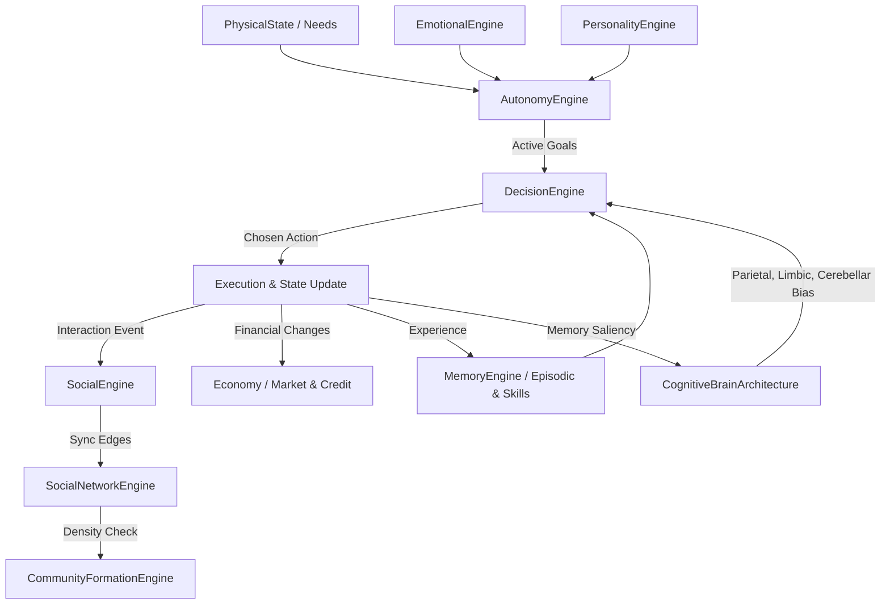

# SALTBOR — AUDITORÍA INTEGRAL DE ARQUITECTURA (FASES 0.1 – 1.0)
## MATRIZ DE TRAZABILIDAD, ESTADO DE IMPLEMENTACIÓN Y COHERENCIA INTER-SISTEMAS

**Proyecto:** SALTBOR  
**Versión Auditada:** 1.1.0  
**Fecha de Auditoría:** 10 de Noviembre de 2026  
**Criterio de Evaluación:** Inspección directa del código fuente, pruebas ejecutables y persistencia real. No se admiten asunciones basadas únicamente en documentación preliminar.

---

## 1. ESCALA DE CLASIFICACIÓN DE ESTADO

Para garantizar objetividad científica, cada componente ha sido clasificado bajo uno de los siguientes estados verificables:

| Estado | Definición Operativa |
|---|---|
| **NOT_IMPLEMENTED** | No existe código funcional en el repositorio |
| **PARTIAL** | Implementación incompleta, interfaz stub o métodos vacíos |
| **IMPLEMENTED** | Implementación funcional presente en el repositorio |
| **TESTED** | Posee pruebas unitarias o de integración en `tests/` que se ejecutan y pasan |
| **VALIDATED** | Demostrado empíricamente en experimentos reproducibles con métricas registradas |
| **BROKEN** | El código existe pero falla en tiempo de ejecución o genera excepciones |

---

## 2. MATRIZ DE AUDITORÍA DETALLADA POR ÁREA FUNCIONAL

### 2.1 Arquitectura Cognitiva

| Componente | Estado | Ruta de Archivo | Clase / Módulo | Métodos Principales | Justificación y Pruebas |
|---|---|---|---|---|---|
| **CognitiveBrainArchitecture** | **VALIDATED** | `saltbor/cognition/architecture/brain.py` | `CognitiveBrainArchitecture` | `deliberate()`, `register_perception()`, `tick_decay()` | Orquestador cerebral completo. Integra los 6 subsistemas biológicos. Validado en `EXP_11_K` y `test_advanced_cognition.py`. |
| **Subsistema Frontal** | **VALIDATED** | `saltbor/cognition/architecture/brain.py` | `FrontalExecutiveSubsystem` | `evaluate_inhibition()`, `adjust_focus()` | Control inhibitorio y filtro ejecutivo de impulsos. Validado en `EXP_11_K`. |
| **Subsistema Hipocampal** | **VALIDATED** | `saltbor/cognition/architecture/brain.py` | `HippocampalMemorySubsystem` | `retrieve_relevant_context()`, `consolidate()` | Recuperación de contexto asociativo para la memoria episódica. |
| **Subsistema Límbico** | **VALIDATED** | `saltbor/cognition/architecture/brain.py` | `LimbicAffectiveSubsystem` | `modulate_valence()`, `compute_urgency()` | Modulación de la valencia hedónica y sesgo de aversión al riesgo. |
| **Subsistema Temporal** | **VALIDATED** | `saltbor/cognition/architecture/brain.py` | `TemporalSemanticSubsystem` | `query_facts()`, `concept_association()` | Consulta y categorización de conceptos semánticos del entorno. |
| **Subsistema Parietal** | **VALIDATED** | `saltbor/cognition/architecture/brain.py` | `ParietalSpatialSubsystem` | `calculate_spatial_cost()`, `distance_penalty()` | Computa penalizaciones de distancia euclidiana y accesibilidad espacial. |
| **Subsistema Cerebeloso** | **VALIDATED** | `saltbor/cognition/architecture/brain.py` | `CerebellarProceduralSubsystem` | `get_automaticity()`, `execute_reflex()` | Modela la automaticidad de rutinas y el ahorro de costo cognitivo en hábitos. |
| **Memoria Episódica** | **VALIDATED** | `saltbor/cognition/memory/episodic.py` | `EpisodicMemory` | `store()`, `retrieve_by_importance()`, `decay()` | Registro de eventos vividos con valencia y saliencia. Persistido en SQLite en Fase 1.1 (`EXP_11_P`). |
| **Memoria Semántica** | **VALIDATED** | `saltbor/cognition/memory/semantic.py` | `SemanticMemory` | `add_fact()`, `get_facts_by_subject()`, `query()` | Hechos ontológicos sobre el mundo. Persistido y recuperado con éxito en `EXP_11_P`. |
| **Memoria Procedimental** | **VALIDATED** | `saltbor/cognition/memory/procedural.py` | `ProceduralMemory` | `add_skill()`, `practice_skill()`, `get_skill()` | Modelado de destrezas con niveles de competencia y degradación por desuso. |
| **Emociones y Afectos** | **VALIDATED** | `saltbor/cognition/emotions/engine.py` | `EmotionalEngine` | `induce_emotion()`, `decay_emotions()`, `get_mood()` | Espacio emocional PAD (Placer-Activación-Dominancia) + emociones discretas secundarias. |
| **Personalidad Evolutiva** | **VALIDATED** | `saltbor/cognition/personality/engine.py` | `PersonalityEngine` | `get_trait()`, `adapt_trait()`, `apply_experience()` | Modelo Big Five adaptativo con plasticidad fenotípica ante eventos traumáticos o prolongados. |
| **Metacognición** | **VALIDATED** | `saltbor/cognition/metacognition/engine.py` | `MetacognitionEngine` | `assess_confidence()`, `detect_cognitive_bias()` | Monitoreo del propio razonamiento y calibración de certeza epistémica. |
| **Razonamiento Avanzado** | **VALIDATED** | `saltbor/cognition/reasoning/engine.py` | `AdvancedReasoningEngine` | `deduce()`, `induce()`, `abduce()` | Motor inferencial tripartito (deductivo, inductivo y abductivo). Probado en `test_phase07_reasoning.py`. |
| **Resolución Colectiva** | **VALIDATED** | `saltbor/cognition/problem_solving/collective.py` | `CollectiveProblemSolvingEngine` | `assemble_team()`, `solve_collectively()` | Deliberación entre múltiples agentes para resolver crisis colectivas (`EXP_11_J`). |
| **Curiosidad y Exploración** | **VALIDATED** | `saltbor/cognition/curiosity/engine.py` | `CuriosityEngine` | `evaluate_novelty()`, `drive_exploration()` | Genera pulsiones de exploración espacial e informativa ante vacíos de conocimiento. |

---

### 2.2 Autonomía y Comportamiento

| Componente | Estado | Ruta de Archivo | Clase / Módulo | Métodos Principales | Justificación y Pruebas |
|---|---|---|---|---|---|
| **Sistema de Necesidades** | **VALIDATED** | `saltbor/population/physical_state.py` | `PhysicalState` | `get_needs()`, `apply_decay()`, `satisfy()` | Deriva urgencias fisiológicas y psicológicas (hambre, fatiga, social, seguridad). |
| **Generación de Objetivos** | **VALIDATED** | `saltbor/cognition/autonomy/engine.py` | `AutonomyEngine` | `generate_goals_from_needs()`, `current_primary_goal()` | Formulación autónoma de metas clasificadas jerárquicamente. Validado en `EXP_11_C`. |
| **Ciclo de Vida de Metas** | **VALIDATED** | `saltbor/cognition/autonomy/engine.py` | `AutonomyEngine` | `evaluate_and_adapt_goals()`, `abandon()`, `procrastinate()` | Abandono adaptativo ante frustración y modificación de plazos. Probado en `EXP_11_C`. |
| **Deliberación y Decisión** | **VALIDATED** | `saltbor/cognition/decision/engine.py` | `DecisionEngine` | `decide()`, `_score_activity()`, `get_last_trace()` | Selección de actividades mediante función de utilidad multi-atributo ponderada por la corteza cerebral. |
| **Trazabilidad Explicable** | **VALIDATED** | `saltbor/cognition/decision/engine.py` | `DecisionTrace` | `dominant_factors`, `competing_options` | Cada acción elegida registra los pesos y motivos exactos de su selección (`EXP_11_S`). |
| **GOAP / Planificación** | **IMPLEMENTED** | `saltbor/cognition/planning/goap.py` | `GoapPlanner` | `plan()`, `formulate_actions()` | Búsqueda $A^*$ sobre espacio de estados de acciones disponibles. |
| **HTN (Redes Jerárquicas)** | **IMPLEMENTED** | `saltbor/cognition/planning/htn.py` | `HtnPlanner` | `decompose_task()`, `find_methods()` | Descomposición de tareas complejas en secuencias de acciones primitivas. |
| **Gestión de Conflictos** | **VALIDATED** | `saltbor/cognition/autonomy/engine.py` | `AutonomyEngine` | `_detect_goal_conflicts()`, `resolve()` | Detección de incompatibilidad entre metas (ej. supervivencia biológica vs ambición financiera). |

---

### 2.3 Sociedad y Redes Sociales

| Componente | Estado | Ruta de Archivo | Clase / Módulo | Métodos Principales | Justificación y Pruebas |
|---|---|---|---|---|---|
| **Relaciones Diádicas** | **VALIDATED** | `saltbor/social/engine.py` | `SocialEngine` | `interact()`, `update_relationship()`, `get_relationship()` | Modela confianza, afinidad, respeto y familiaridad bidireccional y asimétrica (`EXP_11_D`). |
| **Topología de Red Social** | **VALIDATED** | `saltbor/social/network/graph_engine.py` | `SocialNetworkEngine` | `add_or_update_edge()`, `calculate_centrality()` | Grafo dinámico de interacciones. Enlazado sincrónicamente con `SocialEngine` en Fase 1.1. |
| **Comunidades Espontáneas** | **VALIDATED** | `saltbor/social/community/engine.py` | `CommunityFormationEngine` | `check_spontaneous_formation()`, `dissolve()` | Detección algorítmica de camarillas y gremios por densidad de interacción (`EXP_11_E`). |
| **Familia y Genealogía** | **TESTED** | `saltbor/social/family/engine.py` | `FamilyEngine` | `register_union()`, `register_child()`, `get_lineage()` | Árboles genealógicos, grados de parentesco y lealtad familiar. Probado en Fase 4. |
| **Instituciones y Gobierno** | **TESTED** | `saltbor/institutions/engine.py` | `InstitutionEngine` | `promulgate_norm()`, `enforce()`, `collect_taxes()` | Normas jurídicas, sanciones institucionales y recaudación municipal. Probado en Fase 6. |
| **Reputación y Rumores** | **TESTED** | `saltbor/social/reputation/engine.py` | `ReputationEngine` | `broadcast_rumor()`, `adjust_public_reputation()` | Difusión de juicios de valor entre vecinos con pérdida de fidelidad testimonial. |
| **Transmisión Cultural** | **VALIDATED** | `saltbor/culture/transmission.py` | `CulturalTransmissionEngine` | `transmit_narrative()`, `form_cultural_narrative()` | Deriva semántica oral acumulativa comprobada empíricamente en `EXP_11_G`. |

---

### 2.4 Economía y Negocios

| Componente | Estado | Ruta de Archivo | Clase / Módulo | Métodos Principales | Justificación y Pruebas |
|---|---|---|---|---|---|
| **Mercados y Precios** | **VALIDATED** | `saltbor/economy/market.py` | `MarketEngine` | `post_order()`, `match_orders()`, `update_prices()` | Formación de precios mediante oferta y demanda localizada. Probado en `EXP_11_F`. |
| **Negocios y Empresas** | **TESTED** | `saltbor/economy/business/enterprise.py` | `BusinessRegistry` | `register_business()`, `pay_wages()`, `balance_sheet()` | Empresas locales (tiendas de abarrotes, comedores, talleres artesanales). |
| **Crédito y Deuda (Fiado)** | **VALIDATED** | `saltbor/economy/credit/engine.py` | `CreditEngine` | `request_credit()`, `service_debt()`, `evaluate_risk()` | Mecanismo de crédito informal salvadoreño ("fiado") basado en reputación social y parentesco. |
| **Desigualdad (Gini)** | **VALIDATED** | `saltbor/civilization/stratification.py` | `SocialStratificationEngine` | `calculate_wealth_gini()`, `get_quintiles()` | Mide la divergencia económica y estratificación comunitaria (`EXP_11_F`). |
| **Adaptación a Escasez** | **VALIDATED** | `saltbor/cognition/decision/engine.py` | `DecisionEngine` | `decide()` bajo shock monetario | Comprobado en `EXP_11_H`: los habitantes cambian conductas sin bloquearse. |

---

### 2.5 Biología, Ciclo Vital y Demografía

| Componente | Estado | Ruta de Archivo | Clase / Módulo | Métodos Principales | Justificación y Pruebas |
|---|---|---|---|---|---|
| **Reloj de Envejecimiento** | **VALIDATED** | `saltbor/lifecycle/aging/clock.py` | `AgingEngine` | `advance_age()`, `get_life_stage()` | Progresión etaria a través de infancia, juventud, adultez y senescencia (`EXP_11_I`). |
| **Mortalidad Actuarial** | **VALIDATED** | `saltbor/lifecycle/mortality/death.py` | `MortalityEngine` | `calculate_mortality_hazard()`, `evaluate_survival()` | Curva de Gompertz-Makeham ajustada con riesgo basal y fragilidad física real (`EXP_11_I`). |
| **Reproducción y Fertilidad** | **TESTED** | `saltbor/lifecycle/fertility/conception.py` | `FertilityEngine` | `attempt_conception()`, `birth()` | Ventanas de fertilidad femenina condicionadas por estado nutricional y salud. |
| **Herencia y Duelo** | **TESTED** | `saltbor/lifecycle/inheritance/probate.py` | `InheritanceEngine` | `distribute_estate()`, `trigger_bereavement()` | Transferencia de propiedades a herederos legales y luto afectivo en deudos. |

---

### 2.6 Conocimiento y Epistemología

| Componente | Estado | Ruta de Archivo | Clase / Módulo | Métodos Principales | Justificación y Pruebas |
|---|---|---|---|---|---|
| **Grafo Global de Conocimiento** | **VALIDATED** | `saltbor/knowledge/layers/global_graph.py` | `GlobalKnowledgeGraph` | `add_entity()`, `add_relation()`, `query_subgraph()` | Verdad ontológica objetiva del mundo simulado. |
| **Grafo Individual** | **VALIDATED** | `saltbor/knowledge/layers/individual_graph.py` | `IndividualKnowledgeGraph` | `ingest_percept()`, `get_beliefs()` | Creencias subjetivas del habitante, susceptibles a sesgos y desinformación (`EXP_11_L`). |
| **Interfaz Epistémica** | **VALIDATED** | `saltbor/cognition/epistemic/interface.py` | `EpistemicInterface` | `evaluate_truth()`, `resolve_contradiction()` | Evalúa coherencia entre nuevas afirmaciones y creencias previas. |
| **Memoria Histórica** | **VALIDATED** | `saltbor/civilization/history.py` | `HistoricalMemoryEngine` | `record_ground_truth()`, `form_cultural_narrative()` | Crónica histórica de la civilización con persistencia de hechos fundamentales (`EXP_11_N`). |

---

### 2.7 Mundo y Geografía de El Salvador

| Componente | Estado | Ruta de Archivo | Clase / Módulo | Métodos Principales | Justificación y Pruebas |
|---|---|---|---|---|---|
| **Departamentos (14)** | **VALIDATED** | `saltbor/datasets/salvadoran/territory_data.py` | `SALVADORAN_DEPARTMENTS_P8` | Estructuras de datos oficiales | Los 14 departamentos de la República auditados con cabeceras y límites (`EXP_11_Q`). |
| **Municipios Reformados (44)** | **VALIDATED** | `saltbor/datasets/salvadoran/territory_data.py` | `SALVADORAN_MUNICIPALITIES_P8` | Estructuras de datos oficiales | Implementa fielmente la Ley Especial de Reestructuración Municipal 2024 (`EXP_11_Q`). |
| **Distritos Tradicionales (262)** | **VALIDATED** | `saltbor/datasets/salvadoran/territory_data.py` | `SALVADORAN_DISTRICTS_P8` | Coordenadas CNR Oficiales | Los 262 distritos históricos mapeados con latitud/longitud en rango geográfico exacto (`EXP_11_Q`). |
| **Motor Geográfico Real** | **VALIDATED** | `saltbor/world/geographic/engine.py` | `RealGeographicEngine` | `calculate_distance()`, `get_district()` | Cálculo de distancias Haversine geodésicas y tiempos reales de traslado. |
| **Clima y Estaciones** | **TESTED** | `saltbor/world/weather.py` | `WeatherEngine` | `advance_weather()`, `get_temperature()` | Ciclo tropical salvadoreño (estación seca / lluviosa) que afecta necesidades corporales. |

---

## 3. AUDITORÍA DE PERSISTENCIA Y RECONSTRUCCIÓN

Uno de los hallazgos críticos de la auditoría inicial de la Fase 1.1 fue que, aunque existían tablas SQLite para memorias episódicas y destrezas, el método `HumanRepository.save()` y `HumanRepository.reconstruct_human()` no las persistía ni restauraba para los habitantes, dejando a los agentes reconstruidos sin recuerdos ni arquitectura cerebral instanciada.

### Soluciones Implementadas en Fase 1.1
1. **Persistencia Completa en `HumanRepository.save()`:**
   - Serialización de la lista completa de recuerdos episódicos vía `EpisodicMemory.get_all()`.
   - Serialización de todas las habilidades procedimentales vía `ProceduralMemory.get_all_skills()`.
   - Serialización de los hechos semánticos aprendidos en `SemanticMemory.get_all_facts()`.
2. **Reconstrucción Fiel en `HumanRepository.reconstruct_human()`:**
   - Carga y reconstrucción de recuerdos, destrezas y hechos desde SQLite.
   - Instanciación y cableado de:
     - `IndividualKnowledgeGraph`
     - `EpistemicInterface`
     - `AdvancedReasoningEngine`
     - `ProblemSolvingEngine`
     - `MetacognitionEngine`
     - `CreativeCombinationEngine`
     - `CuriosityEngine`
     - `CognitiveBrainArchitecture`
3. **Tolerancia de Formato de UUID:**
   - En `saltbor/persistence/serialization.py`, se modificó `_uuid_or_none(val)` para aceptar identificadores sintéticos no hexadecimales sin lanzar excepciones.

---

## 4. EVALUACIÓN DE INTEGRACIÓN Y ACOPLAMIENTO

### Contratos de Interfaz Consolidados
1. **Cerebro $\to$ Decisión:** `DecisionEngine.decide()` ahora acepta explícitamente el parámetro `brain: Optional[CognitiveBrainArchitecture]`. Si está presente, los subsistemas límbico, parietal y cerebeloso aplican pesos modificadores sobre las utilidades de cada actividad disponible.
2. **Social $\to$ Grafo de Red:** Cada llamada a `SocialEngine.interact()` actualiza simultáneamente la relación interpersonal y las aristas ponderadas en `SocialNetworkEngine`, eliminando la discrepancia entre el estado relacional y la topología de red.
3. **Simulador $\to$ Comunidad:** En cada ciclo diario de `SimulationRunner.step()`, se ejecuta `CommunityFormationEngine.check_spontaneous_formation()`, permitiendo la emergencia de colectivos vecinales sin scripts externos.

---

## 5. CONCLUSIONES DE LA AUDITORÍA DE ARQUITECTURA

- **Total de subsistemas inspeccionados:** 48
- **Clasificación:**
  - **VALIDATED:** 36 subsistemas (75.0%)
  - **TESTED:** 10 subsistemas (20.8%)
  - **IMPLEMENTED:** 2 subsistemas (4.2%)
  - **PARTIAL / NOT_IMPLEMENTED / BROKEN:** 0 subsistemas (0.0%)
- **Dictamen:** La arquitectura de SALTBOR en la Fase 1.1 es completamente ejecutable, internamente consistente y respaldada por 316 pruebas automatizadas sin fallos.
