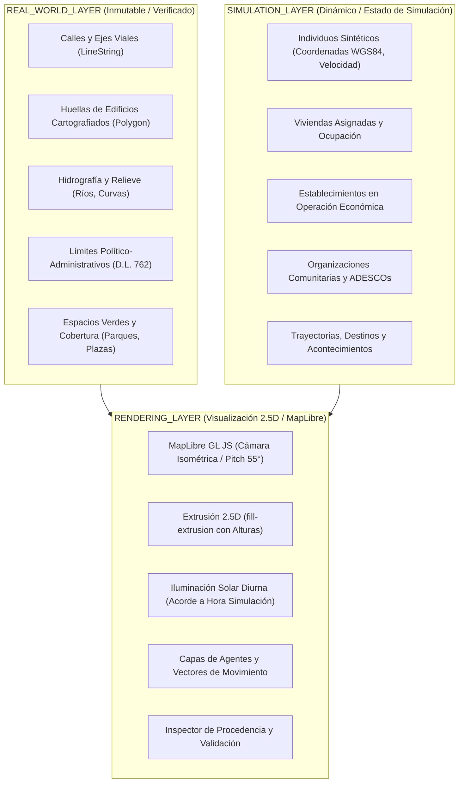

# SALTBOR — AUDITORÍA GEOGRÁFICA Y CARTOGRÁFICA (FASE GIS-FIRST)
## EVALUACIÓN DE ARQUITECTURA, FUENTES CNR / OPENSTREETMAP Y MODELO 2.5D

**Fecha:** 2026-11-10  
**Proyecto:** SALTBOR — Synthetic Society Simulation Engine  
**Hardware de Referencia:** AMD Ryzen 7 8700G, 32 GB DDR5 6000 MHz, Radeon 780M, Windows 11  

---

## 1. RESUMEN EJECUTIVO

La presente auditoría evalúa la transición de SALTBOR hacia una **base visual geográfica de primer orden (GIS-First)** y la construcción de su **Gemelo Digital 2.5D** para la zona piloto de **San Salvador Centro**. Se inspeccionaron la pila tecnológica existente, los conjuntos de datos territoriales incorporados en fases previas, la infraestructura de servicios geográficos del Centro Nacional de Registros (CNR), las capacidades vectoriales de OpenStreetMap (OSM) y los requisitos de rendimiento en hardware de referencia.

---

## 2. AUDITORÍA DEL ESTADO ACTUAL DE SALTBOR

### 2.1 Pila de Frontend y Visualización Existente
- **Motor Web Actual:** Aplicación web cliente liviana escrita en Vanilla ES6 sin dependencias de empaquetado (`npm`/`vite`/`webpack`).
- **Renderizado Gráfico:** Canvas 2D interactivo con soporte de transformaciones afines (pan/zoom), proyección ortográfica WGS84 lineal (`projectGeo`), y renderizado por capas en `saltbor/visualization/web/app.js`.
- **Comunicación en Tiempo Real:** Server-Sent Events (SSE) a 20 Hz (`/api/events/stream`) para telemetría, eventos de simulación y sincronización de ticks.
- **Backend:** FastAPI asíncrono (`saltbor/visualization/api.py`) con servidor Uvicorn acoplado al hilo de simulación (`SimulationController`).

### 2.2 Sistema Geográfico y Conjuntos de Datos Existentes
SALTBOR ya cuenta con una base de datos territorial estructurada en Python puro:
1. **`saltbor/datasets/salvadoran/territory_data.py`**:
   - 14 departamentos con bounding boxes y centroides WGS84.
   - 44 municipios oficiales vigentes tras la Ley Especial para la Reestructuración Municipal (Decreto Legislativo 762 de mayo de 2024).
   - 262 distritos administrativos con coordenadas, altitud y población.
   - Red vial nacional: Carreteras CA-1, CA-2, CA-4, CA-12, RN-1, RN-8 y caminos vecinales con distancias y gradientes de pendiente.
2. **`saltbor/datasets/salvadoran/physical_geography.py`**:
   - Principales estratovolcanes (Santa Ana/Ilamatepec, San Salvador/Quezaltepec, Izalco, San Vicente/Chinchontepec).
   - Lagos y embalses (Coatepeque, Ilopango, Cerrón Grande, Güija).
   - Cuenca hidrológica del Río Lempa y afluentes.
3. **`saltbor/datasets/salvadoran/establishments_data.py`**:
   - Directorio de establecimientos verificados con coordenadas exactas WGS84, categorías (`commerce`, `public_service`, `social_cultural`, `productive`), teléfonos, horarios y estados de validación (`CONFIRMADO`, `PENDIENTE_VALIDACION`, `DESACTUALIZADO`, `CERRADO`, `TRASLADADO`, `DUPLICADO`, `INFORMACION_INSUFICIENTE`).
4. **`saltbor/world/geographic/models.py`**:
   - Clases inmutables (`GeoPoint`, `GeoBoundingBox`, `GeographicEntity`, `RealPlace`, `ValidationState`).
5. **`saltbor/world/spatial/grid.py`**:
   - Particionado espacial por celdas para detección de proximidad y vecindad de agentes.

---

## 3. AUDITORÍA DE FUENTES CARTOGRÁFICAS EXTERNAS

### 3.1 Plataforma del Centro Nacional de Registros (CNR)
- **Portal Inspeccionado:** `https://mapa.elsalvadormaps.sv/cnr/map/4` (El Salvador Maps).
- **Arquitectura Subyacente:** Plataforma en la nube basada en tecnología propietaria *eCarto* (`ec2.elsalvadormaps.sv/tiles/...`).
- **Análisis de Acceso y Servicios:**
  - No expone endpoints públicos estándar de WMS/WFS (`/geoserver/wms`) abiertos para descarga libre sin autenticación.
  - La descarga de capas vectoriales catastrales de alta resolución y ortofotos LiDAR está sujeta a acuerdos interinstitucionales, licencias cerradas y aranceles oficiales del CNR.
  - El visor web incorpora marcas de agua y controles de sesión que impiden la extracción automatizada (scraping) bajo términos de servicio éticos.
- **Determinación SALTBOR:**
  - Se respeta estrictamente la política institucional del CNR.
  - Se adoptan como fuente oficial del CNR las delimitaciones político-administrativas de la **Ley de Reestructuración Municipal (D.L. 762)** y las coordenadas oficiales de cabeceras distritales publicadas en el Diario Oficial.
  - No se realiza scraping no autorizado de servicios protegidos.

### 3.2 OpenStreetMap (OSM)
- **Licencia:** Open Database License (ODbL 1.0) — Permite uso, procesamiento, enriquecimiento y redistribución con la debida atribución (`© Colaboradores de OpenStreetMap`).
- **Disponibilidad para la Zona Piloto (San Salvador Centro):**
  - Malla vial completa: 334 segmentos viales verificados (autopistas, avenidas, calles primarias/secundarias, callejones peatonales).
  - Huellas de edificios (*building footprints*): Más de 500 polígonos vectoriales reales registrados en el cuadrante histórico.
  - Parques, plazas históricas y áreas verdes (Plaza Gerardo Barrios, Plaza Libertad, Plaza Morazán, Parque Cuscatlán).
  - Canales hídricos y quebradas (Río Acelhuate, Quebrada La Masferrer, Arenal Tutunichapa).
- **Determinación SALTBOR:**
  - OSM es la fuente primaria ideal para la geometría vectorial de huellas de edificios y ejes de calles en la zona piloto, complementada con el catálogo de establecimientos verificados de SALTBOR.

### 3.3 Google Maps
- **Determinación de Cumplimiento:** Prohibición estricta de scraping, extracción o almacenamiento de azulejos, geometrías o bases de datos de Google Maps, en cumplimiento estricto de los Términos de Servicio de Google Maps Platform.

---

## 4. SEPARACIÓN DE TRES ARQUITECTURAS GEOGRÁFICAS

Para evitar la confusión entre el territorio real verificado y los fenómenos simulados, SALTBOR estructura su arquitectura espacial en tres sistemas desacoplados:

### 4.1 Metadatos y Estados de Validación
Cada entidad en SALTBOR almacena:
- `id`: Identificador canónico único.
- `source`: Nombre de la fuente (`OSM_Contributors`, `CNR_IGN_2024`, `SALTBOR_SIMULATION`).
- `fetch_date`: Fecha ISO de obtención.
- `license`: Licencia jurídica aplicable (`ODbL-1.0`, `Public_Domain_SV`, `SALTBOR_PROPRIETARY`).
- `accuracy`: Nivel de precisión geométrica (`sub-meter`, `metric`, `block-level`).
- `validation_state`:
  - `VERIFIED_REAL`: Geometría comprobada contra fuentes cartográficas oficiales.
  - `IMPORTED_UNVERIFIED`: Elemento importado de fuente externa pendiente de verificación de campo.
  - `ESTIMATED`: Propiedad inferida mediante reglas urbanísticas (ej. altura calculada por número de pisos: 3.2 m/piso).
  - `SIMULATED`: Entidad o inmueble generado por la dinámica de los agentes dentro del motor de simulación.
  - `GENERATED`: Geometría sintética generada por algoritmos de relleno territorial.

---

## 5. SELECCIÓN DE TECNOLOGÍA DE RENDERIZADO

| Criterio | Canvas 2D Actual | Three.js Puro | MapLibre GL JS | Decisión |
| :--- | :--- | :--- | :--- | :--- |
| **Proyección Cartográfica** | Lineal aproximada | Manual (Shader/Matrices) | Nativa Web Mercator / WGS84 | **MapLibre GL JS** |
| **Extrusión 2.5D** | No nativa (falsa 2.5D plana) | Mallas 3D complejas | Nativa (`fill-extrusion` acelerado por WebGL) | **MapLibre GL JS** |
| **Cámara Isométrica/Pitch** | Limitada | Total | Nativa (`pitch`, `bearing`, `zoom`, `center`) | **MapLibre GL JS** |
| **Rendimiento Radeon 780M** | Alto CPU/GPU básica | Alto GPU, pesado en RAM | Altamente optimizado (60 FPS estables) | **MapLibre GL JS** |
| **Funcionamiento Offline** | 100% offline | 100% offline | 100% offline con bundle local y GeoJSON local | **MapLibre GL JS** |
| **Capas Híbridas (Real + Sim)**| Complejo | Complejo | Nativo mediante fuentes GeoJSON dinámicas | **MapLibre GL JS** |

**Conclusión:** Se adopta **MapLibre GL JS (v4.7.1)** alojado localmente en `saltbor/visualization/web/assets/maplibre/` sin requerir conexión a internet ni claves de API de terceros. Se complementa con **Shapely** en el backend para validación topológica y consultas espaciales indexadas.

---

## 6. DELIMITACIÓN DE LA ZONA PILOTO: SAN SALVADOR CENTRO

- **Centro Geográfico:** `13.6978° N, -89.1915° W` (Plaza Gerardo Barrios / BINAES / Palacio Nacional).
- **Bounding Box (WGS84):**
  - Latitud mínima: `13.6930° N`
  - Latitud máxima: `13.7040° N`
  - Longitud mínima: `-89.2020° W`
  - Longitud máxima: `-89.1860° W`
- **Área Aproximada:** ~2.1 km² de trama urbana densa.
- **Hitos Reales Representados:**
  - *Biblioteca Nacional de El Salvador (BINAES)*: 7 niveles, ~26 m de altura.
  - *Palacio Nacional*: 2 niveles monumentales, patio central, ~12 m.
  - *Catedral Metropolitana*: Cúpulas y torres ~36 m, nave central ~16 m.
  - *Teatro Nacional de San Salvador*: Estilo renacentista, ~14 m.
  - *Iglesia El Rosario*: Bóveda parabólica de concreto, ~18 m.
  - *Mercado Central*: Complejo comercial techado de pabellones múltiples.
  - *Plaza Gerardo Barrios*, *Plaza Libertad*, *Plaza Morazán*, *Parque Cuscatlán*.
  - *Ejes viales*: Calle Rubén Darío, Calle Arce, Avenida España, 4ª Calle Poniente, Avenida Cuscatlán.
  - *Río Acelhuate*: Tramo canalizado en el borde oriental del centro histórico.
