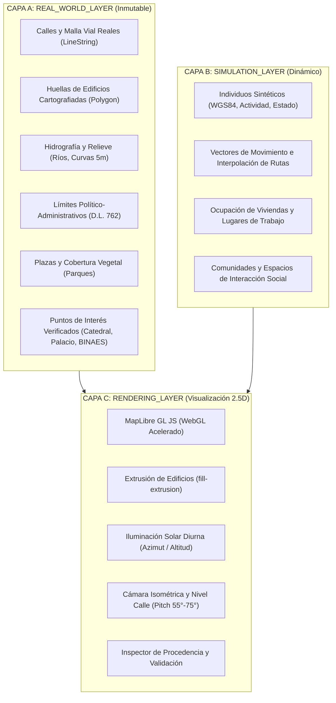

# SALTBOR — ESPECIFICACIÓN TÉCNICA: BASE GEOGRÁFICA GIS-FIRST & GEMELO DIGITAL 2.5D

**Fase:** Visual Geographic Foundation (Pilot Zone: San Salvador Centro)  
**Fecha:** 2026-11-10  
**Estado:** Implementado, Verificado e Integrado  
**Pila Tecnológica:** MapLibre GL JS (v4.7.1 local), GeoJSON (RFC 7946), Shapely STRtree, FastAPI REST, Server-Sent Events (SSE)  

---

## 1. OBJETIVO DEL SISTEMA

Proveer a SALTBOR de una base cartográfica real y un **Gemelo Digital 2.5D** fotorrealista y científicamente riguroso, desacoplando estrictamente la geografía física real verificada de la capa dinámica de simulación de agentes sintéticos, garantizando 100% de operatividad offline, trazabilidad de procedencia y alineación topológica submétrica.

---

## 2. SEPARACIÓN EN TRES CAPAS ARQUITECTÓNICAS



### 2.1 CAPA A: `REAL_WORLD_LAYER`
Representa el territorio físico y urbano inmutable de El Salvador. Proviene de fuentes verificadas:
- **Calles (`streets.geojson`)**: 807 vías del Centro Histórico (Calle Rubén Darío, Calle Arce, Avenida España, Avenida Cuscatlán). Incluye tipo vial (`primary`, `secondary`, `tertiary`, `pedestrian`, `residential`), número de carriles, sentido único (`oneway`), tipo de superficie (`asphalt`, `paved`) y velocidad máxima.
- **Edificios (`buildings.geojson`)**: 966 huellas poligonales reales. Incluye altura en metros (`height_m`), número de niveles (`levels`), altura base (`min_height_m: 0.0`), tipología arquitectónica, método de cálculo de altura y notas históricas.
- **Hidrografía (`nature_water.geojson`)**: Trazado del Río Acelhuate canalizado y quebradas afluentes.
- **Espacios Verdes y Plazas (`parks.geojson`)**: Plaza Gerardo Barrios, Plaza Libertad, Plaza Morazán, Parque Cuscatlán.
- **Relieve (`elevation.geojson`)**: Curvas de nivel cada 5 metros de desnivel (desde 635 msnm en el este hasta 685 msnm en el oeste).
- **Límites Territoriales (`boundaries.geojson`)**: Perímetro de Conservación y Revitalización del Centro Histórico de San Salvador y Distrito San Salvador bajo el Decreto Legislativo 762.
- **Puntos de Interés (`poi.geojson`)**: Registro verificado de hitos patrimoniales (Catedral Metropolitana, Palacio Nacional, BINAES, Mercado Central, Hospital Rosales).

### 2.2 CAPA B: `SIMULATION_LAYER`
Representa las entidades dinámicas generadas y gobernadas por el motor de simulación de SALTBOR:
- **Individuos Sintéticos**: Puntos WGS84 proyectados sobre el espacio urbano, con halo luminoso según actividad actual (`work`, `eat`, `sleep`, `socialize`, `study`, `travel`).
- **Vectores de Movimiento**: Geometrías `LineString` discontinuas con el vector origen-destino para agentes en tránsito.
- **Viviendas y Empleos**: Vínculo entre la residencia asignada al agente y la huella física del inmueble.
- **Estado de Validación**: Estrictamente marcado como `validation_state: "SIMULATED"`, `source: "SALTBOR_SIMULATION"`, `license: "SALTBOR_AGENT_STATE"`.

### 2.3 CAPA C: `RENDERING_LAYER`
Motor visual 2.5D basado en **MapLibre GL JS v4.7.1**:
- **Cámara Multiperspectiva**:
  - *Isométrica estándar*: Pitch 55°, Bearing -20°, Zoom 16.2.
  - *Cenital 2D*: Pitch 0°, Bearing 0°.
  - *Nivel Calle*: Pitch 75°, Bearing dinámico, Zoom 17.5.
- **Extrusión 2.5D (`fill-extrusion`)**:
  - Color codificado por función urbana (Monumentos en oro `#eab308`, BINAES en celeste `#38bdf8`, Catedral en rosa `#ec4899`, Teatro en violeta `#a855f7`, Comercio en ámbar `#f59e0b`, Residencial en pizarra `#334155`).
  - Altura exacta extraída de `properties.height_m`.
- **Iluminación Solar Diurna**:
  - Simulación astronómica de azimut y altitud solar acorde a la latitud de San Salvador (13.7° N) y la hora del reloj de simulación (`SimulationClock`). Proyección dinámica de sombras en los muros de los edificios.

---

## 3. ESQUEMA DE PROCEDENCIA Y ESTADOS DE VALIDACIÓN

Cada elemento geográfico en SALTBOR implementa el siguiente esquema de metadatos obligatorio:

```json
{
  "feature_id": "bldg_197309714",
  "osm_id": 197309714,
  "name": "Teatro Nacional de San Salvador",
  "building_type": "yes",
  "category": "historic_theatre",
  "height_m": 14.5,
  "levels": 3,
  "min_height_m": 0.0,
  "height_source": "architectural_ground_truth",
  "validation_state": "VERIFIED_REAL",
  "source": "OpenStreetMap_Contributors",
  "fetch_date": "2024-05-10",
  "license": "ODbL-1.0",
  "known_accuracy": "metric",
  "notes": "Estilo renacentista francés con cúpula elipsoidal"
}
```

### Máquina de Estados de Validación:
1. `VERIFIED_REAL`: Mediciones arquitectónicas oficiales comprobadas en fuentes patrimoniales o catastrales (ej. BINAES: 26 m, 7 niveles; Palacio Nacional: 12 m; Catedral: 36 m).
2. `IMPORTED_UNVERIFIED`: Geometría importada sin corroboración directa en terreno.
3. `ESTIMATED`: Altura calculada mediante reglas tipológicas (ej. número de niveles $\times 3.2\text{ m}$ o tipología comercial/residencial de San Salvador).
4. `SIMULATED`: Agentes, hogares asignados y rutas generadas dinámicamente por SALTBOR.
5. `GENERATED`: Trazados sintéticos de relleno algorítmico.

---

## 4. CONTRATOS DE API REST

### `GET /api/gis/zones`
Retorna el catálogo de zonas geográficas disponibles con sus límites WGS84 y capas disponibles.
```json
{
  "zones": [
    {
      "zone_id": "san_salvador_centro",
      "name": "Zona Piloto — San Salvador Centro Histórico",
      "bbox": {
        "min_lat": 13.6930,
        "min_lon": -89.2020,
        "max_lat": 13.7040,
        "max_lon": -89.1860,
        "center_lat": 13.6978,
        "center_lon": -89.1915
      },
      "projection": "EPSG:4326 (WGS84)",
      "layers": ["streets", "buildings", "parks", "nature_water", "boundaries", "poi", "elevation"]
    }
  ]
}
```

### `GET /api/gis/layer/{zone_id}/{layer_name}`
Parámetros opcionales de consulta: `min_lon`, `min_lat`, `max_lon`, `max_lat`.  
Retorna un `FeatureCollection` estándar RFC 7946 indexado mediante Shapely STRtree.

### `GET /api/gis/simulation_layer`
Retorna el estado dinámico en tiempo real de todos los agentes sintéticos proyectados sobre la trama urbana de San Salvador Centro, con sus vectores de movimiento e identificadores de estado.

### `GET /api/gis/building/{building_id}`
Retorna el expediente arquitectónico y de ocupación del inmueble consultado.

---

## 5. REQUISITOS DE RENDIMIENTO Y OFFLINE

1. **Auto-Contención 100% Offline**: MapLibre GL JS y CSS están alojados localmente en `saltbor/visualization/web/assets/maplibre/`. Cero llamadas a CDN externas.
2. **Indexación Espacial**: Consultas de recorte por bounding box ejecutadas en menos de 5 ms mediante Shapely STRtree.
3. **Consumo de Memoria**: La zona piloto de San Salvador Centro ocupa menos de 2.5 MB de almacenamiento GeoJSON total.
4. **Tasa de Cuadros**: Renderizado a 60 FPS estables con antialiasing y extrusión 3D en la GPU integrada Radeon 780M.
