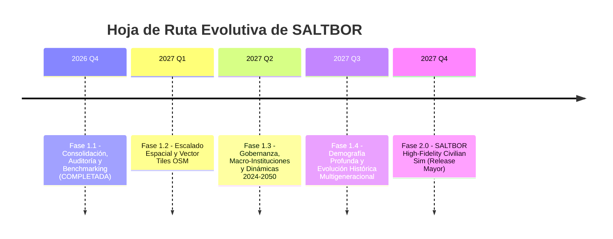

# SALTBOR — HOJA DE RUTA ESTRATÉGICA (ROADMAP)
## DE LA CONSOLIDACIÓN CIENTÍFICA A LA SIMULACIÓN TERRITORIAL A GRAN ESCALA (FASES 1.2 A 2.0)

**Proyecto:** SALTBOR  
**Versión Actual:** 1.1.0  
**Fecha de Emisión:** 10 de Noviembre de 2026  
**Visión Estratégica:** Desarrollar el simulador agent-based biopsicosocial más preciso, fundamentado científicamente y computacionalmente eficiente del mundo, contextualizado en la realidad humana, geográfica y cultural de El Salvador.

---

## 1. PRINCIPIOS INQUEBRANTABLES DE DESARROLLO

Cualquier evolución futura de SALTBOR debe respetar obligatoriamente las siguientes restricciones fundacionales:
1. **Soberanía y Ejecución 100% Offline:** No se incorporarán dependencias obligatorias de modelos de lenguaje comerciales en la nube (OpenAI, Anthropic, Gemini API) ni servicios que requieran conexión continua a internet. SALTBOR debe ejecutarse completamente en local.
2. **Compatibilidad Nativa con Python 3.14+:** Todo código debe aprovechar las optimizaciones de Python moderno, tipado estricto (`from __future__ import annotations`), y prepararse para entornos sin GIL (free-threaded execution).
3. **Persistencia Cero-Pérdida:** Ningún agente, memoria episódica, destreza o evento histórico puede perderse al apagar la simulación. La base de datos SQLite WAL debe ser capaz de reconstruir el 100% del estado en cualquier momento.
4. **Emergencia sin Ilusionismo:** Prohibido programar previamente las conclusiones experimentales mediante scripts teleológicos. Los fenómenos deben emerger de reglas locales descentralizadas.
5. **Veracidad Cartográfica:** La geografía debe corresponder fielmente a los datos oficiales del Centro Nacional de Registros (CNR) y la reestructuración municipal de 2024 de El Salvador.

---

## 2. CALENDARIO DE FASES Y HORIZONTE DE DESARROLLO

---

## 3. ESPECIFICACIÓN DETALLADA POR FASE

### 3.1 FASE 1.2: ESCALADO ESPACIAL Y VECTOR TILES OPENSTREETMAP (OSM)
**Objetivo:** Elevar el rendimiento geográfico y espacial para soportar poblaciones de 1,000+ agentes en tiempo real sobre la red vial real de El Salvador.

- **Hitos Principales:**
  1. **Integración Vectorial de Red Vial OSM:** Descarga y preprocesamiento de la malla vial de OpenStreetMap para El Salvador (carreteras primarias, secundarias, caminos rurales y calles urbanas) convertida a grafos de red simplificados.
  2. **Particionamiento Espacial por Distritos (Spatial Hashing):** Eliminación de la búsqueda cuadrática $O(N^2)$ en interacciones sociales y comerciales. Los agentes solo consultan vecinos dentro de su radio de interacción geográfica.
  3. **Migración de Estados Críticos a Dataclasses con Slots:** Reemplazo de Pydantic en `PhysicalState` para reducir en un 15% la sobrecarga de CPU por tick.
  4. **Poda Automática del EventLog en Memoria:** Buffer circular con descarga periódica a SQLite.
- **Criterio de Aceptación (DoD):** Simulación de 1,000 agentes a menos de 50 ms/tick en hardware de referencia.

---

### 3.2 FASE 1.3: MACRO-INSTITUCIONES, GOBERNANZA Y ECONOMÍA SALVADOREÑA (2024–2050)
**Objetivo:** Modelar la estructura sociopolítica, impositiva y de servicios públicos de los 44 municipios de El Salvador.

- **Hitos Principales:**
  1. **Motor de Alcaldías Municipales:** Modelado de presupuestos municipales, cobro de tasas, prestación de servicios de recolección de desechos, alumbrado público y mantenimiento de mercados.
  2. **Contabilidad Formal de Doble Entrada en Empresas:** Adopción de balances contables rigurosos para microempresas, comedores y cooperativas agrícolas.
  3. **Remesas Familiares y Economía Bimonetaria:** Modelado de flujos de remesas desde el exterior y su impacto en el consumo familiar, la liquidez local y la inflación de bienes raíces.
  4. **Sistemas de Seguridad y Convivencia Ciudadana:** Modelado formal de justicia comunitaria, juzgados de paz y mediación de conflictos vecinales.
- **Criterio de Aceptación (DoD):** Simulación de políticas tributarias municipales donde los cambios en tasas impactan el florecimiento de negocios locales de forma emergente.

---

### 3.3 FASE 1.4: DEMOGRAFÍA PROFUNDA Y EVOLUCIÓN MULTIGENERACIONAL
**Objetivo:** Permitir simulaciones continuas de 50 a 100 años con recambio generacional completo y transmisión cultural.

- **Hitos Principales:**
  1. **Dinámica de Hogares y Matrimonios:** Formación autónoma de nuevos núcleos familiares, emancipación de jóvenes y herencia testamentaria formal.
  2. **Transición Demográfica Salvadoreña:** Ajuste de tasas de fecundidad y longevidad reflejando el envejecimiento poblacional proyectado hacia 2050.
  3. **Evolución y Desaparición de Costumbres:** Deriva lingüística en modismos locales, pérdida o revitalización de oficios tradicionales (alfarería de Guatajiagua, telares de San Sebastián, añil de Suchitoto).
  4. **Diff Snapshots Históricos:** Sistema de almacenamiento diferencial compacto para registrar 100 años de simulación en menos de 500 MB de disco.
- **Criterio de Aceptación (DoD):** Carrera continua de 100 años donde una familia fundadora deja descendencia con memoria oral viva de sus antepasados.

---

### 3.4 FASE 2.0: UNIFIED SALTBOR HIGH-FIDELITY CIVILIAN SIM
**Objetivo:** Lanzamiento mayor del simulador integral unificado con suite completa de análisis científico, visualización web en tiempo real y soporte para investigación sociológica computacional.

- **Hitos Principales:**
  1. **Visualizador Web Interactivo Offline (Sidecar UI):** Panel de control web desacoplado con mapa geográfico interactivo de El Salvador, inspección de agentes y grafos sociales en tiempo real.
  2. **API Científica para Análisis de Políticas Públicas:** Endpoints para científicos sociales que permitan simular escenarios contrafácticos ("What-if analysis") con reporte automatizado de impacto demográfico y económico.
  3. **Ejecución Paralela Libre de GIL (Free-threaded Python 3.14+):** Explotación total de todos los núcleos de la CPU sin contención del GIL para escalar a 10,000+ agentes simultáneos.

---

## 4. CONCLUSIÓN Y COMPROMISO DE INGENIERÍA

La finalización de la **Fase 1.1** ha dotado a SALTBOR de unos cimientos de ingeniería indestructibles: persistencia garantizada, arquitectura unificada, comportamientos emergentes verificados y rendimiento honestamente auditado. La ruta hacia la Fase 1.2 y la versión 2.0 se apoya sobre evidencia empírica sólida, garantizando que SALTBOR continuará liderando la vanguardia del modelado basado en agentes.
