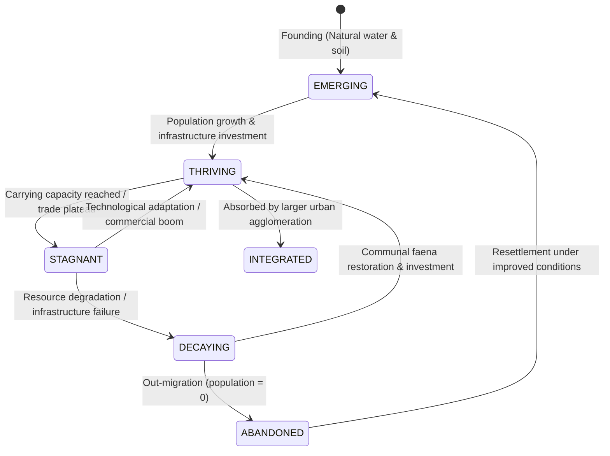

# SETTLEMENT EVOLUTION MODEL (PHASE 1.11)
## Territorial Dynamics, Salvadoran Topography, Infrastructure Lifecycle, and Land-Use Evolution

**System**: SALTBOR Synthetic-Human Society Simulation Platform  
**Subsystem**: Settlement and Territorial Evolution (`saltbor.civilization.settlement`)  
**Language / Environment**: Python 3.12–3.14 (Validated on Python 3.14.5, Windows 11)  
**Status**: ACTIVE PRODUCTION SPECIFICATION  

---

### 1. Executive Summary

In SALTBOR Phase 1.11, settlements are dynamic social-ecological spatial units anchored to real Salvadoran geography. Rather than treating communities as static containers for agents, the `SettlementEvolutionEngine` models how territorial settlements emerge, grow, specialize, stagnate, decay, fragment, integrate, or become permanently abandoned.

Settlement dynamics are strictly emergent: communities do not expand or appear to satisfy arbitrary demographic targets. Instead, settlement formation, migration attraction, and abandonment emerge from local resource availability (water tables, soil fertility), commercial market access, transport topography, and infrastructure integrity.

---

### 2. Settlement Typology and Lifecycle States

#### 2.1 Settlement Types

The settlement typology reflects the physical and legal territorial structures of El Salvador:

```python
class SettlementType(str, Enum):
    CASERIO = "caserio"                    # Dispersed rural hamlet (< 50 inhabitants)
    CANTON = "canton"                      # Rural administrative unit (50 - 250 inhabitants)
    COMUNIDAD_RURAL = "comunidad_rural"    # Cohesive agrarian community with ADESCO
    BARRIO = "barrio"                      # Traditional urban/peri-urban neighborhood
    COLONIA = "colonia"                    # Formal planned residential settlement
    CENTRO_URBANO = "centro_urbano"        # Municipal commercial core (> 250 inhabitants)
    CIUDAD = "ciudad"                      # Major urban agglomeration (> 1000 inhabitants)
```

#### 2.2 Settlement Lifecycle Transitions



```python
class SettlementStatus(str, Enum):
    EMERGING = "emerging"       # Newly founded, low infrastructure, high vulnerability
    THRIVING = "thriving"       # Positive demographic growth, solvent economy, maintained assets
    STAGNANT = "stagnant"       # Zero demographic growth, stable resource utilization
    DECAYING = "decaying"       # Depletion of water/soil, failing infrastructure, out-migration
    ABANDONED = "abandoned"     # Population = 0, structures decaying, zero active economic activity
    INTEGRATED = "integrated"   # Functionally merged into an adjacent expanding urban center
```

---

### 3. Real Salvadoran Geographic Anchors

The settlement engine preserves complete architectural continuity with SALTBOR's geospatial GIS foundation (`saltbor/datasets/gis/` and `saltbor/world/geographic/`):
- **14 Departments**: Ahuachapán, Santa Ana, Sonsonate, Chalatenango, La Libertad, San Salvador, Cuscatlán, La Paz, Cabañas, San Vicente, Usulután, San Miguel, Morazán, and La Unión.
- **44 Municipalities**: Conforming to the 2024 Salvadoran territorial restructuring.
- **262 Historic Districts**: Anchored with authentic centroid coordinates (WGS-84 latitudes $[13.15, 14.45]^\circ\text{N}$, longitudes $[-90.15, -87.68]^\circ\text{W}$).
- **Elevation and Road Topography**: Integrates OpenStreetMap road networks, bridges, and slope energy penalties.

When synthetic settlements emerge during long-running simulation horizons, they are clearly classified:
- `is_real_geographic_anchor = True`: Pre-existing historical municipal or district anchors.
- `is_real_geographic_anchor = False`: Emergent hamlets, colonias, or caseríos founded endogenously by migrating or overcrowded populations.

---

### 4. Infrastructure Asset Lifecycle and Maintenance Economics

Infrastructure assets directly condition human health, economic productivity, and transportation feasibility.

```python
class InfrastructureType(str, Enum):
    ROAD = "road"                              # Transport connectivity; reduces travel friction
    BRIDGE = "bridge"                          # Critical bottleneck over river networks (Lempa, etc.)
    MARKET = "market"                          # Commercial space; amplifies exchange velocity
    SCHOOL = "school"                          # Knowledge transmission and literacy
    HEALTH_CLINIC = "health_clinic"            # Reduces Makeham mortality rate
    WATER_SYSTEM = "water_system"              # Potable water pipes; preserves health and carrying capacity
    ELECTRIC_GRID = "electric_grid"            # Powers artisanal and manufacturing production
    COMMUNITY_HOUSE = "community_house"        # ADESCO assembly venue; boosts social cohesion
    IRRIGATION_NETWORK = "irrigation_network"  # Agricultural yield multiplier
```

#### 4.1 Asset Integrity Decay and Maintenance

Every infrastructure asset degrades annually as a function of usage pressure and environmental weathering:

$$\Delta \text{Condition} = -\left( \delta_{\text{base}} + \frac{N_{\text{pop}}}{C_{\text{capacity}}} \cdot \delta_{\text{wear}} \right) \cdot \Delta t$$

Maintenance is funded endogenously through settlement tax allocations or ADESCO communal dues:

$$\text{Restoration} = \min\left(0.25, \frac{\text{Funds Allocated}}{\text{Annual Maintenance Cost}} \cdot 0.15\right)$$

If an asset's condition level drops below $0.25$, its operational failure risk escalates:

$$P(\text{Failure}) = \max\left(0.0, (0.35 - \text{Condition}) \times 1.8\right)$$

Operational failure causes immediate local disruptions (e.g., road failure increases travel friction, water system failure triggers diarrheal epidemics and spikes child mortality).

---

### 5. Land-Use Transformation Dynamics

Settlements dynamically partition their territorial surface across six land-use classifications:
1. `RESIDENTIAL`: Living quarters and domestic gardens.
2. `COMMERCIAL`: Tiendas, pulperías, comedores, and market stalls.
3. `AGRICULTURAL`: Milpa, frijolares, and horticultural parcels.
4. `FOREST_CONSERVATION`: Protected slopes, riparian buffers, and communal woodlots.
5. `INFRASTRUCTURE`: Roadways, water tanks, clinics, and schools.
6. `FALLOW_DEGRADED`: Over-extracted or eroded soils undergoing secondary succession.

Land use shifts endogenously: as population concentrates, agricultural perimeter parcels are rezoned into residential and commercial plots, shifting regional food production to peri-urban and rural hinterlands.
