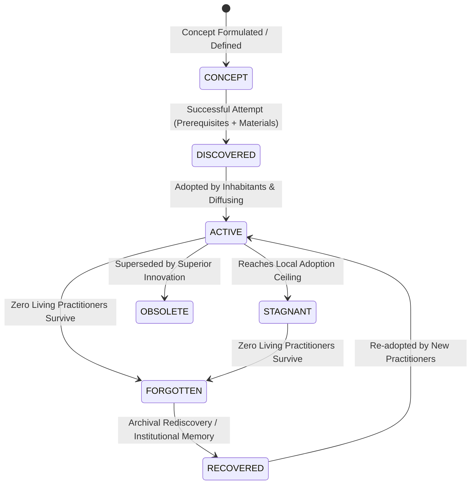

# TECHNOLOGICAL EVOLUTION MODEL (PHASE 1.11)
## Innovation Lifecycles, Knowledge Domains, Diffusion Networks, Obsolescence, and Generational Knowledge Loss

**System**: SALTBOR Synthetic-Human Society Simulation Platform  
**Subsystem**: Technological and Knowledge Evolution (`saltbor.civilization.technology`)  
**Language / Environment**: Python 3.12–3.14 (Validated on Python 3.14.5, Windows 11)  
**Status**: ACTIVE PRODUCTION SPECIFICATION  

---

### 1. Executive Summary

The Technology Evolution Engine [technology.py](file:///c:/GIT%20HUB/sv%20people/saltbor/civilization/technology.py) models the discovery, dissemination, practical failure, obsolescence, loss, and recovery of technological and organizational knowledge across generations.

In SALTBOR, technology is **not a linear tech tree where unlocks are guaranteed forever**. Technologies represent practical repertoires of action embedded in human brains, physical tools, and community practices. If all human practitioners of a technique perish or cease practicing it, that technology transitions into `FORGOTTEN` status and its productivity benefits are lost until institutional memory or archaeological rediscovery recovers it.

---

### 2. Knowledge Domains and Innovation Typology

Knowledge is organized across six pragmatic domains:

```python
class KnowledgeDomain(str, Enum):
    AGRICULTURAL = "agricultural"      # Drip irrigation, organic compost (bocashi), crop rotation
    PRACTICAL = "practical"            # Grain storage in metal silos, food curing, adobe brick stabilization
    MEDICAL = "medical"                # Solar water disinfection (SODIS), medicinal plants, rehydration salts
    ORGANIZATIONAL = "organizational"  # ADESCO governance, cooperative credit (cuchubal), communal faenas
    ENGINEERING = "engineering"        # Gravity aqueducts, footbridges, rainwater harvesting cisterns
    CIVIC = "civic"                    # Deliberative assembly quorums, participatory budgeting, conflict mediation
```

---

### 3. Innovation Lifecycle States



```python
class InnovationStatus(str, Enum):
    CONCEPT = "concept"          # Theoretical possibility; prerequisites unfulfilled
    DISCOVERED = "discovered"    # Discovered by an innovator; known to 1-2 individuals
    ACTIVE = "active"            # Widely practiced and diffusing across settlements
    STAGNANT = "stagnant"        # No new adopters joining; practiced by fixed cohort
    OBSOLETE = "obsolete"        # Replaced by a more productive or efficient alternative
    FORGOTTEN = "forgotten"      # Extinct from living practice; zero surviving practitioners
    RECOVERED = "recovered"      # Restored from institutional archives or historical lore
```

---

### 4. Discovery Mechanics and Physical Pre-Requisites

An individual attempts a technological discovery when confronted with local bottlenecks (e.g., low agricultural yields or potable water shortages). Discovery requires:
1. **Prerequisite Technologies**: Prior knowledge nodes must already be known within the settlement.
2. **Material Availability**: Local environmental access to physical components (e.g., `residuos_organicos`, `tuberia_bambu`, `chapa_galvanizada`).
3. **Cognitive Ingenuity**: Individual problem-solving and epistemic reasoning scores.

When discovered:
- The technique is added to the innovator's known repertoires.
- A historical discovery event is logged in the `HistoricalMemoryEngine`.
- The innovator begins diffusing the technique to family members and apprentices.

---

### 5. Diffusion Channels and Adoption Dynamics

Diffusion proceeds through three distinct empirical channels:

#### 5.1 Intergenerational Family Mentorship
Parents transmit practical skills to children during adolescence. Transmission fidelity averages $88\%$, with minor drift in execution.

#### 5.2 Horizontal Peer Imitation
Neighbors observe successful enterprises employing an innovation. Adoption probability scales with observed productivity bonuses:

$$P(\text{Adopt}) = \min\left(0.40, \beta \cdot \text{ProductivityBonus} \cdot \frac{N_{\text{practitioners}}}{N_{\text{settlement}}}\right)$$

#### 5.3 Inter-Settlement Migration
When a skilled practitioner migrates from an urban center to a rural caserío, they introduce the innovation to the destination settlement's knowledge repertoire.

---

### 6. Failure History and Operational Risks

Innovations are not magical infallible enhancements; they carry operational failure risks:
- Artisanal bamboo pipes may crack or leak.
- Experimental compost heaps may fail if carbon-nitrogen ratios are imbalanced.
- Unmaintained metal silos may develop condensation, spoiling stored grain.

The engine logs failure incidents (`failure_history`). If an innovation fails repeatedly, its perceived utility drops and practitioners may abandon it in favor of traditional methods.

---

### 7. Technological Forgetting and Archival Recovery

#### 7.1 Forgetting Mechanics
At each annual demographic step, the engine audits all active innovations:
```python
if len(living_practitioners) == 0:
    tech.status = InnovationStatus.FORGOTTEN
    settlement.known_technologies.remove(tech.tech_id)
```
When a technology is forgotten, its productivity bonuses ($+15\%$ to $+25\%$) immediately evaporate from local agricultural or commercial yields.

#### 7.2 Archival Recovery
If the settlement maintains an institutional archive (e.g., written ADESCO records, municipal documents, or oral elder folklore), the technology may be re-discovered through research:
```python
recovered = tech_engine.recover_forgotten_knowledge(tech_id, settlement_id)
# Transitions status from FORGOTTEN to RECOVERED and re-enrolls new apprentices
```
This bidirectional dynamics of technological progress and regression demonstrates that civilizations can experience periods of dark ages and knowledge loss when demographic catastrophes sever the continuity of skilled human cohorts.
