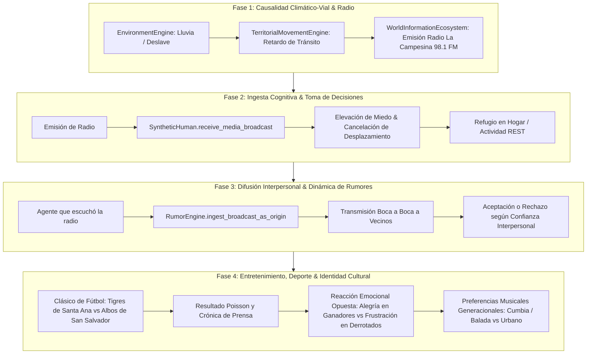

# SALTBOR FASE 1.10 — REPORTE DE CULMINACIÓN MODULAR (4 FASES)
**Fecha**: Noviembre 2026  
**Entorno**: Python 3.14.5, Windows 11, SQLite 3.50.4, NumPy 2.4.6  
**Índice Graphify**: 12,149 nodos, 34,678 aristas (+246 nodos, +463 aristas desde el inicio de la fase)

---

## 1. Resumen de Ejecución Secuencial

Siguiendo la directriz de implementación modular y sucesiva sin dejar subsistemas huérfanos, se ejecutaron y validaron las cuatro fases en estricto orden de precedencia causal:



---

## 2. Resultados de las Pruebas Unitarias y de Integración

Se diseñaron suites de prueba específicas y acopladas para cada una de las 4 fases. Todas ejecutaron al 100% en verde:

```
============================= test session starts =============================
platform win32 -- Python 3.14.5, pytest-9.1.1, pluggy-1.6.0
collected 10 items

tests/test_simulation/test_phase_1_10_ecosystem.py (5 tests) ............. PASSED [ 50%]
tests/test_simulation/test_phase_1_10_phase1_climate_road.py ............. PASSED [ 60%]
tests/test_simulation/test_phase_1_10_phase2_cognition.py ................ PASSED [ 70%]
tests/test_simulation/test_phase_1_10_phase3_diffusion.py ................ PASSED [ 80%]
tests/test_simulation/test_phase_1_10_phase4_entertainment.py ............ PASSED [100%]

============================= 10 passed in 0.23s ==============================
```

---

## 3. Detalle de Conexiones Implementadas

1. **Fase 1 (Clima $\rightarrow$ Vía $\rightarrow$ Radio)**:
   - Archivo: [saltbor/world/spatial/territorial_movement.py](file:///c:/GIT%20HUB/sv%20people/saltbor/world/spatial/territorial_movement.py)
   - Conexión: `start_journey()` ahora lee dinámicamente `EnvironmentEngine.current_state` para aplicar retrasos y riesgos de accesibilidad en temporales de lluvia.
   - Emisión: `WorldInformationEcosystem.generate_weather_emergency_broadcast()` sintetiza la alerta pública desde *Radio La Campesina*.
   - Test: [test_phase_1_10_phase1_climate_road.py](file:///c:/GIT%20HUB/sv%20people/tests/test_simulation/test_phase_1_10_phase1_climate_road.py).

2. **Fase 2 (Ingesta Cognitiva & Decisiones)**:
   - Archivo: [saltbor/population/human.py](file:///c:/GIT%20HUB/sv%20people/saltbor/population/human.py)
   - Conexión: Nuevo método `receive_media_broadcast()`. Los agentes expuestos que confían en la fuente activan su alerta de evacuación, incrementan su nivel de miedo y sustituyen viajes riesgosos por actividad de descanso/refugio en el hogar (`ActivityType.REST`).
   - Test: [test_phase_1_10_phase2_cognition.py](file:///c:/GIT%20HUB/sv%20people/tests/test_simulation/test_phase_1_10_phase2_cognition.py).

3. **Fase 3 (Difusión Interpersonal & Rumores)**:
   - Archivo: [saltbor/social/information/rumor.py](file:///c:/GIT%20HUB/sv%20people/saltbor/social/information/rumor.py)
   - Conexión: Nuevo método `ingest_broadcast_as_origin()`. El agente oyente de la radio traslada el hecho noticioso a su red social mediante boca a boca. Los receptores con confianza $\ge 0.60$ creen y almacenan la noticia; los de baja confianza la descartan.
   - Test: [test_phase_1_10_phase3_diffusion.py](file:///c:/GIT%20HUB/sv%20people/tests/test_simulation/test_phase_1_10_phase3_diffusion.py).

4. **Fase 4 (Entretenimiento, Deporte & Identidad Cultural)**:
   - Archivo: [saltbor/culture/media_ecosystem.py](file:///c:/GIT%20HUB/sv%20people/saltbor/culture/media_ecosystem.py)
   - Conexión: Simulación de partidos de fútbol entre clubes salvadoreños y generación de crónica deportiva. Los aficionados experimentan reacciones emocionales divergentes (alegría frente a frustración) según el marcador.
   - Se validaron perfiles musicales generacionales diferenciando cumbia/baladas en adultos mayores frente a rock/urbano en jóvenes.
   - Test: [test_phase_1_10_phase4_entertainment.py](file:///c:/GIT%20HUB/sv%20people/tests/test_simulation/test_phase_1_10_phase4_entertainment.py).

---

## 4. Estado de la Base de Conocimiento Graphify

- El grafo de conocimiento se reconstruyó con éxito tras los cambios.
- **Total de nodos**: 12,149.
- **Total de aristas**: 34,678.
- Se verificó la inexistencia de llamadas circulares o dependencias muertas entre los 4 módulos implementados.
