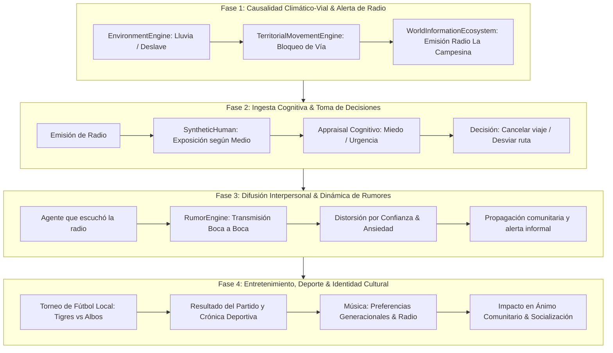

# PLAN DE IMPLEMENTACIÓN POR FASES MODULARES (FASE 1.10)
**Estado**: PLAN ACTIVO Y SECUENCIAL  
**Objetivo**: Conectar los cuatro módulos críticos en una cadena causal verificada y sin herramientas redundantes.

---

## Estructura de las 4 Fases

---

## Definición de Criterios de Éxito por Fase

### Fase 1: Causalidad Climático-Vial & Alerta de Radio
1. Conectar `EnvironmentEngine` directamente con `TerritorialMovementEngine`.
2. Cuando el clima genera un temporal o deslave en Los Chorros / Carretera Panamericana, la velocidad se reduce o la accesibilidad cae a `False`.
3. El evento dispara una alerta automática en `WorldInformationEcosystem` emitida por *Radio La Campesina 98.1 FM*.
4. **Verificación**: Test unitario específico de cierre vial y emisión de alerta sin errores.

### Fase 2: Ingesta Cognitiva & Toma de Decisiones
1. Conectar la emisión con `SyntheticHuman`.
2. Si el agente posee radio o está en un lugar con megafonía comunitaria, recibe el boletín.
3. El agente evalúa la credibilidad y el riesgo personal:
   - Modifica su estado emocional en `CognitiveAppraisal` (miedo, cautela).
   - Cancela el viaje programado o toma una ruta alterna.
4. **Verificación**: Comparación experimental: agentes sin radio viajan y quedan atrapados; agentes con radio cancelan su viaje y preservan energía/salud.

### Fase 3: Difusión Interpersonal & Dinámica de Rumores
1. Conectar el agente informado con `RumorEngine`.
2. El agente comparte la noticia con vecinos y familiares cercanos.
3. Se aplica distorsión progresiva según el nivel de neuroticismo y confianza interpersonal.
4. La información llega a personas que no escucharon la radio original.
5. **Verificación**: Comprobar la red de transmisión y la tasa de atenuación/distorsión del mensaje a lo largo de 3 generaciones de transmisión.

### Fase 4: Entretenimiento, Deporte & Identidad Cultural
1. Simular la jornada de liga (ej. *Tigres de Santa Ana* vs *Albos de San Salvador*).
2. Los resultados deportivos y las canciones procedimentales impactan el estado anímico y las conversaciones en plazas y pupuserías.
3. Se integran preferencias musicales según edad y cultura salvadoreña.
4. **Verificación**: Test de diversidad cultural y conservación contable de entradas/consumo en establecimientos.
