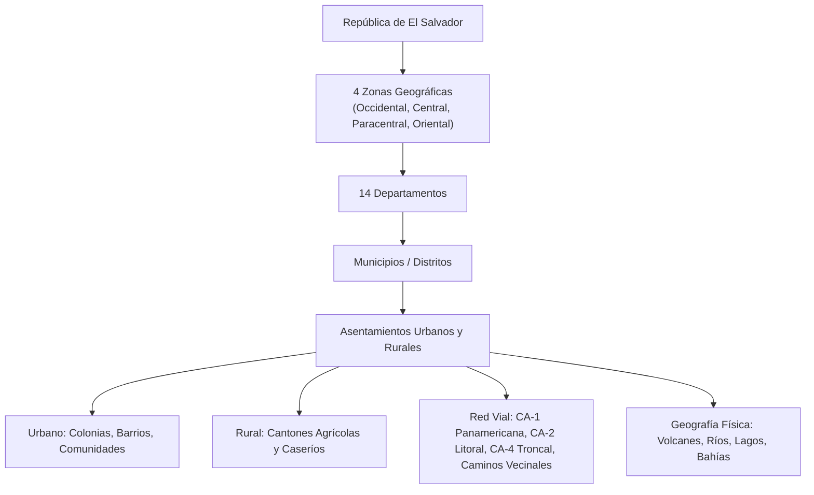
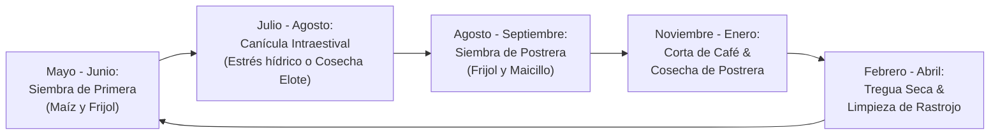

# Saltbor — Section 19: Salvadoran Environment & Cultural Context Engine

## 1. Executive Summary

Section 19 establishes a comprehensive, deeply grounded **Salvadoran environmental, geographical, cultural, historical, linguistic, economic, and social context system**. Saltbor does not treat El Salvador as a superficial visual skin or decorative backdrop; rather, the authentic Salvadoran reality directly influences the **behavior, decision-making, cognitive knowledge, opportunities, interpersonal relationships, economic livelihoods, and life trajectories** of synthetic individuals.

### Core Architectural Principles
- **Functional Grounding**: The Salvadoran environment is an active, causal component of Saltbor's world simulation, knowledge graph, economic ledgers, episodic memory, social communication, and cognitive brain architecture.
- **Strict Separation of Verified Geography**: Real-world geographical entities (14 departments, verified municipalities, cantones, caseríos, volcanoes, rivers, and national highways) are strictly distinguished from simulation-specific experimental testbeds.
- **Causal Climate Dynamics**: Weather and seasonality (Época Seca / Verano, Época Lluviosa / Invierno, Canícula intraestival, Temporales tropicales) exert causal, non-arbitrary constraints on agriculture (maize, beans, coffee), artisanal fishing, road transit, and domestic water availability.
- **Authentic Microeconomics**: Models the genuine economic reality of El Salvador: informal street vending, corner grocery stores (*pulperías*), the community credit notebook (*el fiado*), daily subsistence cash constraints (*el diario*), and international family remittances (*remesas*).
- **Linguistic and Pragmatic Nuance**: Natural Salvadoran Spanish incorporating the authentic *voseo* paradigm, respectful *ustedeo* towards elders and institutions, sociolinguistic registers, and genuine regional vocabulary without caricature or stereotypes.
- **Heterogeneous Cultural Adoption**: Avoids treating all Salvadoran individuals as culturally identical; participation in patron saint festivities, craft knowledge, and folklore varies realistically across age cohorts, rural/urban settings, and individual personality traits.
- **100% Offline & Pure Python**: Operates entirely within Python 3.14 without cloud services, remote APIs, or heavy external binary dependencies.

---

## 2. Geographic and Territorial System

El Salvador's territorial hierarchy is represented from macro-regional zones down to rural caseríos:



### 2.1 The 14 Departments & Regional Zones
- **Zona Occidental**: Ahuachapán (AH), Santa Ana (SA), Sonsonate (SO).
- **Zona Central**: La Libertad (LL), Chalatenango (CH), Cuscatlán (CU), San Salvador (SS).
- **Zona Paracentral**: La Paz (LP), Cabañas (CA), San Vicente (SV).
- **Zona Oriental**: Usulután (US), San Miguel (SM), Morazán (MO), La Unión (LU).

### 2.2 Physical Landscape Features
- **Major Volcanoes**: Ilamatepec / Santa Ana (2,381m, highest crater), Izalco ("Faro del Pacífico"), Quezaltepec / San Salvador (1,893m, Boquerón), Chinchontepec / San Vicente (2,182m), Chaparrastique / San Miguel (2,130m, frequent ash emissions), Conchagua (1,225m, overlooking Gulf of Fonseca).
- **Hydrographic Spine**: Río Lempa (422 km, draining >50% of the country, powering Cerrón Grande, 5 de Noviembre, 15 de Septiembre, and Chaparral hydroelectric dams), Río Grande de San Miguel, Río Paz, Río Goascorán, Río Jiboa, Río Torola.
- **Lakes & Basins**: Lago de Coatepeque (volcanic caldera), Lago de Ilopango (site of the cataclysmic Tierra Blanca Joven eruption ~535 AD), Embalse Cerrón Grande, Laguna de Olomega, Laguna de Alegría.
- **Coastal Estuaries**: Bahía de Jiquilisco (Ramsar mangrove wetland, sea turtle nesting, shrimp aquaculture), Estero de Jaltepeque, Golfo de Fonseca.

### 2.3 Road Infrastructure & Seasonal Transit Friction
The road network models real friction:
- **Paved Highways** (`CA-1`, `CA-2`, `CA-4`): Baseline speed $45\,\text{km/h}$, high passability year-round ($<15\%$ rain penalty).
- **Secondary Asphalt**: Baseline speed $35\,\text{km/h}$.
- **Cobblestone** (*empedrado*): Baseline speed $20\,\text{km/h}$.
- **Unpaved Rural Dirt Roads** (*caminos vecinales*): Baseline speed $12\,\text{km/h}$ in dry season, dropping by $60\%$ to $4.8\,\text{km/h}$ in rainy season due to mud, ruts, and standing water. On steep volcanic or mountain slopes, temporales can trigger landslides (*derrumbes*) that sever cantonal vehicular access completely.

---

## 3. Environmental and Climate Simulation

The climate engine simulates the authentic tropical meteorological cycle of El Salvador:

### 3.1 Seasonal Cycle
- **Época Seca / Verano (November – April)**: Warm temperatures, high evapotranspiración, dry dusty roads (*polvaredas*), trade winds (*vientos de octubre/noviembre*), low relative humidity ($50\% - 55\%$), and minimal precipitation ($0.0\,\text{mm/day}$).
- **Época Lluviosa / Invierno (May – October)**: Frequent convective afternoon and evening downpours (*chaparrones vespertinos*), high humidity ($75\% - 92\%$), soil moisture replenishment ($0.65 - 0.95$).
- **Canícula Intraestival (July – August)**: A critical dry interval of 1 to 3 weeks where rainfall stops or drops sharply in the middle of the rainy season, directly threatening the flowering stage of the *siembra de primera* of maize.

### 3.2 Extreme Meteorological Shocks
- **Temporales Tropicales**: Low-pressure systems or tropical waves producing $3 - 6$ consecutive days of continuous rainfall ($>85\,\text{mm/day}$), saturating volcanic slopes, causing river overflow in the *Bajo Lempa* and *Río Grande de San Miguel*, and triggering debris flows on highways (e.g. *Los Chorros*).
- **Sequías Meteorológicas**: Extended El Niño (ENSO) droughts causing crop withering, well depletion, and drinking water shortages in rural communities.

### 3.3 Agricultural Calendar & Causal Crop Feedback



- **Maize Causal Response**: Vulnerable to canícula moisture stress during tasseling/silking (yield drops by $45\%$ to $0.55\times$ if soil moisture $<0.40$); lodging from high winds during temporales.
- **Bean Causal Response**: Highly sensitive to excessive moisture (yield drops to $0.40\times$ during temporales due to fungal anthracnose and pod rot).
- **Coffee Causal Response**: Corta season requires dry weather for picking and sun-drying beans on patios; unseasonal rain causes ripe cherries to drop and ferment on the ground.

---

## 4. Salvadoran Cultural Knowledge, Foodways & Celebrations

### 4.1 Traditional Foodways & Pupusería Microenterprises
- **Pupusas**:
  - Dough types: Traditional *masa de maíz* vs. *masa de arroz* (pioneered in Olocuilta, La Paz).
  - Fillings: Revueltas (chicharrón, frijoles refritos, quesillo salvadoreño), queso con loroco, frijol con queso, ayote.
  - Accompaniments: *Curtido* fermented in pineapple/apple vinegar with oregano, and cooked natural tomato sauce.
  - Unit Economics: Direct cost $\sim \$0.38$ per pupusa; retail price $\$0.85 - \$1.00$; operating margin $\sim 55\%$. A pupusería selling 150 pupusas daily generates $\sim \$70.50$ in daily net profit, supporting the owner and family helpers.
- **Tamales & Atoles**:
  - *Tamal de gallina india*: Wrapped in plantain leaves with recaudo, potato, chickpea, and olive.
  - *Tamal pisque*: Made with corn dough nixtamalized with wood ash or lime, stuffed with refried beans.
  - *Atol de elote*: Fresh sweet tender corn with milk and cinnamon.
  - *Atol shuco*: Fermented black/purple corn served in traditional *guacales de morro*, topped with toasted squash seed powder (*alhuashte*), whole *frijoles monos*, and hot pepper.
- **Antojitos**: Yuca frita/sancochada with chicharrón or crispy dried fish (*pescaditas*), plantain empanadas, artisanal *quesadilla salvadoreña* baked with *queso duro blando* and fresh curd.

### 4.2 Traditional Handicrafts
- **Cerámica Negra de Guatajiagua (Morazán)**: Ancestral Lenca pottery burnished with river stones and dyed black using a hot natural extract of *jiote* seeds.
- **Alfarería y Miniaturas de Ilobasco (Cabañas)**: Miniature surprise clay figures modeled inside walnut shells or fruits.
- **Telares de Pedal de San Sebastián (San Vicente)**: Handwoven cotton textiles, colorful hammocks, and bedspreads.
- **Madera Pintada de La Palma (Chalatenango)**: Naïf folk art on pine wood and copinol seeds pioneered by Fernando Llort.

### 4.3 Fiestas Patronales & Celebrations
- **Fiestas Agostinas (San Salvador, August 1–6)**: Dedicated to the *Divino Salvador del Mundo*; features the *Desfile del Correo*, *Desfile del Comercio*, and the solemn *Bajada* (Transfiguration). Generates a major annual sales surge for food vendors and sweet makers.
- **Carnaval de San Miguel (San Miguel, late November)**: Dedicated to the *Virgen de la Paz*; massive parade along Avenida Roosevelt attracting diaspora visitors and infusing millions in liquidity.
- **Día de la Cruz (May 3)**: Jiote wood cross decorated with paper chains and seasonal fruits (*mangos, coyoles, jocotes*), thanking the earth for the arrival of rains.
- **Semana Santa (Sonsonate & nationwide)**: Collective fabrication of colored salt and sawdust carpets (*alfombras*), solemn Santo Entierro processions, and consumption of dried fish cakes in soup.

---

## 5. Salvadoran Economic Reality & Livelihoods

### 5.1 Informal Commerce & 'El Fiado'
- **Purchases 'Del Diario'**: Low-income households purchase food in small fractional portions matching daily cash earnings: $\$0.25$ (*una cora*) of cheese, 2 eggs, 5 pieces of French bread, half-pound of beans.
- **The 'Cuaderno de Fiado' Ledger**: Corner stores (*tiendas de esquina*) extend informal unsecured micro-credit to trusted neighbors based on community reputation. Accounts track balances, credit limits ($\$15 - \$60$), and repayment on paydays/Saturdays. Timely repayment raises trust scores and credit limits; chronic defaults revoke credit privileges.

### 5.2 Family Remittances (*Remesas*)
Remittances represent $20\% - 25\%$ of El Salvador's GDP:
- Typical household monthly transfer: $\$200 - \$350\,\text{USD}$ from relatives abroad (*hijos, hermanos en EE.UU.*).
- Standard allocation model:
  - **$45\%$ Food & Subsistence**: Secures nutrition and shields household against food price spikes.
  - **$25\%$ Housing Construction**: Gradually replaces adobe, wood planks, and rusting sheet metal with reinforced concrete blocks and durable roofs.
  - **$15\%$ Education**: Books, uniforms, and school supplies for children.
  - **$10\%$ Healthcare & Medicines**: Chronic care for elderly grandparents.
  - **$5\%$ Savings**: Emergency reserves.
- Emergency transfers: In times of illness or storm damage, diaspora relatives send $+35\%$ extra relief funds.

### 5.3 Rural & Coastal Livelihoods
- **Campesino Milperos**: Cultivate $1 - 2$ manzanas of maize and beans (often rented for $\sim \$120/\text{year}$). Reserve $12 - 15$ quintales for domestic consumption; sell surplus at $\sim \$22/\text{quintal}$.
- **Cortadores de Café**: Seasonal pickers in shade fincas paid $\$2.50 - \$3.00$ per *canasto* (harvesting $4 - 6$ canastos daily during peak harvest).
- **Pescadores Artesanales**: Coastal boatmen operating outboard fiberglass *lanchas* and gillnets (*trasmallos*), earning $\$25 - \$45$ on calm days but grounded when northern winds or temporales cause rough seas (*mar picado*).

---

## 6. Language & Communication (Salvadoran Spanish)

### 6.1 Pronominal Paradigm: Authentic Voseo vs. Ustedeo
- **Voseo** (*vos*): Used universally among family, peers, and friends:
  - Conjugation: *vos tenés*, *vos podés*, *vos sabés*, *mirá vos*, *vení acá*, *hacéme el favor*.
- **Ustedeo** (*usted*): Compulsory for showing respect to elders, authority figures, municipal officials, church leaders, and unfamiliar customers:
  - Usage: *"Buenas tardes tenga usted, don Manuel"*, *"Pase adelante, usted me dice en qué le puedo servir"*.
- **Tuteo**: Rare or restricted to specific media contexts.

### 6.2 Sociolinguistic Registers
1. **Collegiate Informal**: Authentic street caliche (*chero, cipote, bicho, pisto, volado, chivo, cachada, chambre*).
2. **Respectful Elder**: Formal ustedeo, reverence formulas (*"Dios primero", "buenas nos dé Dios"*), inquiring about family health.
3. **Rural Campesino**: Agricultural measurement units (*manzanas, tareas, arrobas, canastos*), piety markers (*"por la misericordia del Creador"*), solidarity calls (*"faena comunal"*).
4. **Formal Institutional**: Municipal, legal, and formal commerce settings.

---

## 7. Historical and Social Memory

Historical memory is bounded by age cohort, rural/urban setting, and familial transmission:
- **1932 Uprising & Repression**: Strong oral awareness among rural elders in Sonsonate/Ahuachapán; associated with the decline of traditional Náhuat dress and language.
- **Agrarian Reform (1980)**: Interventions that created peasant agricultural cooperatives.
- **Armed Conflict (1980–1992) & Peace Accords (1992)**: Direct lived experience for older generations; remembrance of displacement, repopulation, and peace consolidation.
- **Dolarización (2001)**: Adoption of the US dollar at fixed $8.75$ colones rate; ubiquitous awareness across all age groups through daily usage of coins (*coras, cuatros, pesos*).
- **Mass Migration & Remittance Era**: Transnational family structures and diaspora ties.

---

## 8. Dynamic Local Communities & ADESCOs

- **ADESCOs (Asociaciones de Desarrollo Comunal)**:
  - Autonomous community boards with elected leadership (*Presidente, Secretario, Tesorero, Síndico, Vocales*).
  - **Faenas Comunales**: Volunteer collective labor mobilization to clear mudslides, dig drainage ditches, or build community water aqueducts.
- **Cuchubales / Tandas**:
  - Rotating savings and credit circles where members contribute a fixed sum weekly (e.g. $\$10$) and take turns receiving the lump-sum pot (e.g. $\$40 - \$100$), providing crucial liquidity without formal bank loans.

---

## 9. Empirical Validation: The 10 Salvadoran Experiments (EXP_SV_01 – EXP_SV_10)

All 10 experiments were executed via `SimulationLaboratory` and verified in `tests/test_experiments/test_salvadoran_experiments.py`:

| Experiment ID | Focus Area | Tested Conditions | Key Empirical Metric | Result | Verdict |
|:---|:---|:---|:---:|:---:|:---:|
| **EXP_SV_01** | Urban vs. Rural Differences | San Salvador vs. Cantón Tajcuicuitlapán | Service access: $0.92$ (urban) vs. $0.45$ (rural); Paved highway vs. dirt road | Confirmed | **PASS** |
| **EXP_SV_02** | Seasonal Climate & Agriculture | Normal rains vs. Canícula on maize; Temporal on beans | Maize yield drops to $0.55\times$; Bean yield drops to $0.40\times$ (fungal rot) | Confirmed | **PASS** |
| **EXP_SV_03** | Local Market & Informal Fiado | Daily cash purchases vs. $\$8.50$ credit in corner store | Purchase $\le \$3.00$; Credit approved; Repayment raises trust $>0.80$ | Confirmed | **PASS** |
| **EXP_SV_04** | Intergenerational Cultural Transmission | Grandmother to granddaughter pupusa recipe & lore | Granddaughter acquires $>0.60$ skill; Elder retains higher folklore score | Confirmed | **PASS** |
| **EXP_SV_05** | Language & Register Variation | Friends (voseo) vs. Elder greeting (reverential ustedeo) | Peer uses voseo (`True`); Elder uses ustedeo (`False`, register `respectful_elder`) | Confirmed | **PASS** |
| **EXP_SV_06** | Migration & Remittances | Monthly $\$250$ transfer; emergency crisis boost | $45\%$ to food, $25\%$ to housing (quality $>0.40$); Emergency sends $+35\%$ extra | Confirmed | **PASS** |
| **EXP_SV_07** | Patron Saint Festivities | Fiestas Agostinas community fundraising & vendors | Total turnover $>\$1,500\,\text{USD}$; Social cohesion index $>0.50$ | Confirmed | **PASS** |
| **EXP_SV_08** | Transportation Accessibility | Paved highway vs. Cantonal dirt road in rain | Dirt road speed drops by $60\%$; transit hours increase $1.25\text{h} \to 3.12\text{h}$ | Confirmed | **PASS** |
| **EXP_SV_09** | Community Cooperation (ADESCO) | Communal faena to clear landslide; Cuchubal turn | $24.0$ volunteer hours accumulated; Road reopened; Pot awarded $(\$40)$ | Confirmed | **PASS** |
| **EXP_SV_10** | Individual Multi-Environment Adaptation | Campesino (milpa), Fisherman (sea), Pupusera (urban) | Campesino buffers drought via subsistence; Fisherman grounded by storm; Pupusera nets $>\$50/\text{day}$ | Confirmed | **PASS** |

---

## 10. Automated Test Suite Status

The automated test suite now encompasses **195 tests** across all modules with a **100% pass rate** in **6.70 seconds**:

- **144 pre-existing tests** (Phase 0.1 through Phase 0.6) $\to$ **PASS**
- **15 Phase 0.7 reasoning experiments** (`EXP_07_A` through `EXP_07_O`) $\to$ **PASS**
- **14 Phase 0.7 cognitive unit tests** $\to$ **PASS**
- **1 Phase 0.7 performance benchmark test** ($20 - 1,000$ agents) $\to$ **PASS**
- **11 Section 19 Salvadoran context unit tests** $\to$ **PASS**
- **10 Section 19 Salvadoran validation experiments** (`EXP_SV_01` through `EXP_SV_10`) $\to$ **PASS**

---

## 11. Instructions for Reproduction

```powershell
# 1. Run all 195 tests across the entire repository
.venv\Scripts\pytest -v

# 2. Run the 10 Salvadoran validation experiments (EXP_SV_01 through EXP_SV_10)
.venv\Scripts\pytest -v tests\test_experiments\test_salvadoran_experiments.py

# 3. Run the Salvadoran context engine unit test suite
.venv\Scripts\pytest -v tests\test_salvadoran\test_salvadoran_context.py

# 4. Run the Phase 0.7 reasoning and problem solving experiments
.venv\Scripts\pytest -v tests\test_experiments\test_phase07_experiments.py
```
